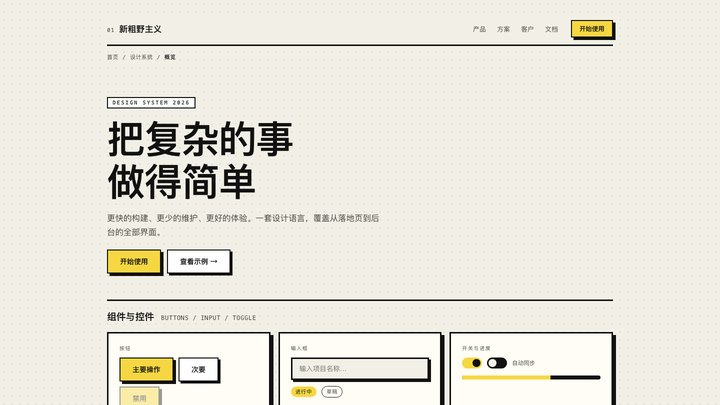
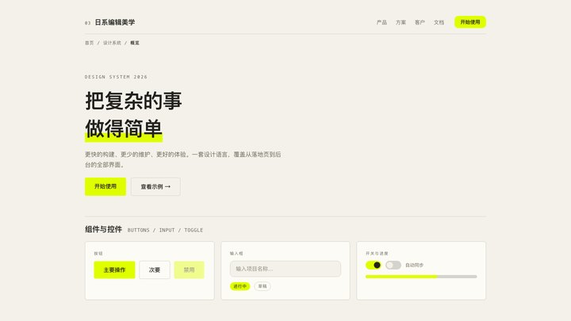
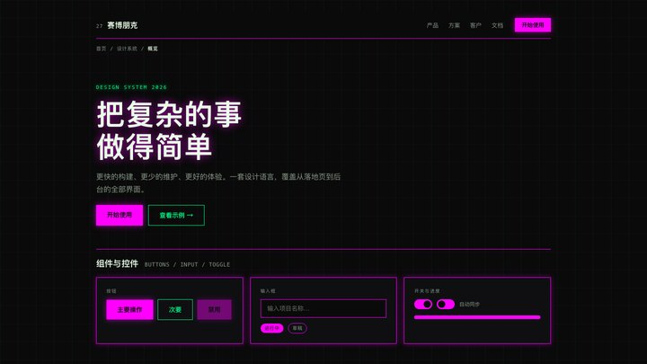
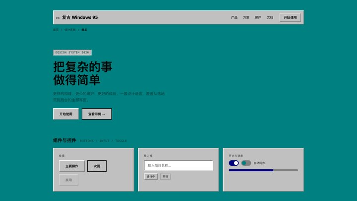
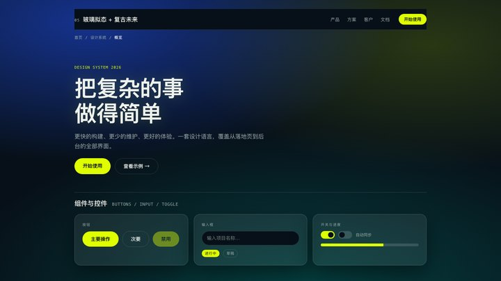
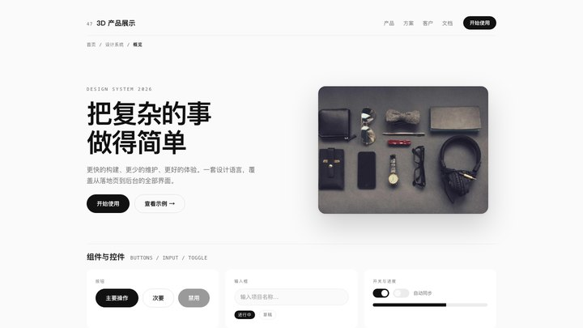

<div align="center">

# 前端设计风格大全 · Style Atlas

**按感觉挑一个，直接拿走。**

50 种前端设计风格：每张缩略图都是真实渲染的一屏，点进去就是完整页面（落地页 + 105 个组件），
下载一个 zip 就带走全部代码与规格。

[**🌐 在线预览**](https://1981yangcq.github.io/frontend-style-pack/) · [**🇨🇳 国内镜像**](https://sunsong.surge.sh) · [**⬇ 下载风格包**](https://github.com/1981yangcq/frontend-style-pack/releases/) · [**📖 怎么给 AI 用**](specs/README.md)

</div>

---

## 点图直达

> 点任意一张，直接进入该风格的完整页面（落地页 + 105 个组件）。

| | | |
|---|---|---|
| <a href="https://1981yangcq.github.io/frontend-style-pack/demos/01-neo-brutalism.html"></a><br><b>新粗野主义</b><br><sub>粗黑边框 + 硬投影</sub> | <a href="https://1981yangcq.github.io/frontend-style-pack/demos/03-japanese-editorial.html"></a><br><b>日系编辑美学</b><br><sub>暖纸底 + 荧光点睛</sub> | <a href="https://1981yangcq.github.io/frontend-style-pack/demos/27-cyberpunk.html"></a><br><b>赛博朋克</b><br><sub>霓虹 + 纯黑 + 故障感</sub> |
| <a href="https://1981yangcq.github.io/frontend-style-pack/demos/08-retro-win95.html"></a><br><b>复古 Windows 95</b><br><sub>3D 边框 + 像素画面</sub> | <a href="https://1981yangcq.github.io/frontend-style-pack/demos/05-glassmorphism-retro.html"></a><br><b>玻璃拟态 + 复古未来</b><br><sub>毛玻璃 + 扫描线</sub> | <a href="https://1981yangcq.github.io/frontend-style-pack/demos/47-3d-product.html"></a><br><b>3D 产品展示</b><br><sub>摄影棚级产品位</sub> |

---

## 这是什么

做前端最常见的时间浪费，不是写代码，是**决定长什么样**：翻 Dribbble、扒 Awwwards、拼组件库、对齐颜色……
这里把「风格」整包做好：一套配色、一套圆角阴影、一套组件，**挑中就能用**。

三种用法：

| 你是谁 | 怎么用 |
|---|---|
| **只想快速要个页面** | 在线预览挑一个 → 下载 zip → 解压双击 `demo.html` 看效果 |
| **想让 AI 帮你做** | 点「复制给 AI 的话」，粘给任意 AI，最后一行换成你的需求 |
| **要自己改代码** | zip 里有 `spec.md`（规格卡）+ `theme.css`（现成变量与组件） |

> 不用先懂「新粗野主义」是什么。看图就行。

---

## 三步拿走

1. **看图挑一个** —— 首页支持按「明暗 / 软硬 / 繁简」筛，或者点 🎲 手气不错
2. **点「下载风格包」** —— 得到一个 zip，解压后双击 `怎么用.html` 或 `demo.html`
3. **想做自己的页面** —— 复制「给 AI 的话」，粘给 AI，改最后一行

---

## 10 种语言

站点所有文案（含 105 个组件、50 个风格描述）均已翻译，右上角切换：

| | | | |
|---|---|---|---|
| [简体中文](https://1981yangcq.github.io/frontend-style-pack/) | [繁體中文](https://1981yangcq.github.io/frontend-style-pack/?lang=zh-TW) | [English](https://1981yangcq.github.io/frontend-style-pack/?lang=en) | [Español](https://1981yangcq.github.io/frontend-style-pack/?lang=es) |
| [Français](https://1981yangcq.github.io/frontend-style-pack/?lang=fr) | [Português (BR)](https://1981yangcq.github.io/frontend-style-pack/?lang=pt-BR) | [Русский](https://1981yangcq.github.io/frontend-style-pack/?lang=ru) | [Deutsch](https://1981yangcq.github.io/frontend-style-pack/?lang=de) |
| [日本語](https://1981yangcq.github.io/frontend-style-pack/?lang=ja) | [한국어](https://1981yangcq.github.io/frontend-style-pack/?lang=ko) | | |

缩略图随语言切换：每种语言都有 50 张真实渲染截图。

---

## 50 种风格

> 点「预览」看完整页面，点「下载」直接拿 zip。

| # | 风格 | 一句话 | 链接 |
|---|---|---|---|
| 01 | **新粗野主义**<br><sub>Neo-Brutalism</sub> | 把网页当作未经打磨的原件，用粗黑边框和生硬投影表达诚实与反叛。 | [预览](https://1981yangcq.github.io/frontend-style-pack/demos/01-neo-brutalism.html) · [下载](https://github.com/1981yangcq/frontend-style-pack/releases/latest/download/style-01-neo-brutalism.zip) |
| 02 | **瑞士·国际主义平面设计**<br><sub>Swiss Style</sub> | 源自 1950s 苏黎世与巴塞尔，用网格和字号层级取代一切装饰。 | [预览](https://1981yangcq.github.io/frontend-style-pack/demos/02-swiss-style.html) · [下载](https://github.com/1981yangcq/frontend-style-pack/releases/latest/download/style-02-swiss-style.zip) |
| 03 | **日系编辑美学**<br><sub>Japanese Editorial</sub> | 把杂志版式搬上网页：暖纸底、极细分割线、一处荧光色点睛。 | [预览](https://1981yangcq.github.io/frontend-style-pack/demos/03-japanese-editorial.html) · [下载](https://github.com/1981yangcq/frontend-style-pack/releases/latest/download/style-03-japanese-editorial.zip) |
| 04 | **终端·开发者工具审美**<br><sub>Terminal CLI Aesthetic</sub> | 把命令行搬进浏览器，用等宽字体和状态灯建立工程可信感。 | [预览](https://1981yangcq.github.io/frontend-style-pack/demos/04-terminal-cli.html) · [下载](https://github.com/1981yangcq/frontend-style-pack/releases/latest/download/style-04-terminal-cli.zip) |
| 05 | **玻璃拟态 + 复古未来**<br><sub>Glassmorphism + Retrofuturism</sub> | 毛玻璃卡片浮在发光背景上，再叠一层 CRT 扫描线，介于高级与怀旧之间。 | [预览](https://1981yangcq.github.io/frontend-style-pack/demos/05-glassmorphism-retro.html) · [下载](https://github.com/1981yangcq/frontend-style-pack/releases/latest/download/style-05-glassmorphism-retro.zip) |
| 06 | **体素美学**<br><sub>Voxel Aesthetic</sub> | 用 16×16 的方块世界语言做界面，像在网页里开了一局沙盒游戏。 | [预览](https://1981yangcq.github.io/frontend-style-pack/demos/06-voxel.html) · [下载](https://github.com/1981yangcq/frontend-style-pack/releases/latest/download/style-06-voxel.zip) |
| 07 | **新拟物化**<br><sub>Neumorphism</sub> | 元素与背景同色，只靠一明一暗两道光「挤」出立体感。 | [预览](https://1981yangcq.github.io/frontend-style-pack/demos/07-neumorphism.html) · [下载](https://github.com/1981yangcq/frontend-style-pack/releases/latest/download/style-07-neumorphism.zip) |
| 08 | **复古 Windows 95**<br><sub>Retro Win95</sub> | 完整复刻 1995 年的桌面系统：窗口、任务栏、开始按钮一个不少。 | [预览](https://1981yangcq.github.io/frontend-style-pack/demos/08-retro-win95.html) · [下载](https://github.com/1981yangcq/frontend-style-pack/releases/latest/download/style-08-retro-win95.zip) |
| 09 | **有机自然**<br><sub>Biophilic Design</sub> | 把阳光、植物和手工纸的质感搬进屏幕，让界面会呼吸。 | [预览](https://1981yangcq.github.io/frontend-style-pack/demos/09-biophilic.html) · [下载](https://github.com/1981yangcq/frontend-style-pack/releases/latest/download/style-09-biophilic.zip) |
| 10 | **3D 超写实**<br><sub>3D & Hyperrealism</sub> | 用透视、多层阴影和材质渐变，在平面上伪造真实的三维空间。 | [预览](https://1981yangcq.github.io/frontend-style-pack/demos/10-3d-hyperrealism.html) · [下载](https://github.com/1981yangcq/frontend-style-pack/releases/latest/download/style-10-3d-hyperrealism.zip) |
| 11 | **鲜艳块状**<br><sub>Vibrant & Block-based</sub> | 大色块 + 撞色 + 粗边框，把页面做成一块块高饱和积木。 | [预览](https://1981yangcq.github.io/frontend-style-pack/demos/11-vibrant-block.html) · [下载](https://github.com/1981yangcq/frontend-style-pack/releases/latest/download/style-11-vibrant-block.zip) |
| 12 | **OLED 暗黑**<br><sub>Dark Mode OLED</sub> | 为纯黑屏幕优化的暗色方案：黑得彻底、亮得克制。 | [预览](https://1981yangcq.github.io/frontend-style-pack/demos/12-dark-oled.html) · [下载](https://github.com/1981yangcq/frontend-style-pack/releases/latest/download/style-12-dark-oled.zip) |
| 13 | **无障碍伦理**<br><sub>Accessible & Ethical</sub> | 把可读性和可达性当第一美学，宁可朴素也不牺牲可用。 | [预览](https://1981yangcq.github.io/frontend-style-pack/demos/13-accessible-ethical.html) · [下载](https://github.com/1981yangcq/frontend-style-pack/releases/latest/download/style-13-accessible-ethical.zip) |
| 14 | **粘土风**<br><sub>Claymorphism</sub> | 元素像被手指揉圆的粘土，柔软、有体积、没有一条硬边。 | [预览](https://1981yangcq.github.io/frontend-style-pack/demos/14-claymorphism.html) · [下载](https://github.com/1981yangcq/frontend-style-pack/releases/latest/download/style-14-claymorphism.zip) |
| 15 | **极光界面**<br><sub>Aurora UI</sub> | 深色底上流动的极光色斑配毛玻璃，近年 SaaS 的「高级感模板」。 | [预览](https://1981yangcq.github.io/frontend-style-pack/demos/15-aurora-ui.html) · [下载](https://github.com/1981yangcq/frontend-style-pack/releases/latest/download/style-15-aurora-ui.zip) |
| 16 | **复古未来**<br><sub>Retro-Futurism</sub> | 80 年代人们想象的未来：太空紫、霓虹粉、会发光的按钮。 | [预览](https://1981yangcq.github.io/frontend-style-pack/demos/16-retro-futurism.html) · [下载](https://github.com/1981yangcq/frontend-style-pack/releases/latest/download/style-16-retro-futurism.zip) |
| 17 | **扁平设计**<br><sub>Flat Design</sub> | 去掉一切阴影、渐变和纹理，只留颜色、形状和字。 | [预览](https://1981yangcq.github.io/frontend-style-pack/demos/17-flat-design.html) · [下载](https://github.com/1981yangcq/frontend-style-pack/releases/latest/download/style-17-flat-design.zip) |
| 18 | **液态玻璃**<br><sub>Liquid Glass</sub> | Apple 2025 年的设计语言：界面像一层会折射背景的液态玻璃。 | [预览](https://1981yangcq.github.io/frontend-style-pack/demos/18-liquid-glass.html) · [下载](https://github.com/1981yangcq/frontend-style-pack/releases/latest/download/style-18-liquid-glass.zip) |
| 19 | **动效驱动**<br><sub>Motion-Driven</sub> | 页面几乎靠动效讲故事，滚动、悬停、转场本身就是内容。 | [预览](https://1981yangcq.github.io/frontend-style-pack/demos/19-motion-driven.html) · [下载](https://github.com/1981yangcq/frontend-style-pack/releases/latest/download/style-19-motion-driven.zip) |
| 20 | **微交互**<br><sub>Micro-interactions</sub> | 不追求视觉冲击，而是在每个按钮、每个状态里塞进恰到好处的反馈。 | [预览](https://1981yangcq.github.io/frontend-style-pack/demos/20-micro-interactions.html) · [下载](https://github.com/1981yangcq/frontend-style-pack/releases/latest/download/style-20-micro-interactions.zip) |
| 21 | **包容性设计**<br><sub>Inclusive Design</sub> | 假设用户有视力、运动、认知等各种差异，让所有人用同一个界面。 | [预览](https://1981yangcq.github.io/frontend-style-pack/demos/21-inclusive-design.html) · [下载](https://github.com/1981yangcq/frontend-style-pack/releases/latest/download/style-21-inclusive-design.zip) |
| 22 | **零界面**<br><sub>Zero Interface</sub> | 界面退到近乎不存在，只留文字和留白，交互靠对话而非点击。 | [预览](https://1981yangcq.github.io/frontend-style-pack/demos/22-zero-interface.html) · [下载](https://github.com/1981yangcq/frontend-style-pack/releases/latest/download/style-22-zero-interface.zip) |
| 23 | **柔和 UI 进化**<br><sub>Soft UI Evolution</sub> | 新拟物与扁平之间的企业级折中：有一点软，但绝不牺牲清晰。 | [预览](https://1981yangcq.github.io/frontend-style-pack/demos/23-soft-ui.html) · [下载](https://github.com/1981yangcq/frontend-style-pack/releases/latest/download/style-23-soft-ui.zip) |
| 24 | **新粗野 2.0**<br><sub>Neubrutalism</sub> | 粗野主义的乐观版：奶油底、红黄撞色、粗黑边，年轻品牌的标准动作。 | [预览](https://1981yangcq.github.io/frontend-style-pack/demos/24-neubrutalism.html) · [下载](https://github.com/1981yangcq/frontend-style-pack/releases/latest/download/style-24-neubrutalism.zip) |
| 25 | **便当盒网格**<br><sub>Bento Box Grid</sub> | 像日式便当一样把不等大的圆角卡片拼在一起，一屏讲清所有卖点。 | [预览](https://1981yangcq.github.io/frontend-style-pack/demos/25-bento-grid.html) · [下载](https://github.com/1981yangcq/frontend-style-pack/releases/latest/download/style-25-bento-grid.zip) |
| 26 | **Y2K 美学**<br><sub>Y2K Aesthetic</sub> | 千禧年对未来的想象：冰蓝粉渐变、金属高光、圆润到发亮的控件。 | [预览](https://1981yangcq.github.io/frontend-style-pack/demos/26-y2k.html) · [下载](https://github.com/1981yangcq/frontend-style-pack/releases/latest/download/style-26-y2k.zip) |
| 27 | **赛博朋克**<br><sub>Cyberpunk UI</sub> | 高对比霓虹 + 纯黑 + 故障感，把反乌托邦科技做成视觉语言。 | [预览](https://1981yangcq.github.io/frontend-style-pack/demos/27-cyberpunk.html) · [下载](https://github.com/1981yangcq/frontend-style-pack/releases/latest/download/style-27-cyberpunk.zip) |
| 28 | **AI 原生界面**<br><sub>AI-Native UI</sub> | 为 AI 产品长出来的视觉：蓝紫渐变、微光边框、对话优先的布局。 | [预览](https://1981yangcq.github.io/frontend-style-pack/demos/28-ai-native.html) · [下载](https://github.com/1981yangcq/frontend-style-pack/releases/latest/download/style-28-ai-native.zip) |
| 29 | **孟菲斯设计**<br><sub>Memphis Design</sub> | 1981 年米兰的反现代主义：几何、撞色、波点，故意「不协调」。 | [预览](https://1981yangcq.github.io/frontend-style-pack/demos/29-memphis.html) · [下载](https://github.com/1981yangcq/frontend-style-pack/releases/latest/download/style-29-memphis.zip) |
| 30 | **蒸汽波**<br><sub>Vaporwave</sub> | 80 年代合成器音乐 + 消费主义残影，粉紫霓虹里带一点虚无。 | [预览](https://1981yangcq.github.io/frontend-style-pack/demos/30-vaporwave.html) · [下载](https://github.com/1981yangcq/frontend-style-pack/releases/latest/download/style-30-vaporwave.zip) |
| 31 | **维度层叠**<br><sub>Dimensional Layering</sub> | 用递进阴影搭出清晰的 Z 轴，让信息有「离你多远」的层次。 | [预览](https://1981yangcq.github.io/frontend-style-pack/demos/31-dimensional-layering.html) · [下载](https://github.com/1981yangcq/frontend-style-pack/releases/latest/download/style-31-dimensional-layering.zip) |
| 32 | **极度极简**<br><sub>Exaggerated Minimalism</sub> | 把极简推到极端：字大到占满屏，其余什么都没有。 | [预览](https://1981yangcq.github.io/frontend-style-pack/demos/32-exaggerated-minimalism.html) · [下载](https://github.com/1981yangcq/frontend-style-pack/releases/latest/download/style-32-exaggerated-minimalism.zip) |
| 33 | **动态排版**<br><sub>Kinetic Typography</sub> | 让文字本身成为主角，靠大小、节奏和动画制造海报级冲击。 | [预览](https://1981yangcq.github.io/frontend-style-pack/demos/33-kinetic-typography.html) · [下载](https://github.com/1981yangcq/frontend-style-pack/releases/latest/download/style-33-kinetic-typography.zip) |
| 34 | **视差叙事**<br><sub>Parallax Storytelling</sub> | 用滚动速度差讲故事，像翻一本有纵深的长卷。 | [预览](https://1981yangcq.github.io/frontend-style-pack/demos/34-parallax-storytelling.html) · [下载](https://github.com/1981yangcq/frontend-style-pack/releases/latest/download/style-34-parallax-storytelling.zip) |
| 35 | **瑞士现代 2.0**<br><sub>Swiss Modernism 2.0</sub> | 瑞士风格的极端化版本：去掉一切，只剩字重、行高和一条细线。 | [预览](https://1981yangcq.github.io/frontend-style-pack/demos/35-swiss-modernism-2.html) · [下载](https://github.com/1981yangcq/frontend-style-pack/releases/latest/download/style-35-swiss-modernism-2.zip) |
| 36 | **科幻 HUD**<br><sub>HUD / Sci-Fi FUI</sub> | 电影里飞船控制台的界面语言：发光细线、角标框、滚动数据。 | [预览](https://1981yangcq.github.io/frontend-style-pack/demos/36-hud-sci-fi.html) · [下载](https://github.com/1981yangcq/frontend-style-pack/releases/latest/download/style-36-hud-sci-fi.zip) |
| 37 | **便当网格 2.0**<br><sub>Bento Grids 2.0</sub> | 便当网格的年轻化版本：暖灰底、iPhone 红点缀、更松快的圆角。 | [预览](https://1981yangcq.github.io/frontend-style-pack/demos/37-bento-2.html) · [下载](https://github.com/1981yangcq/frontend-style-pack/releases/latest/download/style-37-bento-2.zip) |
| 38 | **空间计算**<br><sub>Spatial UI / VisionOS</sub> | 为头显和空间屏设计：界面像悬在空气里的玻璃板，有厚度、有光照。 | [预览](https://1981yangcq.github.io/frontend-style-pack/demos/38-spatial-ui.html) · [下载](https://github.com/1981yangcq/frontend-style-pack/releases/latest/download/style-38-spatial-ui.zip) |
| 39 | **电子墨水**<br><sub>E-Ink & Paper</sub> | 把屏幕做成纸：暖白底、衬线字、零阴影，为长时间阅读而生。 | [预览](https://1981yangcq.github.io/frontend-style-pack/demos/39-e-ink-paper.html) · [下载](https://github.com/1981yangcq/frontend-style-pack/releases/latest/download/style-39-e-ink-paper.zip) |
| 40 | **Z 世代混沌**<br><sub>Gen Z Chaos / Maximalism</sub> | 精心设计的「乱七八糟」：高饱和、错位、贴纸感，反叛一切高级感。 | [预览](https://1981yangcq.github.io/frontend-style-pack/demos/40-genz-chaos.html) · [下载](https://github.com/1981yangcq/frontend-style-pack/releases/latest/download/style-40-genz-chaos.zip) |
| 41 | **仿生有机 2.0**<br><sub>Biomimetic / Organic 2.0</sub> | 不只借用自然的颜色，而是借用自然的生长逻辑与结构。 | [预览](https://1981yangcq.github.io/frontend-style-pack/demos/41-biomimetic.html) · [下载](https://github.com/1981yangcq/frontend-style-pack/releases/latest/download/style-41-biomimetic.zip) |
| 42 | **反精致粗糙**<br><sub>Anti-Polish / Raw Aesthetic</sub> | 刻意不做设计：虚线框、系统字体、零圆角，像线框图直接上线。 | [预览](https://1981yangcq.github.io/frontend-style-pack/demos/42-anti-polish-raw.html) · [下载](https://github.com/1981yangcq/frontend-style-pack/releases/latest/download/style-42-anti-polish-raw.zip) |
| 43 | **触觉数字**<br><sub>Tactile Digital / Deformable UI</sub> | 让屏幕上的东西摸起来像纸、像布、像木头，靠厚度和形变传递温度。 | [预览](https://1981yangcq.github.io/frontend-style-pack/demos/43-tactile-digital.html) · [下载](https://github.com/1981yangcq/frontend-style-pack/releases/latest/download/style-43-tactile-digital.zip) |
| 44 | **自然精粹**<br><sub>Nature Distilled</sub> | 不画叶子不画山，只把自然提炼成比例、色温和克制的绿。 | [预览](https://1981yangcq.github.io/frontend-style-pack/demos/44-nature-distilled.html) · [下载](https://github.com/1981yangcq/frontend-style-pack/releases/latest/download/style-44-nature-distilled.zip) |
| 45 | **光标交互**<br><sub>Interactive Cursor Design</sub> | 把鼠标指针变成主角：准星、拖尾、磁吸，光标本身就是导航。 | [预览](https://1981yangcq.github.io/frontend-style-pack/demos/45-interactive-cursor.html) · [下载](https://github.com/1981yangcq/frontend-style-pack/releases/latest/download/style-45-interactive-cursor.zip) |
| 46 | **语音优先**<br><sub>Voice-First Multimodal</sub> | 为「说话」而设计的界面：一个入口、一圈声波，其余全部退场。 | [预览](https://1981yangcq.github.io/frontend-style-pack/demos/46-voice-first.html) · [下载](https://github.com/1981yangcq/frontend-style-pack/releases/latest/download/style-46-voice-first.zip) |
| 47 | **3D 产品展示**<br><sub>3D Product Preview</sub> | 像摄影棚一样把产品放在无影墙前，让 3D 模型成为唯一内容。 | [预览](https://1981yangcq.github.io/frontend-style-pack/demos/47-3d-product.html) · [下载](https://github.com/1981yangcq/frontend-style-pack/releases/latest/download/style-47-3d-product.zip) |
| 48 | **渐变网格**<br><sub>Gradient Mesh / Aurora Evolved</sub> | 极光 UI 的进化版：多层多色光斑交织，像一张会呼吸的渐变网格。 | [预览](https://1981yangcq.github.io/frontend-style-pack/demos/48-gradient-mesh.html) · [下载](https://github.com/1981yangcq/frontend-style-pack/releases/latest/download/style-48-gradient-mesh.zip) |
| 49 | **色差 RGB 分裂**<br><sub>Chromatic Aberration / RGB Split</sub> | 把镜头色差这个「缺陷」变成设计语言，红绿蓝错位制造数字故障感。 | [预览](https://1981yangcq.github.io/frontend-style-pack/demos/49-chromatic-aberration.html) · [下载](https://github.com/1981yangcq/frontend-style-pack/releases/latest/download/style-49-chromatic-aberration.zip) |
| 50 | **复古胶片**<br><sub>Vintage Analog / Retro Film</sub> | 旧照片和旧书的气质：暖黄氧化色、胶片颗粒、棕色调。 | [预览](https://1981yangcq.github.io/frontend-style-pack/demos/50-vintage-film.html) · [下载](https://github.com/1981yangcq/frontend-style-pack/releases/latest/download/style-50-vintage-film.zip) |

---

## 一个风格包里有什么

| 文件 | 说明 |
|---|---|
| `怎么用.html` | **先看这个**，三步说明（浏览器直接打开） |
| `demo.html` | 完整样例页：落地页 + 105 个组件，单文件自包含 |
| `给AI的话.txt` | 复制给 AI 的提示词，已填好该风格的配色与禁忌 |
| `spec.md` | 规格卡：tokens、必用手法、禁止清单、无障碍下限 |
| `spec.json` | 同上的机器读版本 |
| `theme.css` | 由 tokens 生成的现成样式表，可直接 `@import` |
| `preview.jpg` | 首屏截图 |
| `assets/` | demo 用到的照片（已本地化，离线可看） |

---

## 给 AI 用（免下载）

不想下 zip，也可以直接用全量包：

- [`styles-bundle.md`](styles-bundle.md) —— 全部风格的规格，一次粘给 AI
- [`styles-bundle.json`](styles-bundle.json) —— 机器读版本
- [`specs/README.md`](specs/README.md) —— 怎么投喂、三种档位、验收清单

最省事的用法：

```
下面是前端设计风格大全的规格库，请只使用我指定的那一种。
【指定风格】27 / 赛博朋克
【我的需求】做一个卖咖啡的落地页，要有首屏、三个卖点、价格表
```

---

## 本地跑起来

纯静态，无依赖，直接双击 `index.html` 就能看。

重新生成（改了风格之后）：

```bash
pip install pillow
python build_demos.py      # 生成 50 个风格页（含组件总览）
python build_thumbs.py     # 重截 50 张缩略图
python build_zips.py       # 打包 50 个风格包
python build.py            # 首页
```

---

## 贡献一个新风格

见 [CONTRIBUTING.md](CONTRIBUTING.md)。核心是 3 步：

1. 在 `styles.json` 加一行（名称 / 一句话 / 分组 / 参考站点）
2. 在 `themes.py` 加一套 tokens（颜色 / 圆角 / 阴影 / 字体）
3. 跑 `build_demos.py`，能生成页面就说明合格

提交后会自动出现在网站和 AI 投喂包里。

---

## 许可与致谢

- **代码**（生成器、CSS、HTML）：[MIT](LICENSE)
- **文案 / 规格卡 / 组件矩阵**：CC BY 4.0
- **风格清单**参考 B 站视频《50 种前端风格主义》及配套仓库（MIT）、[UI UX Pro Max Skill](https://github.com/nextlevelbuilder/ui-ux-pro-max-skill)（MIT）
- **demo 实现 / 规格卡 / 组件总览 / 导出包**：本仓库原创
- **演示照片**来自 [picsum.photos](https://picsum.photos)（Unsplash），仅作占位，商用请自行替换

---

<sub>关键词：前端设计风格 · UI 风格 · 网页设计 · CSS · design system · design tokens · 前端模板 · AI 提示词 · brutalist · glassmorphism · neumorphism · 极简 · 复古 · 赛博朋克</sub>
