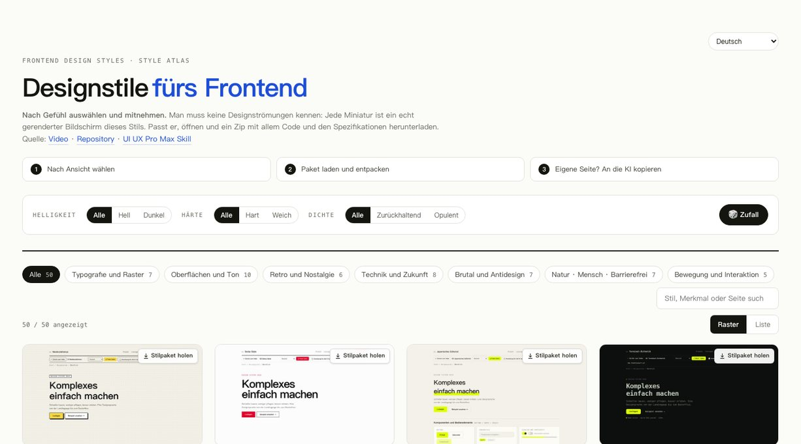
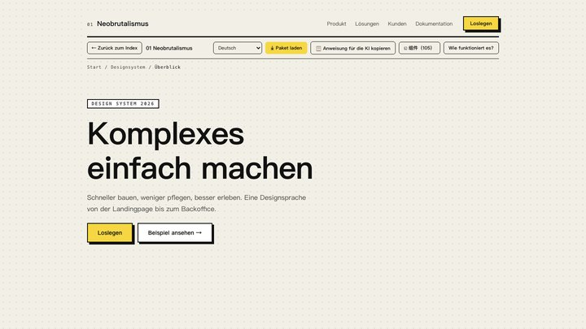
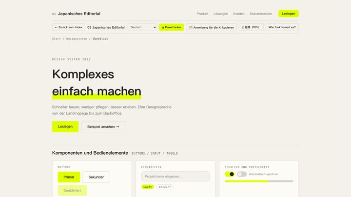
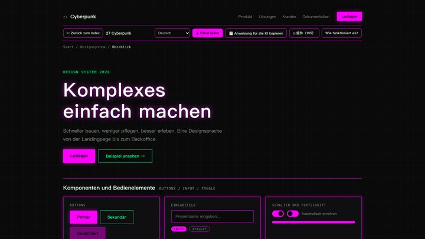
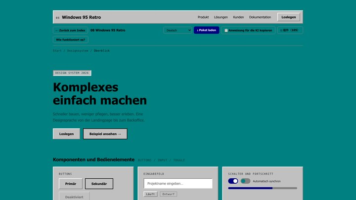
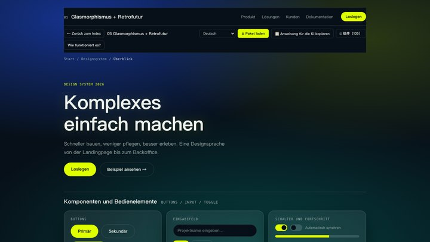
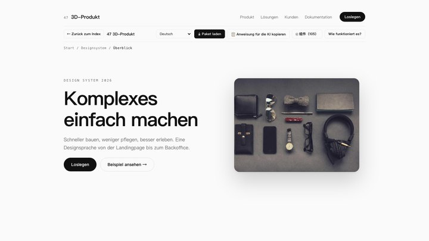

<p align="center">

**Sprache**: [简体中文](https://github.com/1981yangcq/frontend-style-pack/blob/main/README.md) · [繁體中文](https://github.com/1981yangcq/frontend-style-pack/blob/main/docs/i18n/README.zh-TW.md) · [English](https://github.com/1981yangcq/frontend-style-pack/blob/main/docs/i18n/README.en.md) · [Español](https://github.com/1981yangcq/frontend-style-pack/blob/main/docs/i18n/README.es.md) · [Français](https://github.com/1981yangcq/frontend-style-pack/blob/main/docs/i18n/README.fr.md) · [Português (BR)](https://github.com/1981yangcq/frontend-style-pack/blob/main/docs/i18n/README.pt-BR.md) · [Русский](https://github.com/1981yangcq/frontend-style-pack/blob/main/docs/i18n/README.ru.md) · **Deutsch** · [日本語](https://github.com/1981yangcq/frontend-style-pack/blob/main/docs/i18n/README.ja.md) · [한국어](https://github.com/1981yangcq/frontend-style-pack/blob/main/docs/i18n/README.ko.md)

</p>

<div align="center">

# Katalog der Frontend-Designstile · Style Atlas

**Nach Gefühl auswählen und mitnehmen.**

50 Frontend-Designstile: Jede Miniatur ist ein echtes Rendering, und jede öffnet eine vollständige
Seite (Landingpage + 105 Komponenten). Ein Zip herunterladen und alles ist da.



[**🌐 Live-Vorschau**](https://1981yangcq.github.io/frontend-style-pack/?lang=de) · [**🇨🇳 China-Spiegel**](https://sunsong.surge.sh?lang=de) · [**⬇ Pakete laden**](https://github.com/1981yangcq/frontend-style-pack/releases/) · [**📖 Mit KI nutzen**](../../specs/README.md)

</div>

---

## Antippen und öffnen

> Alle sechs sind echte Screenshots. Einfach eine antippen — die vollständige Seite dieses Stils öffnet sich (Landingpage + 105 Komponenten).

| | | |
|---|---|---|
| <a href="https://1981yangcq.github.io/frontend-style-pack/demos/01-neo-brutalism.html?lang=de"></a> | <a href="https://1981yangcq.github.io/frontend-style-pack/demos/03-japanese-editorial.html?lang=de"></a> | <a href="https://1981yangcq.github.io/frontend-style-pack/demos/27-cyberpunk.html?lang=de"></a> |
| <a href="https://1981yangcq.github.io/frontend-style-pack/demos/08-retro-win95.html?lang=de"></a> | <a href="https://1981yangcq.github.io/frontend-style-pack/demos/05-glassmorphism-retro.html?lang=de"></a> | <a href="https://1981yangcq.github.io/frontend-style-pack/demos/47-3d-product.html?lang=de"></a> |

---

## Was ist das

Der größte Zeitfresser im Frontend ist nicht das Coden, sondern **die Entscheidung, wie es aussehen soll**: Dribbble durchscrollen, Awwwards durchforsten, Komponentenbibliotheken zusammenstückeln, Farben abgleichen.
Hier kommt der Stil als komplettes Paket: ein Farbsatz, ein Radius- und Schattensystem, ein Komponentensatz. **Auswählen und loslegen.**

| Wer du bist | Was du tust |
|---|---|
| **Ich brauche schnell eine Seite** | In der Vorschau wählen → Zip laden → entpacken und `demo.html` öffnen |
| **Ich lasse die KI bauen** | „Anweisung für die KI kopieren“ drücken, in eine KI einfügen, letzte Zeile ersetzen |
| **Ich schraube am Code** | Im Zip liegen `spec.md` (Spezifikationskarte) und `theme.css` (fertige Tokens und Komponenten) |

> Du musst nicht wissen, was „Neobrutalismus“ ist. Einfach ansehen.

---

## Drei Schritte

1. **Nach Ansicht wählen** — nach Helligkeit / Härte / Dichte filtern oder 🎲 Zufall drücken
2. **Paket laden** — ein Zip kommt an; entpacken und `怎么用.html` oder `demo.html` öffnen
3. **Eigene Seite bauen** — KI-Anweisung kopieren, einfügen, letzte Zeile ändern

---

## 50 Stile

> „Vorschau“ öffnet die ganze Seite, „Laden“ gibt dir das Zip.

| # | Stil | In einem Satz | Links |
|---|---|---|---|
| 01 | **Neobrutalismus**<br><sub>Neo-Brutalism</sub> | Behandelt die Seite als rohes Material: schwere schwarze Rahmen und harte Schatten, die Ehrlichkeit und Auflehnung ausdrücken. | [Vorschau](https://1981yangcq.github.io/frontend-style-pack/?lang=dedemos/01-neo-brutalism.html) · [Laden](https://github.com/1981yangcq/frontend-style-pack/releases/latest/download/style-01-neo-brutalism.zip) |
| 02 | **Swiss Style**<br><sub>Swiss Style</sub> | In den 1950ern in Zürich und Basel entstanden: jedes Ornament durch Raster und typografische Hierarchie ersetzen. | [Vorschau](https://1981yangcq.github.io/frontend-style-pack/?lang=dedemos/02-swiss-style.html) · [Laden](https://github.com/1981yangcq/frontend-style-pack/releases/latest/download/style-02-swiss-style.zip) |
| 03 | **Japanisches Editorial**<br><sub>Japanese Editorial</sub> | Bringt Magazin-Layout ins Web: warmes Papier, feinste Linien, ein einziger fluoreszierender Akzent. | [Vorschau](https://1981yangcq.github.io/frontend-style-pack/?lang=dedemos/03-japanese-editorial.html) · [Laden](https://github.com/1981yangcq/frontend-style-pack/releases/latest/download/style-03-japanese-editorial.zip) |
| 04 | **Terminal-Ästhetik**<br><sub>Terminal CLI Aesthetic</sub> | Holt die Kommandozeile in den Browser: Monospace und Statusleuchten schaffen Ingenieursglaubwürdigkeit. | [Vorschau](https://1981yangcq.github.io/frontend-style-pack/?lang=dedemos/04-terminal-cli.html) · [Laden](https://github.com/1981yangcq/frontend-style-pack/releases/latest/download/style-04-terminal-cli.zip) |
| 05 | **Glasmorphismus + Retrofutur**<br><sub>Glassmorphism + Retrofuturism</sub> | Milchige Karten auf leuchtendem Grund, darüber CRT-Scanlines: halb edel, halb Nostalgie. | [Vorschau](https://1981yangcq.github.io/frontend-style-pack/?lang=dedemos/05-glassmorphism-retro.html) · [Laden](https://github.com/1981yangcq/frontend-style-pack/releases/latest/download/style-05-glassmorphism-retro.zip) |
| 06 | **Voxel**<br><sub>Voxel Aesthetic</sub> | Eine 16×16-Blockwelt als Interface, als würde man ein Sandbox-Spiel im Browser öffnen. | [Vorschau](https://1981yangcq.github.io/frontend-style-pack/?lang=dedemos/06-voxel.html) · [Laden](https://github.com/1981yangcq/frontend-style-pack/releases/latest/download/style-06-voxel.zip) |
| 07 | **Neumorphismus**<br><sub>Neumorphism</sub> | Elemente haben die Hintergrundfarbe; zwei Lichter, eines hell und eines dunkel, drücken die Form heraus. | [Vorschau](https://1981yangcq.github.io/frontend-style-pack/?lang=dedemos/07-neumorphism.html) · [Laden](https://github.com/1981yangcq/frontend-style-pack/releases/latest/download/style-07-neumorphism.zip) |
| 08 | **Windows 95 Retro**<br><sub>Retro Win95</sub> | Eine originalgetreue Nachbildung des Desktops von 1995: Fenster, Taskleiste, Startknopf. | [Vorschau](https://1981yangcq.github.io/frontend-style-pack/?lang=dedemos/08-retro-win95.html) · [Laden](https://github.com/1981yangcq/frontend-style-pack/releases/latest/download/style-08-retro-win95.zip) |
| 09 | **Biophil**<br><sub>Biophilic Design</sub> | Bringt Sonnenlicht, Pflanzen und handgeschöpftes Papier auf den Bildschirm, damit die Oberfläche atmet. | [Vorschau](https://1981yangcq.github.io/frontend-style-pack/?lang=dedemos/09-biophilic.html) · [Laden](https://github.com/1981yangcq/frontend-style-pack/releases/latest/download/style-09-biophilic.zip) |
| 10 | **3D-Hyperrealismus**<br><sub>3D & Hyperrealism</sub> | Täuscht echte Tiefe auf der Fläche vor: Perspektive, Schattenlagen und Materialverläufe. | [Vorschau](https://1981yangcq.github.io/frontend-style-pack/?lang=dedemos/10-3d-hyperrealism.html) · [Laden](https://github.com/1981yangcq/frontend-style-pack/releases/latest/download/style-10-3d-hyperrealism.zip) |
| 11 | **Lebendige Blöcke**<br><sub>Vibrant & Block-based</sub> | Große Farbflächen, Kontrastfarben und dicke Rahmen machen die Seite zu einem Stapel gesättigter Bausteine. | [Vorschau](https://1981yangcq.github.io/frontend-style-pack/?lang=dedemos/11-vibrant-block.html) · [Laden](https://github.com/1981yangcq/frontend-style-pack/releases/latest/download/style-11-vibrant-block.zip) |
| 12 | **OLED-Dunkel**<br><sub>Dark Mode OLED</sub> | Ein dunkles Schema für echtes Schwarz: wirklich schwarz, Helligkeit zurückhaltend. | [Vorschau](https://1981yangcq.github.io/frontend-style-pack/?lang=dedemos/12-dark-oled.html) · [Laden](https://github.com/1981yangcq/frontend-style-pack/releases/latest/download/style-12-dark-oled.zip) |
| 13 | **Barrierefrei und ethisch**<br><sub>Accessible & Ethical</sub> | Lesbarkeit und Erreichbarkeit als erste Ästhetik: schlicht vor hübsch. | [Vorschau](https://1981yangcq.github.io/frontend-style-pack/?lang=dedemos/13-accessible-ethical.html) · [Laden](https://github.com/1981yangcq/frontend-style-pack/releases/latest/download/style-13-accessible-ethical.zip) |
| 14 | **Ton**<br><sub>Claymorphism</sub> | Die Elemente wirken wie mit dem Finger aus Ton geformt: weich, voluminös, keine harte Kante. | [Vorschau](https://1981yangcq.github.io/frontend-style-pack/?lang=dedemos/14-claymorphism.html) · [Laden](https://github.com/1981yangcq/frontend-style-pack/releases/latest/download/style-14-claymorphism.zip) |
| 15 | **Aurora UI**<br><sub>Aurora UI</sub> | Fließende Aurora-Flächen auf dunklem Grund hinter Milchglas: die aktuelle Premium-Formel im SaaS. | [Vorschau](https://1981yangcq.github.io/frontend-style-pack/?lang=dedemos/15-aurora-ui.html) · [Laden](https://github.com/1981yangcq/frontend-style-pack/releases/latest/download/style-15-aurora-ui.zip) |
| 16 | **Retrofuturismus**<br><sub>Retro-Futurism</sub> | Die Zukunft, wie die 1980er sie sahen: Weltraumviolett, Neonrosa, leuchtende Buttons. | [Vorschau](https://1981yangcq.github.io/frontend-style-pack/?lang=dedemos/16-retro-futurism.html) · [Laden](https://github.com/1981yangcq/frontend-style-pack/releases/latest/download/style-16-retro-futurism.zip) |
| 17 | **Flat Design**<br><sub>Flat Design</sub> | Keine Schatten, keine Verläufe, keine Texturen: nur Farbe, Form und Typografie. | [Vorschau](https://1981yangcq.github.io/frontend-style-pack/?lang=dedemos/17-flat-design.html) · [Laden](https://github.com/1981yangcq/frontend-style-pack/releases/latest/download/style-17-flat-design.zip) |
| 18 | **Flüssiges Glas**<br><sub>Liquid Glass</sub> | Apples Sprache von 2025: die Oberfläche verhält sich wie flüssiges Glas, das den Hintergrund bricht. | [Vorschau](https://1981yangcq.github.io/frontend-style-pack/?lang=dedemos/18-liquid-glass.html) · [Laden](https://github.com/1981yangcq/frontend-style-pack/releases/latest/download/style-18-liquid-glass.zip) |
| 19 | **Bewegungsgetrieben**<br><sub>Motion-Driven</sub> | Die Seite erzählt fast alles über Bewegung: Scrollen, Hover und Übergang sind der Inhalt. | [Vorschau](https://1981yangcq.github.io/frontend-style-pack/?lang=dedemos/19-motion-driven.html) · [Laden](https://github.com/1981yangcq/frontend-style-pack/releases/latest/download/style-19-motion-driven.zip) |
| 20 | **Mikrointeraktionen**<br><sub>Micro-interactions</sub> | Kein Spektakel: die richtige Menge Rückmeldung in jedem Button und jedem Zustand. | [Vorschau](https://1981yangcq.github.io/frontend-style-pack/?lang=dedemos/20-micro-interactions.html) · [Laden](https://github.com/1981yangcq/frontend-style-pack/releases/latest/download/style-20-micro-interactions.zip) |
| 21 | **Inklusives Design**<br><sub>Inclusive Design</sub> | Setzt visuelle, motorische und kognitive Unterschiede voraus und baut eine Oberfläche für alle. | [Vorschau](https://1981yangcq.github.io/frontend-style-pack/?lang=dedemos/21-inclusive-design.html) · [Laden](https://github.com/1981yangcq/frontend-style-pack/releases/latest/download/style-21-inclusive-design.zip) |
| 22 | **Zero Interface**<br><sub>Zero Interface</sub> | Die Oberfläche verschwindet fast, es bleiben Text und Weißraum. Interaktion geschieht im Gespräch. | [Vorschau](https://1981yangcq.github.io/frontend-style-pack/?lang=dedemos/22-zero-interface.html) · [Laden](https://github.com/1981yangcq/frontend-style-pack/releases/latest/download/style-22-zero-interface.zip) |
| 23 | **Soft-UI-Evolution**<br><sub>Soft UI Evolution</sub> | Der Enterprise-Kompromiss zwischen Neumorphismus und Flat: etwas weich, nie auf Kosten der Klarheit. | [Vorschau](https://1981yangcq.github.io/frontend-style-pack/?lang=dedemos/23-soft-ui.html) · [Laden](https://github.com/1981yangcq/frontend-style-pack/releases/latest/download/style-23-soft-ui.zip) |
| 24 | **Neubrutalismus**<br><sub>Neubrutalism</sub> | Der optimistische Brutalismus: Creme-Grund, Rot-Gelb-Kontrast, schwere schwarze Rahmen. | [Vorschau](https://1981yangcq.github.io/frontend-style-pack/?lang=dedemos/24-neubrutalism.html) · [Laden](https://github.com/1981yangcq/frontend-style-pack/releases/latest/download/style-24-neubrutalism.zip) |
| 25 | **Bento-Raster**<br><sub>Bento Box Grid</sub> | Verschieden große abgerundete Karten wie ein japanisches Bento, alles auf einem Bildschirm erklärt. | [Vorschau](https://1981yangcq.github.io/frontend-style-pack/?lang=dedemos/25-bento-grid.html) · [Laden](https://github.com/1981yangcq/frontend-style-pack/releases/latest/download/style-25-bento-grid.zip) |
| 26 | **Y2K-Ästhetik**<br><sub>Y2K Aesthetic</sub> | Die Zukunftsvorstellung der Jahrtausendwende: Eisblau-zu-Pink-Verläufe, Metallglanz, sehr runde Bedienelemente. | [Vorschau](https://1981yangcq.github.io/frontend-style-pack/?lang=dedemos/26-y2k.html) · [Laden](https://github.com/1981yangcq/frontend-style-pack/releases/latest/download/style-26-y2k.zip) |
| 27 | **Cyberpunk**<br><sub>Cyberpunk UI</sub> | Hochkontrast-Neon auf reinem Schwarz mit Glitch: dystopische Technik als Bildsprache. | [Vorschau](https://1981yangcq.github.io/frontend-style-pack/?lang=dedemos/27-cyberpunk.html) · [Laden](https://github.com/1981yangcq/frontend-style-pack/releases/latest/download/style-27-cyberpunk.zip) |
| 28 | **KI-native UI**<br><sub>AI-Native UI</sub> | Das Aussehen, das KI-Produkte entwickelt haben: Blauviolett-Verläufe, leuchtende Kanten, Gespräch zuerst. | [Vorschau](https://1981yangcq.github.io/frontend-style-pack/?lang=dedemos/28-ai-native.html) · [Laden](https://github.com/1981yangcq/frontend-style-pack/releases/latest/download/style-28-ai-native.zip) |
| 29 | **Memphis**<br><sub>Memphis Design</sub> | Mailand 1981 gegen die Moderne: Geometrie, Kontrastfarben, Punkte, absichtlich unstimmig. | [Vorschau](https://1981yangcq.github.io/frontend-style-pack/?lang=dedemos/29-memphis.html) · [Laden](https://github.com/1981yangcq/frontend-style-pack/releases/latest/download/style-29-memphis.zip) |
| 30 | **Vaporwave**<br><sub>Vaporwave</sub> | 80er-Synthmusik und Reste des Konsums: Neonrosa mit etwas Leere darin. | [Vorschau](https://1981yangcq.github.io/frontend-style-pack/?lang=dedemos/30-vaporwave.html) · [Laden](https://github.com/1981yangcq/frontend-style-pack/releases/latest/download/style-30-vaporwave.zip) |
| 31 | **Dimensionale Schichtung**<br><sub>Dimensional Layering</sub> | Gestufte Schatten bauen eine klare Z-Achse: jede Information hat eine Entfernung. | [Vorschau](https://1981yangcq.github.io/frontend-style-pack/?lang=dedemos/31-dimensional-layering.html) · [Laden](https://github.com/1981yangcq/frontend-style-pack/releases/latest/download/style-31-dimensional-layering.zip) |
| 32 | **Übertriebener Minimalismus**<br><sub>Exaggerated Minimalism</sub> | Minimalismus bis zum Ende: Die Schrift füllt den Bildschirm, sonst bleibt nichts. | [Vorschau](https://1981yangcq.github.io/frontend-style-pack/?lang=dedemos/32-exaggerated-minimalism.html) · [Laden](https://github.com/1981yangcq/frontend-style-pack/releases/latest/download/style-32-exaggerated-minimalism.zip) |
| 33 | **Kinetische Typografie**<br><sub>Kinetic Typography</sub> | Die Schrift ist die Hauptfigur: Größe, Rhythmus und Animation für Plakatwirkung. | [Vorschau](https://1981yangcq.github.io/frontend-style-pack/?lang=dedemos/33-kinetic-typography.html) · [Laden](https://github.com/1981yangcq/frontend-style-pack/releases/latest/download/style-33-kinetic-typography.zip) |
| 34 | **Parallax-Erzählung**<br><sub>Parallax Storytelling</sub> | Erzählt über Unterschiede der Scrollgeschwindigkeit, wie eine lange Rolle mit Tiefe. | [Vorschau](https://1981yangcq.github.io/frontend-style-pack/?lang=dedemos/34-parallax-storytelling.html) · [Laden](https://github.com/1981yangcq/frontend-style-pack/releases/latest/download/style-34-parallax-storytelling.zip) |
| 35 | **Swiss Modernism 2.0**<br><sub>Swiss Modernism 2.0</sub> | Der Swiss Style auf die Spitze getrieben: alles weg, nur Gewicht, Zeilenhöhe und eine Haarlinie. | [Vorschau](https://1981yangcq.github.io/frontend-style-pack/?lang=dedemos/35-swiss-modernism-2.html) · [Laden](https://github.com/1981yangcq/frontend-style-pack/releases/latest/download/style-35-swiss-modernism-2.zip) |
| 36 | **HUD / Sci-Fi-FUI**<br><sub>HUD / Sci-Fi FUI</sub> | Die Konsolensprache aus Science-Fiction: feine Leuchtlinien, Eckklammern, laufende Daten. | [Vorschau](https://1981yangcq.github.io/frontend-style-pack/?lang=dedemos/36-hud-sci-fi.html) · [Laden](https://github.com/1981yangcq/frontend-style-pack/releases/latest/download/style-36-hud-sci-fi.zip) |
| 37 | **Bento-Raster 2.0**<br><sub>Bento Grids 2.0</sub> | Die junge Bento-Version: warmes Grau, iPhone-Rot-Akzente, lockerere Radien. | [Vorschau](https://1981yangcq.github.io/frontend-style-pack/?lang=dedemos/37-bento-2.html) · [Laden](https://github.com/1981yangcq/frontend-style-pack/releases/latest/download/style-37-bento-2.zip) |
| 38 | **Spatial UI / visionOS**<br><sub>Spatial UI / VisionOS</sub> | Für Headsets entworfen: Glasplatten im Raum, mit Dicke und Licht. | [Vorschau](https://1981yangcq.github.io/frontend-style-pack/?lang=dedemos/38-spatial-ui.html) · [Laden](https://github.com/1981yangcq/frontend-style-pack/releases/latest/download/style-38-spatial-ui.zip) |
| 39 | **E-Ink**<br><sub>E-Ink & Paper</sub> | Macht den Bildschirm zu Papier: warmes Weiß, Serifenschrift, keine Schatten, für langes Lesen. | [Vorschau](https://1981yangcq.github.io/frontend-style-pack/?lang=dedemos/39-e-ink-paper.html) · [Laden](https://github.com/1981yangcq/frontend-style-pack/releases/latest/download/style-39-e-ink-paper.zip) |
| 40 | **Gen-Z-Chaos**<br><sub>Gen Z Chaos / Maximalism</sub> | Sorgfältig gestaltetes Durcheinander: Sättigung, Verschiebung, Sticker gegen das Feine. | [Vorschau](https://1981yangcq.github.io/frontend-style-pack/?lang=dedemos/40-genz-chaos.html) · [Laden](https://github.com/1981yangcq/frontend-style-pack/releases/latest/download/style-40-genz-chaos.zip) |
| 41 | **Biomimetisch 2.0**<br><sub>Biomimetic / Organic 2.0</sub> | Nicht die Farben der Natur, sondern ihre Wachstumslogik und Struktur. | [Vorschau](https://1981yangcq.github.io/frontend-style-pack/?lang=dedemos/41-biomimetic.html) · [Laden](https://github.com/1981yangcq/frontend-style-pack/releases/latest/download/style-41-biomimetic.zip) |
| 42 | **Anti-Polish**<br><sub>Anti-Polish / Raw Aesthetic</sub> | Bewusst undesignt: gestrichelte Rahmen, Systemschrift, Radius null, wie ein veröffentlichtes Wireframe. | [Vorschau](https://1981yangcq.github.io/frontend-style-pack/?lang=dedemos/42-anti-polish-raw.html) · [Laden](https://github.com/1981yangcq/frontend-style-pack/releases/latest/download/style-42-anti-polish-raw.zip) |
| 43 | **Taktiles Digital**<br><sub>Tactile Digital / Deformable UI</sub> | Lässt Dinge auf dem Bildschirm wie Papier, Stoff oder Holz wirken, über Dicke und Verformung. | [Vorschau](https://1981yangcq.github.io/frontend-style-pack/?lang=dedemos/43-tactile-digital.html) · [Laden](https://github.com/1981yangcq/frontend-style-pack/releases/latest/download/style-43-tactile-digital.zip) |
| 44 | **Destillierte Natur**<br><sub>Nature Distilled</sub> | Keine Blätter, keine Berge: Natur reduziert auf Proportion, Farbtemperatur und ein zurückhaltendes Grün. | [Vorschau](https://1981yangcq.github.io/frontend-style-pack/?lang=dedemos/44-nature-distilled.html) · [Laden](https://github.com/1981yangcq/frontend-style-pack/releases/latest/download/style-44-nature-distilled.zip) |
| 45 | **Cursor-Interaktion**<br><sub>Interactive Cursor Design</sub> | Der Zeiger wird zur Hauptfigur: Fadenkreuz, Spur, Magnetismus. | [Vorschau](https://1981yangcq.github.io/frontend-style-pack/?lang=dedemos/45-interactive-cursor.html) · [Laden](https://github.com/1981yangcq/frontend-style-pack/releases/latest/download/style-45-interactive-cursor.zip) |
| 46 | **Sprache zuerst**<br><sub>Voice-First Multimodal</sub> | Fürs Sprechen entworfen: ein Einstieg, ein Klangring, alles andere tritt zurück. | [Vorschau](https://1981yangcq.github.io/frontend-style-pack/?lang=dedemos/46-voice-first.html) · [Laden](https://github.com/1981yangcq/frontend-style-pack/releases/latest/download/style-46-voice-first.zip) |
| 47 | **3D-Produkt**<br><sub>3D Product Preview</sub> | Stellt das Produkt wie im Studio vor eine schattenlose Wand, das 3D-Modell ist der einzige Inhalt. | [Vorschau](https://1981yangcq.github.io/frontend-style-pack/?lang=dedemos/47-3d-product.html) · [Laden](https://github.com/1981yangcq/frontend-style-pack/releases/latest/download/style-47-3d-product.zip) |
| 48 | **Verlaufsnetz**<br><sub>Gradient Mesh / Aurora Evolved</sub> | Die weiterentwickelte Aurora: mehrere Farbfelder zu einem atmenden Netz verwoben. | [Vorschau](https://1981yangcq.github.io/frontend-style-pack/?lang=dedemos/48-gradient-mesh.html) · [Laden](https://github.com/1981yangcq/frontend-style-pack/releases/latest/download/style-48-gradient-mesh.zip) |
| 49 | **RGB-Split**<br><sub>Chromatic Aberration / RGB Split</sub> | Macht die chromatische Aberration, einen Fehler, zur Sprache: Rot, Grün und Blau versetzt. | [Vorschau](https://1981yangcq.github.io/frontend-style-pack/?lang=dedemos/49-chromatic-aberration.html) · [Laden](https://github.com/1981yangcq/frontend-style-pack/releases/latest/download/style-49-chromatic-aberration.zip) |
| 50 | **Vintage-Film**<br><sub>Vintage Analog / Retro Film</sub> | Die Stimmung alter Fotos und Bücher: oxidierte Warmtöne, Filmkorn, Brauntöne. | [Vorschau](https://1981yangcq.github.io/frontend-style-pack/?lang=dedemos/50-vintage-film.html) · [Laden](https://github.com/1981yangcq/frontend-style-pack/releases/latest/download/style-50-vintage-film.zip) |

---

## Inhalt eines Stilpakets

| Datei | Was sie ist |
|---|---|
| `怎么用.html` | **Zuerst lesen** — drei Schritte, öffnet im Browser |
| `demo.html` | Die vollständige Beispielseite: Landingpage + 105 Komponenten, eine Datei |
| `给AI的话.txt` | Die KI-Anweisung, Farben und Verbote schon eingetragen |
| `spec.md` | Spezifikationskarte: Tokens, Pflichttechniken, Verbotsliste, Barrierefreiheits-Untergrenze |
| `spec.json` | Dasselbe, maschinenlesbar |
| `theme.css` | Aus den Tokens erzeugtes Stylesheet, direkt per `@import` nutzbar |
| `preview.jpg` | Screenshot des ersten Bildschirms |
| `assets/` | Fotos der Demo (mitgeliefert, funktionieren offline) |

---

## Mit KI nutzen (ohne Download)

Ohne Zip geht auch das Gesamtpaket:

- [`styles-bundle.md`](styles-bundle.md) — alle Stil-Spezifikationen in einem Einfügen
- [`styles-bundle.json`](styles-bundle.json) — maschinenlesbar
- [`specs/README.md`](specs/README.md) — wie man es füttert, drei Stufen, Abnahmeliste

```
Unten steht die Spezifikationsbibliothek von Katalog der Frontend-Designstile. Nutze nur den Stil, den ich nenne.
[Stil] 27 / Cyberpunk
[Was ich brauche] Eine Café-Landingpage mit Hero, drei Vorteilen und Preistabelle
```

---

## Lokal starten

Rein statisch, ohne Abhängigkeiten: einfach `index.html` öffnen. Nach einer Stiländerung neu bauen:

```bash
pip install pillow
python build_demos.py      # 50 页
python build_thumbs.py
python build_zips.py
python build.py            # 首页
```

---

## Einen Stil beitragen

Siehe [CONTRIBUTING.md](CONTRIBUTING.md). Drei Schritte:

1. Eine Zeile in `styles.json` ergänzen (Name / ein Satz / Gruppe / Referenzseiten)
2. Einen Token-Satz in `themes.py` ergänzen (Farbe / Radius / Schatten / Schrift)
3. `build_demos.py` laufen lassen — entsteht die Seite, passt es

Nach dem Merge erscheint er automatisch auf der Website und im KI-Bundle.

---

## Lizenz und Danksagung

- **Code** (Generatoren, CSS, HTML): [MIT](LICENSE)
- **Texte / Spezifikationskarten / Komponentenmatrix**: CC BY 4.0
- **Stilliste** nach dem Bilibili-Video und dessen Repository (MIT), [UI UX Pro Max Skill](https://github.com/nextlevelbuilder/ui-ux-pro-max-skill) (MIT)
- **Demo-Umsetzung / Spezifikationskarten / Komponentenübersicht / Pakete**: original aus diesem Repository
- **Fotos** von [picsum.photos](https://picsum.photos) (Unsplash), nur Platzhalter — für kommerzielle Nutzung ersetzen
