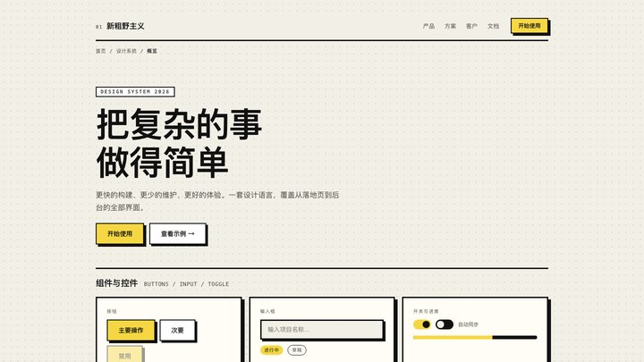
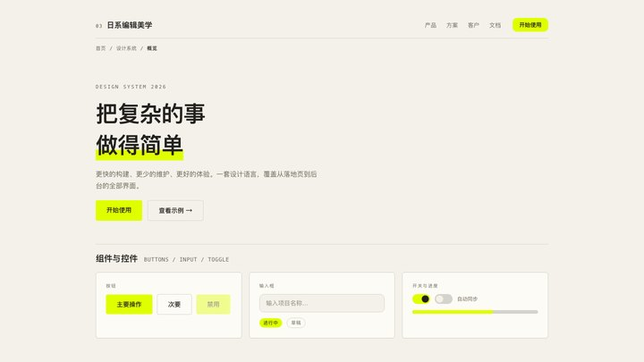
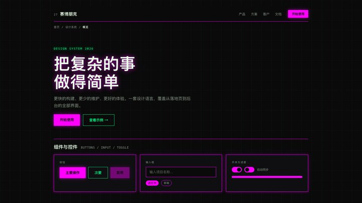
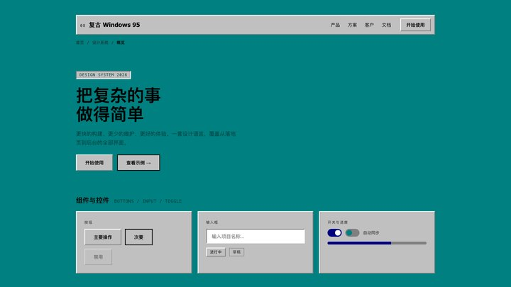
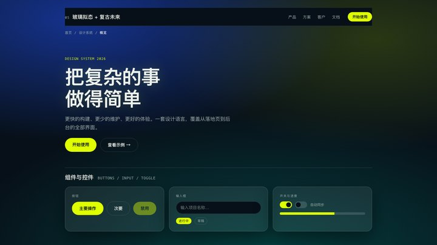
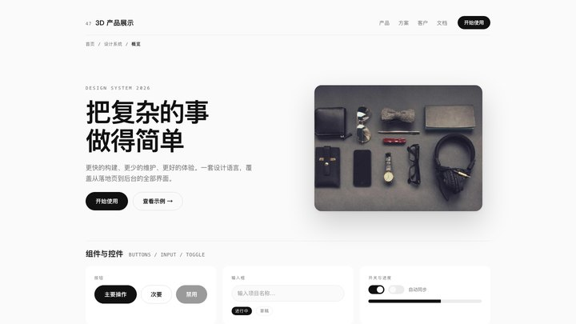

<div align="center">

# Frontend Design Styles · Style Atlas

**Pick one by feel. Take it with you.**

50 frontend design styles: every thumbnail is a real render, and each one opens a complete page
(landing page + 105 components). Download one zip and the whole thing is yours.

[**🌐 Live preview**](https://1981yangcq.github.io/frontend-style-pack/) · [**🇨🇳 China mirror**](https://sunsong.surge.sh) · [**⬇ Download packs**](https://github.com/1981yangcq/frontend-style-pack/releases/) · [**📖 Using it with AI**](../../specs/README.md)

</div>

**Language**: [简体中文](https://github.com/1981yangcq/frontend-style-pack/blob/main/README.md) · [繁體中文](https://github.com/1981yangcq/frontend-style-pack/blob/main/docs/i18n/README.zh-TW.md) · **English** · [Español](https://github.com/1981yangcq/frontend-style-pack/blob/main/docs/i18n/README.es.md) · [Français](https://github.com/1981yangcq/frontend-style-pack/blob/main/docs/i18n/README.fr.md) · [Português (BR)](https://github.com/1981yangcq/frontend-style-pack/blob/main/docs/i18n/README.pt-BR.md) · [Русский](https://github.com/1981yangcq/frontend-style-pack/blob/main/docs/i18n/README.ru.md) · [Deutsch](https://github.com/1981yangcq/frontend-style-pack/blob/main/docs/i18n/README.de.md) · [日本語](https://github.com/1981yangcq/frontend-style-pack/blob/main/docs/i18n/README.ja.md) · [한국어](https://github.com/1981yangcq/frontend-style-pack/blob/main/docs/i18n/README.ko.md)

---

## Tap to open

> All six are real screenshots. Tap any of them to open that style's full page (landing page + 105 components).

| | | |
|---|---|---|
| <a href="https://1981yangcq.github.io/frontend-style-pack/demos/01-neo-brutalism.html"></a> | <a href="https://1981yangcq.github.io/frontend-style-pack/demos/03-japanese-editorial.html"></a> | <a href="https://1981yangcq.github.io/frontend-style-pack/demos/27-cyberpunk.html"></a> |
| <a href="https://1981yangcq.github.io/frontend-style-pack/demos/08-retro-win95.html"></a> | <a href="https://1981yangcq.github.io/frontend-style-pack/demos/05-glassmorphism-retro.html"></a> | <a href="https://1981yangcq.github.io/frontend-style-pack/demos/47-3d-product.html"></a> |

---

## What this is

The biggest time sink in frontend work isn't writing code — it's **deciding what it should look like**: browsing Dribbble, digging through Awwwards, stitching component libraries together, matching colours.
Here the style comes as a whole pack: one colour set, one radius and shadow system, one component set. **Pick it and use it.**

| Who you are | What to do |
|---|---|
| **I just need a page, fast** | Pick one in the preview → download the zip → unzip and open `demo.html` |
| **I want AI to build it** | Hit “Copy prompt for AI”, paste into any AI, replace the last line with your request |
| **I'll edit the code** | The zip has `spec.md` (spec card) + `theme.css` (ready tokens and components) |

> You don't need to know what “neo-brutalism” means. Just look.

---

## Three steps

1. **Pick one by look** — filter by tone / edge / density on the home page, or hit 🎲 Feeling lucky
2. **Download the pack** — you get a zip; unzip and open `怎么用.html` (how to use) or `demo.html`
3. **Build your own page** — copy the AI prompt, paste it, change the last line

---

## 50 styles

> “Preview” opens the full page, “Download” gives you the zip.

| # | Style | In one line | Links |
|---|---|---|---|
| 01 | **Neo-Brutalism**<br><sub>Neo-Brutalism</sub> | Treats the page as raw, unpolished material: heavy black borders and hard offset shadows that read as honest and rebellious. | [Preview](https://1981yangcq.github.io/frontend-style-pack/demos/01-neo-brutalism.html) · [Download](https://github.com/1981yangcq/frontend-style-pack/releases/latest/download/style-01-neo-brutalism.zip) |
| 02 | **Swiss Style**<br><sub>Swiss Style</sub> | Born in 1950s Zürich and Basel: replace every ornament with a grid and a type hierarchy. | [Preview](https://1981yangcq.github.io/frontend-style-pack/demos/02-swiss-style.html) · [Download](https://github.com/1981yangcq/frontend-style-pack/releases/latest/download/style-02-swiss-style.zip) |
| 03 | **Japanese Editorial**<br><sub>Japanese Editorial</sub> | Brings magazine layout to the web: warm paper ground, hairline rules, a single fluorescent accent. | [Preview](https://1981yangcq.github.io/frontend-style-pack/demos/03-japanese-editorial.html) · [Download](https://github.com/1981yangcq/frontend-style-pack/releases/latest/download/style-03-japanese-editorial.zip) |
| 04 | **Terminal CLI Aesthetic**<br><sub>Terminal CLI Aesthetic</sub> | Puts the command line in the browser: monospace type and status LEDs build engineering credibility. | [Preview](https://1981yangcq.github.io/frontend-style-pack/demos/04-terminal-cli.html) · [Download](https://github.com/1981yangcq/frontend-style-pack/releases/latest/download/style-04-terminal-cli.zip) |
| 05 | **Glassmorphism + Retrofuturism**<br><sub>Glassmorphism + Retrofuturism</sub> | Frosted cards floating on a glowing field with a CRT scanline on top: half premium, half nostalgia. | [Preview](https://1981yangcq.github.io/frontend-style-pack/demos/05-glassmorphism-retro.html) · [Download](https://github.com/1981yangcq/frontend-style-pack/releases/latest/download/style-05-glassmorphism-retro.zip) |
| 06 | **Voxel Aesthetic**<br><sub>Voxel Aesthetic</sub> | A 16×16 block world turned into an interface, like opening a sandbox game inside a web page. | [Preview](https://1981yangcq.github.io/frontend-style-pack/demos/06-voxel.html) · [Download](https://github.com/1981yangcq/frontend-style-pack/releases/latest/download/style-06-voxel.zip) |
| 07 | **Neumorphism**<br><sub>Neumorphism</sub> | Elements share the background colour; two lights, one bright and one dark, press the shape out of the surface. | [Preview](https://1981yangcq.github.io/frontend-style-pack/demos/07-neumorphism.html) · [Download](https://github.com/1981yangcq/frontend-style-pack/releases/latest/download/style-07-neumorphism.zip) |
| 08 | **Retro Win95**<br><sub>Retro Win95</sub> | A faithful replica of the 1995 desktop: windows, taskbar, start button, all of it. | [Preview](https://1981yangcq.github.io/frontend-style-pack/demos/08-retro-win95.html) · [Download](https://github.com/1981yangcq/frontend-style-pack/releases/latest/download/style-08-retro-win95.zip) |
| 09 | **Biophilic Design**<br><sub>Biophilic Design</sub> | Brings sunlight, plants and handmade paper to the screen so the interface breathes. | [Preview](https://1981yangcq.github.io/frontend-style-pack/demos/09-biophilic.html) · [Download](https://github.com/1981yangcq/frontend-style-pack/releases/latest/download/style-09-biophilic.zip) |
| 10 | **3D & Hyperrealism**<br><sub>3D & Hyperrealism</sub> | Fakes real depth on a flat plane with perspective, layered shadows and material gradients. | [Preview](https://1981yangcq.github.io/frontend-style-pack/demos/10-3d-hyperrealism.html) · [Download](https://github.com/1981yangcq/frontend-style-pack/releases/latest/download/style-10-3d-hyperrealism.zip) |
| 11 | **Vibrant & Block-based**<br><sub>Vibrant & Block-based</sub> | Big colour blocks, clashing hues and heavy borders make the page a stack of saturated bricks. | [Preview](https://1981yangcq.github.io/frontend-style-pack/demos/11-vibrant-block.html) · [Download](https://github.com/1981yangcq/frontend-style-pack/releases/latest/download/style-11-vibrant-block.zip) |
| 12 | **Dark Mode OLED**<br><sub>Dark Mode OLED</sub> | A dark scheme tuned for pure-black panels: truly black, restrained in brightness. | [Preview](https://1981yangcq.github.io/frontend-style-pack/demos/12-dark-oled.html) · [Download](https://github.com/1981yangcq/frontend-style-pack/releases/latest/download/style-12-dark-oled.zip) |
| 13 | **Accessible & Ethical**<br><sub>Accessible & Ethical</sub> | Readability and reachability as the primary aesthetic: plain before pretty. | [Preview](https://1981yangcq.github.io/frontend-style-pack/demos/13-accessible-ethical.html) · [Download](https://github.com/1981yangcq/frontend-style-pack/releases/latest/download/style-13-accessible-ethical.zip) |
| 14 | **Claymorphism**<br><sub>Claymorphism</sub> | Elements look pressed from clay by a finger: soft, volumetric, not a hard edge anywhere. | [Preview](https://1981yangcq.github.io/frontend-style-pack/demos/14-claymorphism.html) · [Download](https://github.com/1981yangcq/frontend-style-pack/releases/latest/download/style-14-claymorphism.zip) |
| 15 | **Aurora UI**<br><sub>Aurora UI</sub> | Flowing aurora fields on a dark ground behind frosted glass: the recent SaaS definition of premium. | [Preview](https://1981yangcq.github.io/frontend-style-pack/demos/15-aurora-ui.html) · [Download](https://github.com/1981yangcq/frontend-style-pack/releases/latest/download/style-15-aurora-ui.zip) |
| 16 | **Retro-Futurism**<br><sub>Retro-Futurism</sub> | The future as the 1980s imagined it: space purple, neon pink, buttons that glow. | [Preview](https://1981yangcq.github.io/frontend-style-pack/demos/16-retro-futurism.html) · [Download](https://github.com/1981yangcq/frontend-style-pack/releases/latest/download/style-16-retro-futurism.zip) |
| 17 | **Flat Design**<br><sub>Flat Design</sub> | No shadows, no gradients, no texture: just colour, shape and type. | [Preview](https://1981yangcq.github.io/frontend-style-pack/demos/17-flat-design.html) · [Download](https://github.com/1981yangcq/frontend-style-pack/releases/latest/download/style-17-flat-design.zip) |
| 18 | **Liquid Glass**<br><sub>Liquid Glass</sub> | Apple's 2025 language: the interface behaves like liquid glass that refracts what sits behind it. | [Preview](https://1981yangcq.github.io/frontend-style-pack/demos/18-liquid-glass.html) · [Download](https://github.com/1981yangcq/frontend-style-pack/releases/latest/download/style-18-liquid-glass.zip) |
| 19 | **Motion-Driven**<br><sub>Motion-Driven</sub> | The page tells its story almost entirely through motion; scroll, hover and transition are the content. | [Preview](https://1981yangcq.github.io/frontend-style-pack/demos/19-motion-driven.html) · [Download](https://github.com/1981yangcq/frontend-style-pack/releases/latest/download/style-19-motion-driven.zip) |
| 20 | **Micro-interactions**<br><sub>Micro-interactions</sub> | No visual spectacle: just the right amount of feedback in every button and every state. | [Preview](https://1981yangcq.github.io/frontend-style-pack/demos/20-micro-interactions.html) · [Download](https://github.com/1981yangcq/frontend-style-pack/releases/latest/download/style-20-micro-interactions.zip) |
| 21 | **Inclusive Design**<br><sub>Inclusive Design</sub> | Assumes visual, motor and cognitive differences, and builds one interface that works for everyone. | [Preview](https://1981yangcq.github.io/frontend-style-pack/demos/21-inclusive-design.html) · [Download](https://github.com/1981yangcq/frontend-style-pack/releases/latest/download/style-21-inclusive-design.zip) |
| 22 | **Zero Interface**<br><sub>Zero Interface</sub> | The interface nearly disappears, leaving text and whitespace; interaction happens in conversation, not clicks. | [Preview](https://1981yangcq.github.io/frontend-style-pack/demos/22-zero-interface.html) · [Download](https://github.com/1981yangcq/frontend-style-pack/releases/latest/download/style-22-zero-interface.zip) |
| 23 | **Soft UI Evolution**<br><sub>Soft UI Evolution</sub> | The enterprise middle ground between neumorphism and flat: a little soft, never at the cost of clarity. | [Preview](https://1981yangcq.github.io/frontend-style-pack/demos/23-soft-ui.html) · [Download](https://github.com/1981yangcq/frontend-style-pack/releases/latest/download/style-23-soft-ui.zip) |
| 24 | **Neubrutalism**<br><sub>Neubrutalism</sub> | The optimistic brutalism: cream ground, red-yellow clashes, heavy black borders — the young-brand default. | [Preview](https://1981yangcq.github.io/frontend-style-pack/demos/24-neubrutalism.html) · [Download](https://github.com/1981yangcq/frontend-style-pack/releases/latest/download/style-24-neubrutalism.zip) |
| 25 | **Bento Box Grid**<br><sub>Bento Box Grid</sub> | Unequal rounded cards assembled like a Japanese bento, explaining every selling point in one screen. | [Preview](https://1981yangcq.github.io/frontend-style-pack/demos/25-bento-grid.html) · [Download](https://github.com/1981yangcq/frontend-style-pack/releases/latest/download/style-25-bento-grid.zip) |
| 26 | **Y2K Aesthetic**<br><sub>Y2K Aesthetic</sub> | The millennium's idea of the future: icy blue to pink gradients, metallic sheen, controls so round they shine. | [Preview](https://1981yangcq.github.io/frontend-style-pack/demos/26-y2k.html) · [Download](https://github.com/1981yangcq/frontend-style-pack/releases/latest/download/style-26-y2k.zip) |
| 27 | **Cyberpunk UI**<br><sub>Cyberpunk UI</sub> | High-contrast neon on pure black with glitch: dystopian tech turned into a visual language. | [Preview](https://1981yangcq.github.io/frontend-style-pack/demos/27-cyberpunk.html) · [Download](https://github.com/1981yangcq/frontend-style-pack/releases/latest/download/style-27-cyberpunk.zip) |
| 28 | **AI-Native UI**<br><sub>AI-Native UI</sub> | The look AI products grew into: blue-violet gradients, luminous edges, conversation-first layout. | [Preview](https://1981yangcq.github.io/frontend-style-pack/demos/28-ai-native.html) · [Download](https://github.com/1981yangcq/frontend-style-pack/releases/latest/download/style-28-ai-native.zip) |
| 29 | **Memphis Design**<br><sub>Memphis Design</sub> | Milan, 1981, against modernism: geometry, clashing colour and dots, deliberately out of tune. | [Preview](https://1981yangcq.github.io/frontend-style-pack/demos/29-memphis.html) · [Download](https://github.com/1981yangcq/frontend-style-pack/releases/latest/download/style-29-memphis.zip) |
| 30 | **Vaporwave**<br><sub>Vaporwave</sub> | 80s synth music and the residue of consumerism: pink neon with a little emptiness inside. | [Preview](https://1981yangcq.github.io/frontend-style-pack/demos/30-vaporwave.html) · [Download](https://github.com/1981yangcq/frontend-style-pack/releases/latest/download/style-30-vaporwave.zip) |
| 31 | **Dimensional Layering**<br><sub>Dimensional Layering</sub> | Progressive shadows build a clear Z axis, giving every piece of information a distance. | [Preview](https://1981yangcq.github.io/frontend-style-pack/demos/31-dimensional-layering.html) · [Download](https://github.com/1981yangcq/frontend-style-pack/releases/latest/download/style-31-dimensional-layering.zip) |
| 32 | **Exaggerated Minimalism**<br><sub>Exaggerated Minimalism</sub> | Minimalism pushed until the type fills the screen and nothing else remains. | [Preview](https://1981yangcq.github.io/frontend-style-pack/demos/32-exaggerated-minimalism.html) · [Download](https://github.com/1981yangcq/frontend-style-pack/releases/latest/download/style-32-exaggerated-minimalism.zip) |
| 33 | **Kinetic Typography**<br><sub>Kinetic Typography</sub> | Type becomes the protagonist; scale, rhythm and animation give it poster-level impact. | [Preview](https://1981yangcq.github.io/frontend-style-pack/demos/33-kinetic-typography.html) · [Download](https://github.com/1981yangcq/frontend-style-pack/releases/latest/download/style-33-kinetic-typography.zip) |
| 34 | **Parallax Storytelling**<br><sub>Parallax Storytelling</sub> | Tells the story through differences in scroll speed, like a long scroll with depth. | [Preview](https://1981yangcq.github.io/frontend-style-pack/demos/34-parallax-storytelling.html) · [Download](https://github.com/1981yangcq/frontend-style-pack/releases/latest/download/style-34-parallax-storytelling.zip) |
| 35 | **Swiss Modernism 2.0**<br><sub>Swiss Modernism 2.0</sub> | Swiss style taken to the extreme: strip everything, keep weight, leading and one hairline. | [Preview](https://1981yangcq.github.io/frontend-style-pack/demos/35-swiss-modernism-2.html) · [Download](https://github.com/1981yangcq/frontend-style-pack/releases/latest/download/style-35-swiss-modernism-2.zip) |
| 36 | **HUD / Sci-Fi FUI**<br><sub>HUD / Sci-Fi FUI</sub> | The console language from sci-fi films: thin luminous lines, corner brackets, scrolling data. | [Preview](https://1981yangcq.github.io/frontend-style-pack/demos/36-hud-sci-fi.html) · [Download](https://github.com/1981yangcq/frontend-style-pack/releases/latest/download/style-36-hud-sci-fi.zip) |
| 37 | **Bento Grids 2.0**<br><sub>Bento Grids 2.0</sub> | A younger bento grid: warm grey ground, iPhone red accents, looser radii. | [Preview](https://1981yangcq.github.io/frontend-style-pack/demos/37-bento-2.html) · [Download](https://github.com/1981yangcq/frontend-style-pack/releases/latest/download/style-37-bento-2.zip) |
| 38 | **Spatial UI / VisionOS**<br><sub>Spatial UI / VisionOS</sub> | Designed for headsets: panels of glass suspended in air, with thickness and lighting. | [Preview](https://1981yangcq.github.io/frontend-style-pack/demos/38-spatial-ui.html) · [Download](https://github.com/1981yangcq/frontend-style-pack/releases/latest/download/style-38-spatial-ui.zip) |
| 39 | **E-Ink & Paper**<br><sub>E-Ink & Paper</sub> | Turns the screen into paper: warm white, serif type, no shadow, built for long reading. | [Preview](https://1981yangcq.github.io/frontend-style-pack/demos/39-e-ink-paper.html) · [Download](https://github.com/1981yangcq/frontend-style-pack/releases/latest/download/style-39-e-ink-paper.zip) |
| 40 | **Gen Z Chaos / Maximalism**<br><sub>Gen Z Chaos / Maximalism</sub> | Carefully designed mess: saturation, displacement, stickers — a rejection of polish. | [Preview](https://1981yangcq.github.io/frontend-style-pack/demos/40-genz-chaos.html) · [Download](https://github.com/1981yangcq/frontend-style-pack/releases/latest/download/style-40-genz-chaos.zip) |
| 41 | **Biomimetic / Organic 2.0**<br><sub>Biomimetic / Organic 2.0</sub> | Borrows not the colours of nature but its growth logic and structure. | [Preview](https://1981yangcq.github.io/frontend-style-pack/demos/41-biomimetic.html) · [Download](https://github.com/1981yangcq/frontend-style-pack/releases/latest/download/style-41-biomimetic.zip) |
| 42 | **Anti-Polish / Raw Aesthetic**<br><sub>Anti-Polish / Raw Aesthetic</sub> | Deliberately undesigned: dashed frames, system fonts, zero radius — a wireframe shipped as is. | [Preview](https://1981yangcq.github.io/frontend-style-pack/demos/42-anti-polish-raw.html) · [Download](https://github.com/1981yangcq/frontend-style-pack/releases/latest/download/style-42-anti-polish-raw.zip) |
| 43 | **Tactile Digital / Deformable UI**<br><sub>Tactile Digital / Deformable UI</sub> | Makes things on screen feel like paper, cloth or wood through thickness and deformation. | [Preview](https://1981yangcq.github.io/frontend-style-pack/demos/43-tactile-digital.html) · [Download](https://github.com/1981yangcq/frontend-style-pack/releases/latest/download/style-43-tactile-digital.zip) |
| 44 | **Nature Distilled**<br><sub>Nature Distilled</sub> | No leaves, no mountains: nature reduced to proportion, colour temperature and restrained green. | [Preview](https://1981yangcq.github.io/frontend-style-pack/demos/44-nature-distilled.html) · [Download](https://github.com/1981yangcq/frontend-style-pack/releases/latest/download/style-44-nature-distilled.zip) |
| 45 | **Interactive Cursor Design**<br><sub>Interactive Cursor Design</sub> | The pointer becomes the protagonist: crosshair, trail, magnetism — the cursor is the navigation. | [Preview](https://1981yangcq.github.io/frontend-style-pack/demos/45-interactive-cursor.html) · [Download](https://github.com/1981yangcq/frontend-style-pack/releases/latest/download/style-45-interactive-cursor.zip) |
| 46 | **Voice-First Multimodal**<br><sub>Voice-First Multimodal</sub> | Designed for speaking: one entry point, a ring of sound, everything else steps back. | [Preview](https://1981yangcq.github.io/frontend-style-pack/demos/46-voice-first.html) · [Download](https://github.com/1981yangcq/frontend-style-pack/releases/latest/download/style-46-voice-first.zip) |
| 47 | **3D Product Preview**<br><sub>3D Product Preview</sub> | Puts the product in a studio in front of a seamless wall, so the 3D model is the only content. | [Preview](https://1981yangcq.github.io/frontend-style-pack/demos/47-3d-product.html) · [Download](https://github.com/1981yangcq/frontend-style-pack/releases/latest/download/style-47-3d-product.zip) |
| 48 | **Gradient Mesh / Aurora Evolved**<br><sub>Gradient Mesh / Aurora Evolved</sub> | Aurora evolved: multiple coloured fields woven together into a breathing mesh. | [Preview](https://1981yangcq.github.io/frontend-style-pack/demos/48-gradient-mesh.html) · [Download](https://github.com/1981yangcq/frontend-style-pack/releases/latest/download/style-48-gradient-mesh.zip) |
| 49 | **Chromatic Aberration / RGB Split**<br><sub>Chromatic Aberration / RGB Split</sub> | Turns lens aberration, a defect, into a language: red, green and blue out of register. | [Preview](https://1981yangcq.github.io/frontend-style-pack/demos/49-chromatic-aberration.html) · [Download](https://github.com/1981yangcq/frontend-style-pack/releases/latest/download/style-49-chromatic-aberration.zip) |
| 50 | **Vintage Analog / Retro Film**<br><sub>Vintage Analog / Retro Film</sub> | The feel of old photographs and old books: oxidised warm yellows, film grain, brown tones. | [Preview](https://1981yangcq.github.io/frontend-style-pack/demos/50-vintage-film.html) · [Download](https://github.com/1981yangcq/frontend-style-pack/releases/latest/download/style-50-vintage-film.zip) |

---

## Inside a style pack

| File | What it is |
|---|---|
| `怎么用.html` | **Read this first** — three steps, opens in any browser |
| `demo.html` | The full sample page: landing page + 105 components, one self-contained file |
| `给AI的话.txt` | The AI prompt with this style's colours and don'ts already filled in |
| `spec.md` | Spec card: tokens, required moves, forbidden list, accessibility floor |
| `spec.json` | The same, machine-readable |
| `theme.css` | A stylesheet generated from the tokens, ready to `@import` |
| `preview.jpg` | Screenshot of the first screen |
| `assets/` | Photos used by the demo (localised, works offline) |

---

## Use it with AI (no download)

Don't want to download? Use the bundle:

- [`styles-bundle.md`](styles-bundle.md) — every style's spec, paste it into an AI in one go
- [`styles-bundle.json`](styles-bundle.json) — machine-readable
- [`specs/README.md`](specs/README.md) — how to feed it, three levels, acceptance checklist

```
Below is the spec library of Frontend Design Styles. Use only the one I name.
[Style] 27 / Cyberpunk
[What I need] A coffee landing page with a hero, three benefits and a pricing table
```

---

## Run it locally

Pure static, no dependencies — just open `index.html`. To regenerate after changing a style:

```bash
pip install pillow
python build_demos.py      # 50 页
python build_thumbs.py
python build_zips.py
python build.py            # 首页
```

---

## Add a style

See [CONTRIBUTING.md](CONTRIBUTING.md). Three steps:

1. Add a row to `styles.json` (name / one line / group / reference sites)
2. Add a token set to `themes.py` (colour / radius / shadow / type)
3. Run `build_demos.py` — if it generates the page, it passes

Once merged it shows up on the site and in the AI bundle automatically.

---

## License & credits

- **Code** (generators, CSS, HTML): [MIT](LICENSE)
- **Copy / spec cards / component matrix**: CC BY 4.0
- **Style list** based on the Bilibili video and its repository (MIT), [UI UX Pro Max Skill](https://github.com/nextlevelbuilder/ui-ux-pro-max-skill) (MIT)
- **Demo implementation / spec cards / component overview / packs**: original to this repo
- **Photos** from [picsum.photos](https://picsum.photos) (Unsplash), placeholders only — replace for commercial use
