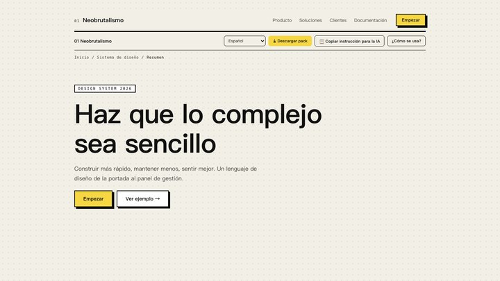
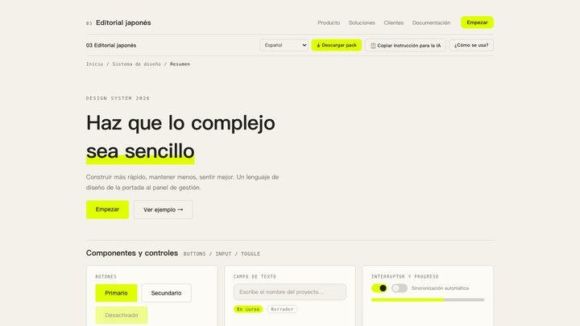
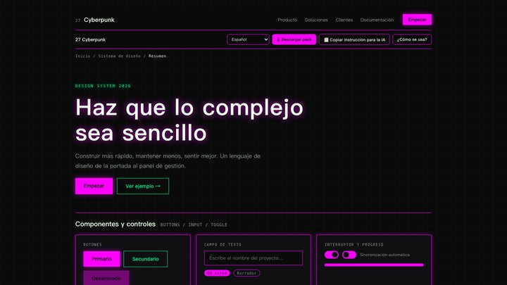
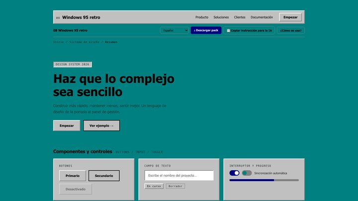
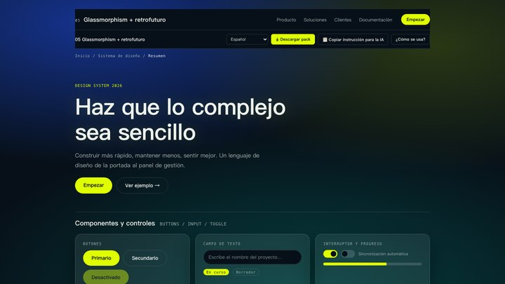
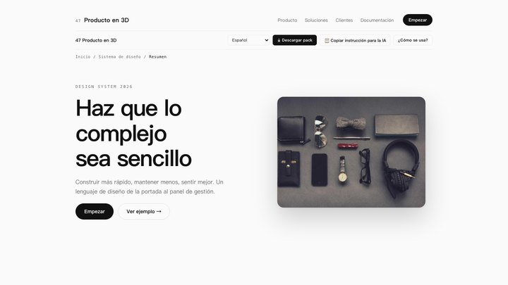

<div align="center">

# Catálogo de estilos de diseño frontend · Style Atlas

**Elige por sensación y llévatelo.**

50 estilos de diseño frontend: cada miniatura es un render real y al abrirla encuentras
una página completa (portada + 105 componentes). Descarga un zip y te llevas todo el código y las especificaciones.

[**🌐 Vista en vivo**](https://1981yangcq.github.io/frontend-style-pack/?lang=es) · [**🇨🇳 Espejo en China**](https://sunsong.surge.sh?lang=es) · [**⬇ Descargar packs**](https://github.com/1981yangcq/frontend-style-pack/releases/) · [**📖 Usarlo con IA**](../../specs/README.md)

</div>

**Idioma**: [简体中文](https://github.com/1981yangcq/frontend-style-pack/blob/main/README.md) · [繁體中文](https://github.com/1981yangcq/frontend-style-pack/blob/main/docs/i18n/README.zh-TW.md) · [English](https://github.com/1981yangcq/frontend-style-pack/blob/main/docs/i18n/README.en.md) · **Español** · [Français](https://github.com/1981yangcq/frontend-style-pack/blob/main/docs/i18n/README.fr.md) · [Português (BR)](https://github.com/1981yangcq/frontend-style-pack/blob/main/docs/i18n/README.pt-BR.md) · [Русский](https://github.com/1981yangcq/frontend-style-pack/blob/main/docs/i18n/README.ru.md) · [Deutsch](https://github.com/1981yangcq/frontend-style-pack/blob/main/docs/i18n/README.de.md) · [日本語](https://github.com/1981yangcq/frontend-style-pack/blob/main/docs/i18n/README.ja.md) · [한국어](https://github.com/1981yangcq/frontend-style-pack/blob/main/docs/i18n/README.ko.md)

---

## Toca y entra

> Las seis son capturas reales. Toca cualquiera para abrir la página completa de ese estilo (portada + 105 componentes).

| | | |
|---|---|---|
| <a href="https://1981yangcq.github.io/frontend-style-pack/demos/01-neo-brutalism.html?lang=es"></a> | <a href="https://1981yangcq.github.io/frontend-style-pack/demos/03-japanese-editorial.html?lang=es"></a> | <a href="https://1981yangcq.github.io/frontend-style-pack/demos/27-cyberpunk.html?lang=es"></a> |
| <a href="https://1981yangcq.github.io/frontend-style-pack/demos/08-retro-win95.html?lang=es"></a> | <a href="https://1981yangcq.github.io/frontend-style-pack/demos/05-glassmorphism-retro.html?lang=es"></a> | <a href="https://1981yangcq.github.io/frontend-style-pack/demos/47-3d-product.html?lang=es"></a> |

---

## Qué es esto

Lo que más tiempo consume en frontend no es escribir código, es **decidir qué aspecto tendrá**: mirar Dribbble, bucear en Awwwards, coser bibliotecas de componentes, cuadrar colores.
Aquí el estilo viene en un paquete: una paleta, un sistema de radios y sombras, un set de componentes. **Lo eliges y lo usas.**

| Quién eres | Qué hacer |
|---|---|
| **Solo necesito una página, ya** | Elige en la vista en vivo → descarga el zip → descomprime y abre `demo.html` |
| **Quiero que la IA lo haga** | Pulsa «Copiar instrucción para la IA», pégala en cualquier IA y cambia la última línea |
| **Voy a tocar el código** | El zip trae `spec.md` (ficha técnica) + `theme.css` (tokens y componentes listos) |

> No hace falta saber qué es el «neobrutalismo». Mira y elige.

---

## Tres pasos

1. **Elige a ojo** — filtra por tono / dureza / densidad en la portada, o pulsa 🎲 Al azar
2. **Descarga el pack** — obtienes un zip; descomprime y abre `怎么用.html` (cómo se usa) o `demo.html`
3. **Crea tu página** — copia la instrucción para la IA, pégala y cambia la última línea

---

## 50 estilos

> «Vista previa» abre la página completa; «Descargar» te da el zip.

| # | Estilo | En una frase | Enlaces |
|---|---|---|---|
| 01 | **Neobrutalismo**<br><sub>Neo-Brutalism</sub> | Trata la página como material sin pulir: bordes negros gruesos y sombras duras que transmiten honestidad y rebeldía. | [Vista previa](https://1981yangcq.github.io/frontend-style-pack/?lang=esdemos/01-neo-brutalism.html) · [Descargar](https://github.com/1981yangcq/frontend-style-pack/releases/latest/download/style-01-neo-brutalism.zip) |
| 02 | **Estilo suizo**<br><sub>Swiss Style</sub> | Nacido en Zúrich y Basilea en los años 50: sustituye todo adorno por una retícula y una jerarquía tipográfica. | [Vista previa](https://1981yangcq.github.io/frontend-style-pack/?lang=esdemos/02-swiss-style.html) · [Descargar](https://github.com/1981yangcq/frontend-style-pack/releases/latest/download/style-02-swiss-style.zip) |
| 03 | **Editorial japonés**<br><sub>Japanese Editorial</sub> | Lleva la maquetación de revista a la web: papel cálido, filetes finísimos y un solo acento fluorescente. | [Vista previa](https://1981yangcq.github.io/frontend-style-pack/?lang=esdemos/03-japanese-editorial.html) · [Descargar](https://github.com/1981yangcq/frontend-style-pack/releases/latest/download/style-03-japanese-editorial.zip) |
| 04 | **Estética terminal**<br><sub>Terminal CLI Aesthetic</sub> | Mete la línea de comandos en el navegador: monoespaciada y luces de estado para transmitir credibilidad técnica. | [Vista previa](https://1981yangcq.github.io/frontend-style-pack/?lang=esdemos/04-terminal-cli.html) · [Descargar](https://github.com/1981yangcq/frontend-style-pack/releases/latest/download/style-04-terminal-cli.zip) |
| 05 | **Glassmorphism + retrofuturo**<br><sub>Glassmorphism + Retrofuturism</sub> | Tarjetas de cristal esmerilado sobre un fondo luminoso, con líneas de barrido CRT encima: mitad premium, mitad nostalgia. | [Vista previa](https://1981yangcq.github.io/frontend-style-pack/?lang=esdemos/05-glassmorphism-retro.html) · [Descargar](https://github.com/1981yangcq/frontend-style-pack/releases/latest/download/style-05-glassmorphism-retro.zip) |
| 06 | **Vóxel**<br><sub>Voxel Aesthetic</sub> | Un mundo de bloques de 16×16 convertido en interfaz, como abrir un juego sandbox dentro de la web. | [Vista previa](https://1981yangcq.github.io/frontend-style-pack/?lang=esdemos/06-voxel.html) · [Descargar](https://github.com/1981yangcq/frontend-style-pack/releases/latest/download/style-06-voxel.zip) |
| 07 | **Neumorfismo**<br><sub>Neumorphism</sub> | Los elementos comparten el color del fondo; dos luces, una clara y otra oscura, sacan la forma de la superficie. | [Vista previa](https://1981yangcq.github.io/frontend-style-pack/?lang=esdemos/07-neumorphism.html) · [Descargar](https://github.com/1981yangcq/frontend-style-pack/releases/latest/download/style-07-neumorphism.zip) |
| 08 | **Windows 95 retro**<br><sub>Retro Win95</sub> | Réplica fiel del escritorio de 1995: ventanas, barra de tareas y botón de inicio incluidos. | [Vista previa](https://1981yangcq.github.io/frontend-style-pack/?lang=esdemos/08-retro-win95.html) · [Descargar](https://github.com/1981yangcq/frontend-style-pack/releases/latest/download/style-08-retro-win95.zip) |
| 09 | **Biofílico**<br><sub>Biophilic Design</sub> | Lleva la luz del sol, las plantas y el papel artesanal a la pantalla para que la interfaz respire. | [Vista previa](https://1981yangcq.github.io/frontend-style-pack/?lang=esdemos/09-biophilic.html) · [Descargar](https://github.com/1981yangcq/frontend-style-pack/releases/latest/download/style-09-biophilic.zip) |
| 10 | **3D hiperrealista**<br><sub>3D & Hyperrealism</sub> | Finge profundidad real sobre un plano con perspectiva, sombras en capas y degradados de material. | [Vista previa](https://1981yangcq.github.io/frontend-style-pack/?lang=esdemos/10-3d-hyperrealism.html) · [Descargar](https://github.com/1981yangcq/frontend-style-pack/releases/latest/download/style-10-3d-hyperrealism.zip) |
| 11 | **Bloques vibrantes**<br><sub>Vibrant & Block-based</sub> | Grandes bloques de color, choques cromáticos y bordes gruesos convierten la página en una pila de ladrillos saturados. | [Vista previa](https://1981yangcq.github.io/frontend-style-pack/?lang=esdemos/11-vibrant-block.html) · [Descargar](https://github.com/1981yangcq/frontend-style-pack/releases/latest/download/style-11-vibrant-block.zip) |
| 12 | **Oscuro OLED**<br><sub>Dark Mode OLED</sub> | Un esquema oscuro afinado para paneles de negro puro: negro de verdad, brillo contenido. | [Vista previa](https://1981yangcq.github.io/frontend-style-pack/?lang=esdemos/12-dark-oled.html) · [Descargar](https://github.com/1981yangcq/frontend-style-pack/releases/latest/download/style-12-dark-oled.zip) |
| 13 | **Accesible y ético**<br><sub>Accessible & Ethical</sub> | La legibilidad y el alcance como primera estética: sencillo antes que bonito. | [Vista previa](https://1981yangcq.github.io/frontend-style-pack/?lang=esdemos/13-accessible-ethical.html) · [Descargar](https://github.com/1981yangcq/frontend-style-pack/releases/latest/download/style-13-accessible-ethical.zip) |
| 14 | **Arcilla**<br><sub>Claymorphism</sub> | Los elementos parecen moldeados con un dedo en arcilla: suaves, con volumen y sin una sola arista dura. | [Vista previa](https://1981yangcq.github.io/frontend-style-pack/?lang=esdemos/14-claymorphism.html) · [Descargar](https://github.com/1981yangcq/frontend-style-pack/releases/latest/download/style-14-claymorphism.zip) |
| 15 | **Aurora UI**<br><sub>Aurora UI</sub> | Manchas de aurora fluyendo sobre un fondo oscuro tras cristal esmerilado: la receta reciente de lo premium en SaaS. | [Vista previa](https://1981yangcq.github.io/frontend-style-pack/?lang=esdemos/15-aurora-ui.html) · [Descargar](https://github.com/1981yangcq/frontend-style-pack/releases/latest/download/style-15-aurora-ui.zip) |
| 16 | **Retrofuturismo**<br><sub>Retro-Futurism</sub> | El futuro tal como lo imaginaban los años 80: púrpura espacial, rosa neón y botones que brillan. | [Vista previa](https://1981yangcq.github.io/frontend-style-pack/?lang=esdemos/16-retro-futurism.html) · [Descargar](https://github.com/1981yangcq/frontend-style-pack/releases/latest/download/style-16-retro-futurism.zip) |
| 17 | **Diseño plano**<br><sub>Flat Design</sub> | Sin sombras, sin degradados, sin texturas: solo color, forma y tipografía. | [Vista previa](https://1981yangcq.github.io/frontend-style-pack/?lang=esdemos/17-flat-design.html) · [Descargar](https://github.com/1981yangcq/frontend-style-pack/releases/latest/download/style-17-flat-design.zip) |
| 18 | **Vidrio líquido**<br><sub>Liquid Glass</sub> | El lenguaje de Apple de 2025: la interfaz se comporta como una capa de vidrio líquido que refracta lo que hay detrás. | [Vista previa](https://1981yangcq.github.io/frontend-style-pack/?lang=esdemos/18-liquid-glass.html) · [Descargar](https://github.com/1981yangcq/frontend-style-pack/releases/latest/download/style-18-liquid-glass.zip) |
| 19 | **Dirigido por movimiento**<br><sub>Motion-Driven</sub> | La página cuenta su historia casi solo con movimiento: el scroll, el hover y la transición son el contenido. | [Vista previa](https://1981yangcq.github.io/frontend-style-pack/?lang=esdemos/19-motion-driven.html) · [Descargar](https://github.com/1981yangcq/frontend-style-pack/releases/latest/download/style-19-motion-driven.zip) |
| 20 | **Microinteracciones**<br><sub>Micro-interactions</sub> | Sin espectáculo visual: la cantidad justa de respuesta en cada botón y cada estado. | [Vista previa](https://1981yangcq.github.io/frontend-style-pack/?lang=esdemos/20-micro-interactions.html) · [Descargar](https://github.com/1981yangcq/frontend-style-pack/releases/latest/download/style-20-micro-interactions.zip) |
| 21 | **Diseño inclusivo**<br><sub>Inclusive Design</sub> | Asume diferencias visuales, motoras y cognitivas y construye una interfaz que sirve a todos. | [Vista previa](https://1981yangcq.github.io/frontend-style-pack/?lang=esdemos/21-inclusive-design.html) · [Descargar](https://github.com/1981yangcq/frontend-style-pack/releases/latest/download/style-21-inclusive-design.zip) |
| 22 | **Interfaz cero**<br><sub>Zero Interface</sub> | La interfaz casi desaparece: quedan el texto y el espacio. Se interactúa conversando, no haciendo clic. | [Vista previa](https://1981yangcq.github.io/frontend-style-pack/?lang=esdemos/22-zero-interface.html) · [Descargar](https://github.com/1981yangcq/frontend-style-pack/releases/latest/download/style-22-zero-interface.zip) |
| 23 | **Evolución de UI suave**<br><sub>Soft UI Evolution</sub> | El punto medio empresarial entre neumorfismo y plano: algo suave, nunca a costa de la claridad. | [Vista previa](https://1981yangcq.github.io/frontend-style-pack/?lang=esdemos/23-soft-ui.html) · [Descargar](https://github.com/1981yangcq/frontend-style-pack/releases/latest/download/style-23-soft-ui.zip) |
| 24 | **Neubrutalismo**<br><sub>Neubrutalism</sub> | El brutalismo optimista: fondo crema, choque rojo-amarillo y bordes negros gruesos, el gesto por defecto de las marcas jóvenes. | [Vista previa](https://1981yangcq.github.io/frontend-style-pack/?lang=esdemos/24-neubrutalism.html) · [Descargar](https://github.com/1981yangcq/frontend-style-pack/releases/latest/download/style-24-neubrutalism.zip) |
| 25 | **Retícula bento**<br><sub>Bento Box Grid</sub> | Tarjetas redondeadas de tamaños distintos ensambladas como un bento japonés, contando todo en una pantalla. | [Vista previa](https://1981yangcq.github.io/frontend-style-pack/?lang=esdemos/25-bento-grid.html) · [Descargar](https://github.com/1981yangcq/frontend-style-pack/releases/latest/download/style-25-bento-grid.zip) |
| 26 | **Estética Y2K**<br><sub>Y2K Aesthetic</sub> | La idea del futuro del milenio: degradados de azul hielo a rosa, brillo metálico y controles tan redondos que brillan. | [Vista previa](https://1981yangcq.github.io/frontend-style-pack/?lang=esdemos/26-y2k.html) · [Descargar](https://github.com/1981yangcq/frontend-style-pack/releases/latest/download/style-26-y2k.zip) |
| 27 | **Cyberpunk**<br><sub>Cyberpunk UI</sub> | Neón de alto contraste sobre negro puro con glitch: la tecnología distópica como lenguaje visual. | [Vista previa](https://1981yangcq.github.io/frontend-style-pack/?lang=esdemos/27-cyberpunk.html) · [Descargar](https://github.com/1981yangcq/frontend-style-pack/releases/latest/download/style-27-cyberpunk.zip) |
| 28 | **UI nativa de IA**<br><sub>AI-Native UI</sub> | El aspecto que han adoptado los productos de IA: degradados azul violeta, bordes luminosos y composición conversacional. | [Vista previa](https://1981yangcq.github.io/frontend-style-pack/?lang=esdemos/28-ai-native.html) · [Descargar](https://github.com/1981yangcq/frontend-style-pack/releases/latest/download/style-28-ai-native.zip) |
| 29 | **Memphis**<br><sub>Memphis Design</sub> | Milán, 1981, contra el modernismo: geometría, colores que chocan y lunares, deliberadamente desafinado. | [Vista previa](https://1981yangcq.github.io/frontend-style-pack/?lang=esdemos/29-memphis.html) · [Descargar](https://github.com/1981yangcq/frontend-style-pack/releases/latest/download/style-29-memphis.zip) |
| 30 | **Vaporwave**<br><sub>Vaporwave</sub> | Música synth de los 80 y residuo del consumismo: neón rosa con algo de vacío dentro. | [Vista previa](https://1981yangcq.github.io/frontend-style-pack/?lang=esdemos/30-vaporwave.html) · [Descargar](https://github.com/1981yangcq/frontend-style-pack/releases/latest/download/style-30-vaporwave.zip) |
| 31 | **Capas dimensionales**<br><sub>Dimensional Layering</sub> | Sombras progresivas construyen un eje Z claro: cada información tiene una distancia. | [Vista previa](https://1981yangcq.github.io/frontend-style-pack/?lang=esdemos/31-dimensional-layering.html) · [Descargar](https://github.com/1981yangcq/frontend-style-pack/releases/latest/download/style-31-dimensional-layering.zip) |
| 32 | **Minimalismo exagerado**<br><sub>Exaggerated Minimalism</sub> | Minimalismo llevado al extremo: la tipografía llena la pantalla y no queda nada más. | [Vista previa](https://1981yangcq.github.io/frontend-style-pack/?lang=esdemos/32-exaggerated-minimalism.html) · [Descargar](https://github.com/1981yangcq/frontend-style-pack/releases/latest/download/style-32-exaggerated-minimalism.zip) |
| 33 | **Tipografía cinética**<br><sub>Kinetic Typography</sub> | La tipografía es la protagonista: escala, ritmo y animación para un impacto de cartel. | [Vista previa](https://1981yangcq.github.io/frontend-style-pack/?lang=esdemos/33-kinetic-typography.html) · [Descargar](https://github.com/1981yangcq/frontend-style-pack/releases/latest/download/style-33-kinetic-typography.zip) |
| 34 | **Narrativa parallax**<br><sub>Parallax Storytelling</sub> | Cuenta la historia con diferencias de velocidad de scroll, como un rollo largo con profundidad. | [Vista previa](https://1981yangcq.github.io/frontend-style-pack/?lang=esdemos/34-parallax-storytelling.html) · [Descargar](https://github.com/1981yangcq/frontend-style-pack/releases/latest/download/style-34-parallax-storytelling.zip) |
| 35 | **Modernismo suizo 2.0**<br><sub>Swiss Modernism 2.0</sub> | El estilo suizo llevado al límite: quítalo todo, deja peso, interlineado y un solo filete. | [Vista previa](https://1981yangcq.github.io/frontend-style-pack/?lang=esdemos/35-swiss-modernism-2.html) · [Descargar](https://github.com/1981yangcq/frontend-style-pack/releases/latest/download/style-35-swiss-modernism-2.zip) |
| 36 | **HUD / FUI de ciencia ficción**<br><sub>HUD / Sci-Fi FUI</sub> | El lenguaje de las consolas de las naves: líneas finas luminosas, corchetes de esquina y datos que fluyen. | [Vista previa](https://1981yangcq.github.io/frontend-style-pack/?lang=esdemos/36-hud-sci-fi.html) · [Descargar](https://github.com/1981yangcq/frontend-style-pack/releases/latest/download/style-36-hud-sci-fi.zip) |
| 37 | **Retícula bento 2.0**<br><sub>Bento Grids 2.0</sub> | La versión joven del bento: gris cálido, toques de rojo iPhone y radios más sueltos. | [Vista previa](https://1981yangcq.github.io/frontend-style-pack/?lang=esdemos/37-bento-2.html) · [Descargar](https://github.com/1981yangcq/frontend-style-pack/releases/latest/download/style-37-bento-2.zip) |
| 38 | **UI espacial / visionOS**<br><sub>Spatial UI / VisionOS</sub> | Diseñado para visores: paneles de vidrio suspendidos en el aire, con grosor e iluminación. | [Vista previa](https://1981yangcq.github.io/frontend-style-pack/?lang=esdemos/38-spatial-ui.html) · [Descargar](https://github.com/1981yangcq/frontend-style-pack/releases/latest/download/style-38-spatial-ui.zip) |
| 39 | **Tinta electrónica**<br><sub>E-Ink & Paper</sub> | Convierte la pantalla en papel: blanco cálido, serif y sin sombras, para leer mucho tiempo. | [Vista previa](https://1981yangcq.github.io/frontend-style-pack/?lang=esdemos/39-e-ink-paper.html) · [Descargar](https://github.com/1981yangcq/frontend-style-pack/releases/latest/download/style-39-e-ink-paper.zip) |
| 40 | **Caos generación Z**<br><sub>Gen Z Chaos / Maximalism</sub> | Desorden diseñado con cuidado: saturación, desplazamiento y pegatinas frente a la elegancia. | [Vista previa](https://1981yangcq.github.io/frontend-style-pack/?lang=esdemos/40-genz-chaos.html) · [Descargar](https://github.com/1981yangcq/frontend-style-pack/releases/latest/download/style-40-genz-chaos.zip) |
| 41 | **Biomimético 2.0**<br><sub>Biomimetic / Organic 2.0</sub> | No toma los colores de la naturaleza sino su lógica de crecimiento y su estructura. | [Vista previa](https://1981yangcq.github.io/frontend-style-pack/?lang=esdemos/41-biomimetic.html) · [Descargar](https://github.com/1981yangcq/frontend-style-pack/releases/latest/download/style-41-biomimetic.zip) |
| 42 | **Antipulido**<br><sub>Anti-Polish / Raw Aesthetic</sub> | Deliberadamente sin diseñar: marcos discontinuos, tipografía del sistema y radio cero, como un wireframe publicado. | [Vista previa](https://1981yangcq.github.io/frontend-style-pack/?lang=esdemos/42-anti-polish-raw.html) · [Descargar](https://github.com/1981yangcq/frontend-style-pack/releases/latest/download/style-42-anti-polish-raw.zip) |
| 43 | **Táctil digital**<br><sub>Tactile Digital / Deformable UI</sub> | Hace que lo que hay en pantalla se sienta como papel, tela o madera mediante grosor y deformación. | [Vista previa](https://1981yangcq.github.io/frontend-style-pack/?lang=esdemos/43-tactile-digital.html) · [Descargar](https://github.com/1981yangcq/frontend-style-pack/releases/latest/download/style-43-tactile-digital.zip) |
| 44 | **Naturaleza destilada**<br><sub>Nature Distilled</sub> | Sin hojas ni montañas: la naturaleza reducida a proporción, temperatura de color y un verde contenido. | [Vista previa](https://1981yangcq.github.io/frontend-style-pack/?lang=esdemos/44-nature-distilled.html) · [Descargar](https://github.com/1981yangcq/frontend-style-pack/releases/latest/download/style-44-nature-distilled.zip) |
| 45 | **Interacción con cursor**<br><sub>Interactive Cursor Design</sub> | El puntero es el protagonista: mira, estela y magnetismo; el cursor es la navegación. | [Vista previa](https://1981yangcq.github.io/frontend-style-pack/?lang=esdemos/45-interactive-cursor.html) · [Descargar](https://github.com/1981yangcq/frontend-style-pack/releases/latest/download/style-45-interactive-cursor.zip) |
| 46 | **Voz primero**<br><sub>Voice-First Multimodal</sub> | Diseñado para hablar: una entrada, un anillo de sonido y todo lo demás se retira. | [Vista previa](https://1981yangcq.github.io/frontend-style-pack/?lang=esdemos/46-voice-first.html) · [Descargar](https://github.com/1981yangcq/frontend-style-pack/releases/latest/download/style-46-voice-first.zip) |
| 47 | **Producto en 3D**<br><sub>3D Product Preview</sub> | Coloca el producto ante una pared sin sombras, como en un estudio, y el modelo 3D es todo el contenido. | [Vista previa](https://1981yangcq.github.io/frontend-style-pack/?lang=esdemos/47-3d-product.html) · [Descargar](https://github.com/1981yangcq/frontend-style-pack/releases/latest/download/style-47-3d-product.zip) |
| 48 | **Malla de degradados**<br><sub>Gradient Mesh / Aurora Evolved</sub> | La aurora evolucionada: varios campos de color tejidos en una malla que respira. | [Vista previa](https://1981yangcq.github.io/frontend-style-pack/?lang=esdemos/48-gradient-mesh.html) · [Descargar](https://github.com/1981yangcq/frontend-style-pack/releases/latest/download/style-48-gradient-mesh.zip) |
| 49 | **Separación RGB**<br><sub>Chromatic Aberration / RGB Split</sub> | Convierte la aberración cromática, un defecto, en lenguaje: rojo, verde y azul desalineados. | [Vista previa](https://1981yangcq.github.io/frontend-style-pack/?lang=esdemos/49-chromatic-aberration.html) · [Descargar](https://github.com/1981yangcq/frontend-style-pack/releases/latest/download/style-49-chromatic-aberration.zip) |
| 50 | **Película vintage**<br><sub>Vintage Analog / Retro Film</sub> | El aire de las fotos y los libros viejos: amarillos oxidados, grano de película y tonos marrones. | [Vista previa](https://1981yangcq.github.io/frontend-style-pack/?lang=esdemos/50-vintage-film.html) · [Descargar](https://github.com/1981yangcq/frontend-style-pack/releases/latest/download/style-50-vintage-film.zip) |

---

## Qué hay dentro de un pack

| Archivo | Qué es |
|---|---|
| `怎么用.html` | **Lee esto primero** — tres pasos, se abre en el navegador |
| `demo.html` | La página de muestra completa: portada + 105 componentes, un solo archivo |
| `给AI的话.txt` | La instrucción para la IA con los colores y las prohibiciones ya puestas |
| `spec.md` | Ficha técnica: tokens, recursos obligatorios, lista de prohibiciones, mínimo de accesibilidad |
| `spec.json` | Lo mismo, legible por máquina |
| `theme.css` | Hoja de estilos generada desde los tokens, lista para `@import` |
| `preview.jpg` | Captura de la primera pantalla |
| `assets/` | Fotos del demo (incluidas, funcionan sin conexión) |

---

## Usarlo con IA (sin descargar)

Si no quieres el zip, usa el paquete completo:

- [`styles-bundle.md`](styles-bundle.md) — las especificaciones de todos los estilos, en un solo pegado
- [`styles-bundle.json`](styles-bundle.json) — versión legible por máquina
- [`specs/README.md`](specs/README.md) — cómo alimentarlo, tres niveles, lista de aceptación

```
Abajo está la biblioteca de especificaciones de Estilos de diseño frontend. Usa solo el que yo indique.
[Estilo] 27 / Cyberpunk
[Lo que necesito] Una landing de café con portada, tres beneficios y tabla de precios
```

---

## Ejecutarlo en local

Es estático y sin dependencias: abre `index.html` y listo. Para regenerar tras cambiar un estilo:

```bash
pip install pillow
python build_demos.py      # 50 页
python build_thumbs.py
python build_zips.py
python build.py            # 首页
```

---

## Añadir un estilo

Mira [CONTRIBUTING.md](CONTRIBUTING.md). Tres pasos:

1. Añade una fila en `styles.json` (nombre / una frase / grupo / sitios de referencia)
2. Añade un juego de tokens en `themes.py` (color / radio / sombra / tipografía)
3. Ejecuta `build_demos.py`: si genera la página, pasa

Al fusionarse aparece solo en el sitio y en el paquete para IA.

---

## Licencia y créditos

- **Código** (generadores, CSS, HTML): [MIT](LICENSE)
- **Textos / fichas técnicas / matriz de componentes**: CC BY 4.0
- **Lista de estilos** basada en el vídeo de Bilibili y su repositorio (MIT), [UI UX Pro Max Skill](https://github.com/nextlevelbuilder/ui-ux-pro-max-skill) (MIT)
- **Implementación de demos / fichas / resumen de componentes / packs**: originales de este repositorio
- **Fotos** de [picsum.photos](https://picsum.photos) (Unsplash), solo como relleno: sustitúyelas para uso comercial
