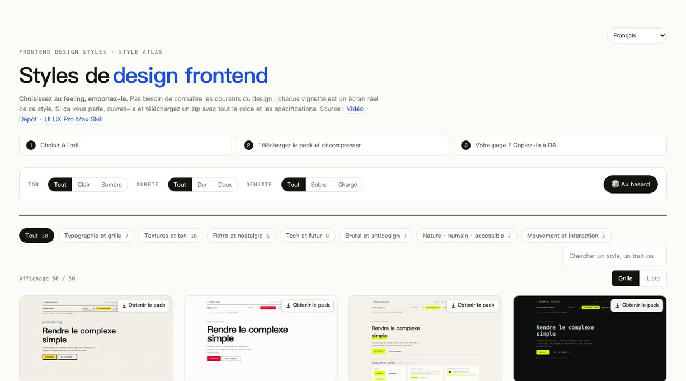
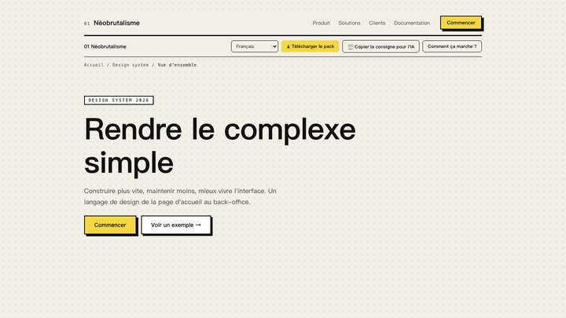
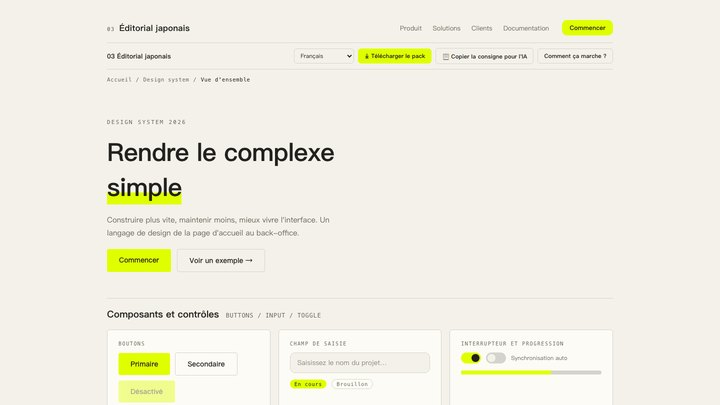
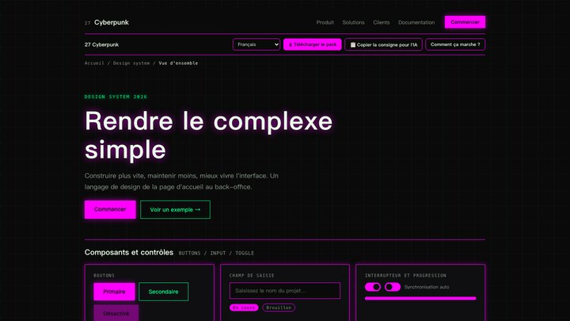
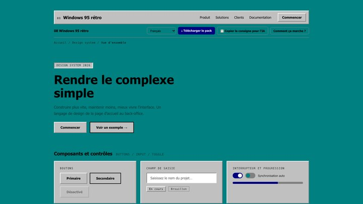
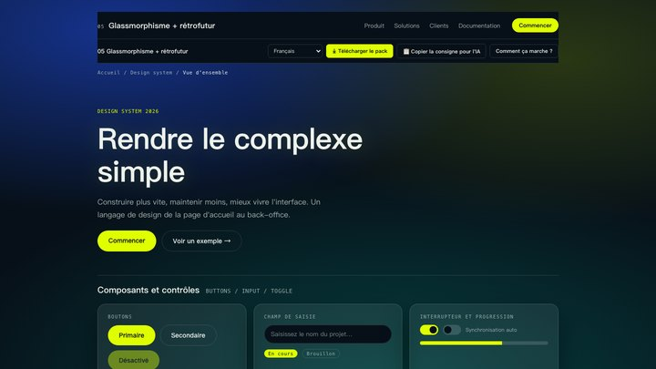
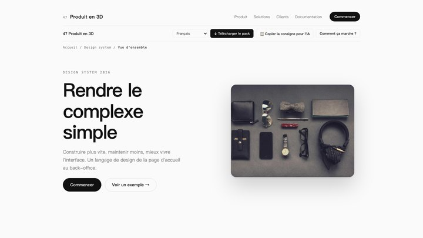

<p align="center">

**Langue** : [简体中文](https://github.com/1981yangcq/frontend-style-pack/blob/main/README.md) · [繁體中文](https://github.com/1981yangcq/frontend-style-pack/blob/main/docs/i18n/README.zh-TW.md) · [English](https://github.com/1981yangcq/frontend-style-pack/blob/main/docs/i18n/README.en.md) · [Español](https://github.com/1981yangcq/frontend-style-pack/blob/main/docs/i18n/README.es.md) · **Français** · [Português (BR)](https://github.com/1981yangcq/frontend-style-pack/blob/main/docs/i18n/README.pt-BR.md) · [Русский](https://github.com/1981yangcq/frontend-style-pack/blob/main/docs/i18n/README.ru.md) · [Deutsch](https://github.com/1981yangcq/frontend-style-pack/blob/main/docs/i18n/README.de.md) · [日本語](https://github.com/1981yangcq/frontend-style-pack/blob/main/docs/i18n/README.ja.md) · [한국어](https://github.com/1981yangcq/frontend-style-pack/blob/main/docs/i18n/README.ko.md)

</p>

<div align="center">

# Catalogue des styles de design frontend · Style Atlas

**Choisissez au feeling, emportez-le.**

50 styles de design frontend : chaque vignette est un rendu réel, et l'ouvrir donne une page
complète (page d'accueil + 105 composants). Un zip et vous repartez avec tout le code et les spécifications.



[**🌐 Aperçu en ligne**](https://1981yangcq.github.io/frontend-style-pack/?lang=fr) · [**🇨🇳 Miroir Chine**](https://sunsong.surge.sh?lang=fr) · [**⬇ Télécharger les packs**](https://github.com/1981yangcq/frontend-style-pack/releases/) · [**📖 L'utiliser avec l'IA**](../../specs/README.md)

</div>

---

## Cliquez pour ouvrir

> Les six sont de vraies captures. Cliquez sur l'une d'elles pour ouvrir la page complète de ce style (accueil + 105 composants).

| | | |
|---|---|---|
| <a href="https://1981yangcq.github.io/frontend-style-pack/demos/01-neo-brutalism.html?lang=fr"></a> | <a href="https://1981yangcq.github.io/frontend-style-pack/demos/03-japanese-editorial.html?lang=fr"></a> | <a href="https://1981yangcq.github.io/frontend-style-pack/demos/27-cyberpunk.html?lang=fr"></a> |
| <a href="https://1981yangcq.github.io/frontend-style-pack/demos/08-retro-win95.html?lang=fr"></a> | <a href="https://1981yangcq.github.io/frontend-style-pack/demos/05-glassmorphism-retro.html?lang=fr"></a> | <a href="https://1981yangcq.github.io/frontend-style-pack/demos/47-3d-product.html?lang=fr"></a> |

---

## Qu'est-ce que c'est

Le plus gros consommateur de temps en frontend n'est pas le code, c'est **décider à quoi ça ressemble** : parcourir Dribbble, fouiller Awwwards, recoller des bibliothèques de composants, accorder les couleurs.
Ici le style arrive en pack complet : un jeu de couleurs, un système de rayons et d'ombres, un jeu de composants. **On choisit, on utilise.**

| Qui vous êtes | Quoi faire |
|---|---|
| **Il me faut une page, vite** | Choisissez dans l'aperçu → téléchargez le zip → décompressez et ouvrez `demo.html` |
| **Je veux que l'IA la fasse** | Cliquez sur « Copier la consigne pour l'IA », collez-la et changez la dernière ligne |
| **Je vais toucher au code** | Le zip contient `spec.md` (fiche technique) et `theme.css` (tokens et composants prêts) |

> Pas besoin de savoir ce qu'est le « néobrutalisme ». Regardez, c'est tout.

---

## Trois étapes

1. **Choisir à l'œil** — filtrez par ton / dureté / densité, ou cliquez sur 🎲 Au hasard
2. **Télécharger le pack** — un zip arrive ; décompressez et ouvrez `怎么用.html` ou `demo.html`
3. **Créer votre page** — copiez la consigne pour l'IA, collez-la, changez la dernière ligne

---

## 50 styles

> « Aperçu » ouvre la page complète, « Télécharger » donne le zip.

| # | Style | En une phrase | Liens |
|---|---|---|---|
| 01 | **Néobrutalisme**<br><sub>Neo-Brutalism</sub> | Traite la page comme une matière brute : bordures noires épaisses et ombres dures qui disent l'honnêteté et la révolte. | [A⁠p⁠e⁠r⁠ç⁠u](https://1981yangcq.github.io/frontend-style-pack/?lang=frdemos/01-neo-brutalism.html) · [Télécharger](https://github.com/1981yangcq/frontend-style-pack/releases/latest/download/style-01-neo-brutalism.zip) |
| 02 | **Style suisse**<br><sub>Swiss Style</sub> | Né à Zurich et Bâle dans les années 1950 : remplacer tout ornement par une grille et une hiérarchie typographique. | [A⁠p⁠e⁠r⁠ç⁠u](https://1981yangcq.github.io/frontend-style-pack/?lang=frdemos/02-swiss-style.html) · [Télécharger](https://github.com/1981yangcq/frontend-style-pack/releases/latest/download/style-02-swiss-style.zip) |
| 03 | **Éditorial japonais**<br><sub>Japanese Editorial</sub> | Porte la maquette de magazine sur le web : papier chaud, filets très fins, un seul accent fluorescent. | [A⁠p⁠e⁠r⁠ç⁠u](https://1981yangcq.github.io/frontend-style-pack/?lang=frdemos/03-japanese-editorial.html) · [Télécharger](https://github.com/1981yangcq/frontend-style-pack/releases/latest/download/style-03-japanese-editorial.zip) |
| 04 | **Esthétique terminal**<br><sub>Terminal CLI Aesthetic</sub> | Met la ligne de commande dans le navigateur : monospace et voyants d'état pour une crédibilité d'ingénieur. | [A⁠p⁠e⁠r⁠ç⁠u](https://1981yangcq.github.io/frontend-style-pack/?lang=frdemos/04-terminal-cli.html) · [Télécharger](https://github.com/1981yangcq/frontend-style-pack/releases/latest/download/style-04-terminal-cli.zip) |
| 05 | **Glassmorphisme + rétrofutur**<br><sub>Glassmorphism + Retrofuturism</sub> | Cartes en verre dépoli sur un fond lumineux, avec des lignes de balayage CRT par-dessus : moitié premium, moitié nostalgie. | [A⁠p⁠e⁠r⁠ç⁠u](https://1981yangcq.github.io/frontend-style-pack/?lang=frdemos/05-glassmorphism-retro.html) · [Télécharger](https://github.com/1981yangcq/frontend-style-pack/releases/latest/download/style-05-glassmorphism-retro.zip) |
| 06 | **Voxel**<br><sub>Voxel Aesthetic</sub> | Un monde de blocs 16×16 devenu interface, comme ouvrir un jeu sandbox dans la page. | [A⁠p⁠e⁠r⁠ç⁠u](https://1981yangcq.github.io/frontend-style-pack/?lang=frdemos/06-voxel.html) · [Télécharger](https://github.com/1981yangcq/frontend-style-pack/releases/latest/download/style-06-voxel.zip) |
| 07 | **Neumorphisme**<br><sub>Neumorphism</sub> | Les éléments partagent la couleur du fond ; deux lumières, une claire et une sombre, font sortir la forme de la surface. | [A⁠p⁠e⁠r⁠ç⁠u](https://1981yangcq.github.io/frontend-style-pack/?lang=frdemos/07-neumorphism.html) · [Télécharger](https://github.com/1981yangcq/frontend-style-pack/releases/latest/download/style-07-neumorphism.zip) |
| 08 | **Windows 95 rétro**<br><sub>Retro Win95</sub> | Réplique fidèle du bureau de 1995 : fenêtres, barre des tâches et bouton démarrer. | [A⁠p⁠e⁠r⁠ç⁠u](https://1981yangcq.github.io/frontend-style-pack/?lang=frdemos/08-retro-win95.html) · [Télécharger](https://github.com/1981yangcq/frontend-style-pack/releases/latest/download/style-08-retro-win95.zip) |
| 09 | **Biophilique**<br><sub>Biophilic Design</sub> | Amène la lumière du soleil, les plantes et le papier fait main à l'écran pour que l'interface respire. | [A⁠p⁠e⁠r⁠ç⁠u](https://1981yangcq.github.io/frontend-style-pack/?lang=frdemos/09-biophilic.html) · [Télécharger](https://github.com/1981yangcq/frontend-style-pack/releases/latest/download/style-09-biophilic.zip) |
| 10 | **3D hyperréaliste**<br><sub>3D & Hyperrealism</sub> | Simule une vraie profondeur sur un plan avec perspective, ombres en couches et dégradés de matière. | [A⁠p⁠e⁠r⁠ç⁠u](https://1981yangcq.github.io/frontend-style-pack/?lang=frdemos/10-3d-hyperrealism.html) · [Télécharger](https://github.com/1981yangcq/frontend-style-pack/releases/latest/download/style-10-3d-hyperrealism.zip) |
| 11 | **Blocs vibrants**<br><sub>Vibrant & Block-based</sub> | Grands aplats, couleurs qui se heurtent et bordures épaisses : la page devient un mur de briques saturées. | [A⁠p⁠e⁠r⁠ç⁠u](https://1981yangcq.github.io/frontend-style-pack/?lang=frdemos/11-vibrant-block.html) · [Télécharger](https://github.com/1981yangcq/frontend-style-pack/releases/latest/download/style-11-vibrant-block.zip) |
| 12 | **Sombre OLED**<br><sub>Dark Mode OLED</sub> | Un schéma sombre réglé pour les dalles noir pur : noir véritable, luminosité contenue. | [A⁠p⁠e⁠r⁠ç⁠u](https://1981yangcq.github.io/frontend-style-pack/?lang=frdemos/12-dark-oled.html) · [Télécharger](https://github.com/1981yangcq/frontend-style-pack/releases/latest/download/style-12-dark-oled.zip) |
| 13 | **Accessible et éthique**<br><sub>Accessible & Ethical</sub> | La lisibilité et l'accès comme première esthétique : simple avant joli. | [A⁠p⁠e⁠r⁠ç⁠u](https://1981yangcq.github.io/frontend-style-pack/?lang=frdemos/13-accessible-ethical.html) · [Télécharger](https://github.com/1981yangcq/frontend-style-pack/releases/latest/download/style-13-accessible-ethical.zip) |
| 14 | **Argile**<br><sub>Claymorphism</sub> | Les éléments semblent modelés au doigt dans l'argile : doux, volumineux, sans une seule arête dure. | [A⁠p⁠e⁠r⁠ç⁠u](https://1981yangcq.github.io/frontend-style-pack/?lang=frdemos/14-claymorphism.html) · [Télécharger](https://github.com/1981yangcq/frontend-style-pack/releases/latest/download/style-14-claymorphism.zip) |
| 15 | **Aurora UI**<br><sub>Aurora UI</sub> | Des nappes d'aurore sur fond sombre derrière un verre dépoli : la recette récente du premium en SaaS. | [A⁠p⁠e⁠r⁠ç⁠u](https://1981yangcq.github.io/frontend-style-pack/?lang=frdemos/15-aurora-ui.html) · [Télécharger](https://github.com/1981yangcq/frontend-style-pack/releases/latest/download/style-15-aurora-ui.zip) |
| 16 | **Rétrofuturisme**<br><sub>Retro-Futurism</sub> | Le futur tel que les années 1980 l'imaginaient : violet spatial, rose néon et boutons qui brillent. | [A⁠p⁠e⁠r⁠ç⁠u](https://1981yangcq.github.io/frontend-style-pack/?lang=frdemos/16-retro-futurism.html) · [Télécharger](https://github.com/1981yangcq/frontend-style-pack/releases/latest/download/style-16-retro-futurism.zip) |
| 17 | **Design plat**<br><sub>Flat Design</sub> | Sans ombres, sans dégradés, sans textures : seulement couleur, forme et typographie. | [A⁠p⁠e⁠r⁠ç⁠u](https://1981yangcq.github.io/frontend-style-pack/?lang=frdemos/17-flat-design.html) · [Télécharger](https://github.com/1981yangcq/frontend-style-pack/releases/latest/download/style-17-flat-design.zip) |
| 18 | **Verre liquide**<br><sub>Liquid Glass</sub> | Le langage d'Apple 2025 : l'interface se comporte comme une couche de verre liquide qui réfracte l'arrière-plan. | [A⁠p⁠e⁠r⁠ç⁠u](https://1981yangcq.github.io/frontend-style-pack/?lang=frdemos/18-liquid-glass.html) · [Télécharger](https://github.com/1981yangcq/frontend-style-pack/releases/latest/download/style-18-liquid-glass.zip) |
| 19 | **Piloté par le mouvement**<br><sub>Motion-Driven</sub> | La page raconte presque tout par le mouvement : défilement, survol et transition sont le contenu. | [A⁠p⁠e⁠r⁠ç⁠u](https://1981yangcq.github.io/frontend-style-pack/?lang=frdemos/19-motion-driven.html) · [Télécharger](https://github.com/1981yangcq/frontend-style-pack/releases/latest/download/style-19-motion-driven.zip) |
| 20 | **Micro-interactions**<br><sub>Micro-interactions</sub> | Pas de spectacle : la juste dose de retour dans chaque bouton et chaque état. | [A⁠p⁠e⁠r⁠ç⁠u](https://1981yangcq.github.io/frontend-style-pack/?lang=frdemos/20-micro-interactions.html) · [Télécharger](https://github.com/1981yangcq/frontend-style-pack/releases/latest/download/style-20-micro-interactions.zip) |
| 21 | **Design inclusif**<br><sub>Inclusive Design</sub> | Suppose des différences visuelles, motrices et cognitives et construit une interface qui sert tout le monde. | [A⁠p⁠e⁠r⁠ç⁠u](https://1981yangcq.github.io/frontend-style-pack/?lang=frdemos/21-inclusive-design.html) · [Télécharger](https://github.com/1981yangcq/frontend-style-pack/releases/latest/download/style-21-inclusive-design.zip) |
| 22 | **Interface zéro**<br><sub>Zero Interface</sub> | L'interface disparaît presque, il reste le texte et l'espace. On interagit en parlant, pas en cliquant. | [A⁠p⁠e⁠r⁠ç⁠u](https://1981yangcq.github.io/frontend-style-pack/?lang=frdemos/22-zero-interface.html) · [Télécharger](https://github.com/1981yangcq/frontend-style-pack/releases/latest/download/style-22-zero-interface.zip) |
| 23 | **Évolution de l'UI douce**<br><sub>Soft UI Evolution</sub> | Le compromis entreprise entre neumorphisme et plat : un peu doux, jamais au prix de la clarté. | [A⁠p⁠e⁠r⁠ç⁠u](https://1981yangcq.github.io/frontend-style-pack/?lang=frdemos/23-soft-ui.html) · [Télécharger](https://github.com/1981yangcq/frontend-style-pack/releases/latest/download/style-23-soft-ui.zip) |
| 24 | **Néobrutalisme optimiste**<br><sub>Neubrutalism</sub> | Le brutalisme optimiste : fond crème, choc rouge-jaune et bordures noires épaisses, le réflexe des jeunes marques. | [A⁠p⁠e⁠r⁠ç⁠u](https://1981yangcq.github.io/frontend-style-pack/?lang=frdemos/24-neubrutalism.html) · [Télécharger](https://github.com/1981yangcq/frontend-style-pack/releases/latest/download/style-24-neubrutalism.zip) |
| 25 | **Grille bento**<br><sub>Bento Box Grid</sub> | Des cartes arrondies de tailles différentes assemblées comme un bento japonais, tout dire en un écran. | [A⁠p⁠e⁠r⁠ç⁠u](https://1981yangcq.github.io/frontend-style-pack/?lang=frdemos/25-bento-grid.html) · [Télécharger](https://github.com/1981yangcq/frontend-style-pack/releases/latest/download/style-25-bento-grid.zip) |
| 26 | **Esthétique Y2K**<br><sub>Y2K Aesthetic</sub> | L'idée du futur du millénaire : dégradés bleu glacé vers rose, éclat métallique et contrôles si ronds qu'ils brillent. | [A⁠p⁠e⁠r⁠ç⁠u](https://1981yangcq.github.io/frontend-style-pack/?lang=frdemos/26-y2k.html) · [Télécharger](https://github.com/1981yangcq/frontend-style-pack/releases/latest/download/style-26-y2k.zip) |
| 27 | **Cyberpunk**<br><sub>Cyberpunk UI</sub> | Néon très contrasté sur noir pur avec du glitch : la technologie dystopique comme langage visuel. | [A⁠p⁠e⁠r⁠ç⁠u](https://1981yangcq.github.io/frontend-style-pack/?lang=frdemos/27-cyberpunk.html) · [Télécharger](https://github.com/1981yangcq/frontend-style-pack/releases/latest/download/style-27-cyberpunk.zip) |
| 28 | **UI native IA**<br><sub>AI-Native UI</sub> | L'allure qu'ont prise les produits d'IA : dégradés bleu-violet, bords lumineux et composition conversationnelle. | [A⁠p⁠e⁠r⁠ç⁠u](https://1981yangcq.github.io/frontend-style-pack/?lang=frdemos/28-ai-native.html) · [Télécharger](https://github.com/1981yangcq/frontend-style-pack/releases/latest/download/style-28-ai-native.zip) |
| 29 | **Memphis**<br><sub>Memphis Design</sub> | Milan, 1981, contre le modernisme : géométrie, couleurs qui s'entrechoquent et pois, volontairement dissonant. | [A⁠p⁠e⁠r⁠ç⁠u](https://1981yangcq.github.io/frontend-style-pack/?lang=frdemos/29-memphis.html) · [Télécharger](https://github.com/1981yangcq/frontend-style-pack/releases/latest/download/style-29-memphis.zip) |
| 30 | **Vaporwave**<br><sub>Vaporwave</sub> | Musique synth des années 80 et résidu du consumérisme : néon rose avec un peu de vide dedans. | [A⁠p⁠e⁠r⁠ç⁠u](https://1981yangcq.github.io/frontend-style-pack/?lang=frdemos/30-vaporwave.html) · [Télécharger](https://github.com/1981yangcq/frontend-style-pack/releases/latest/download/style-30-vaporwave.zip) |
| 31 | **Couches dimensionnelles**<br><sub>Dimensional Layering</sub> | Des ombres progressives construisent un axe Z clair : chaque information a une distance. | [A⁠p⁠e⁠r⁠ç⁠u](https://1981yangcq.github.io/frontend-style-pack/?lang=frdemos/31-dimensional-layering.html) · [Télécharger](https://github.com/1981yangcq/frontend-style-pack/releases/latest/download/style-31-dimensional-layering.zip) |
| 32 | **Minimalisme exagéré**<br><sub>Exaggerated Minimalism</sub> | Le minimalisme poussé à l'extrême : la typographie remplit l'écran et rien d'autre ne reste. | [A⁠p⁠e⁠r⁠ç⁠u](https://1981yangcq.github.io/frontend-style-pack/?lang=frdemos/32-exaggerated-minimalism.html) · [Télécharger](https://github.com/1981yangcq/frontend-style-pack/releases/latest/download/style-32-exaggerated-minimalism.zip) |
| 33 | **Typographie cinétique**<br><sub>Kinetic Typography</sub> | La typographie est la vedette : échelle, rythme et animation pour un impact d'affiche. | [A⁠p⁠e⁠r⁠ç⁠u](https://1981yangcq.github.io/frontend-style-pack/?lang=frdemos/33-kinetic-typography.html) · [Télécharger](https://github.com/1981yangcq/frontend-style-pack/releases/latest/download/style-33-kinetic-typography.zip) |
| 34 | **Narration parallaxe**<br><sub>Parallax Storytelling</sub> | Raconte par les écarts de vitesse de défilement, comme un rouleau long avec de la profondeur. | [A⁠p⁠e⁠r⁠ç⁠u](https://1981yangcq.github.io/frontend-style-pack/?lang=frdemos/34-parallax-storytelling.html) · [Télécharger](https://github.com/1981yangcq/frontend-style-pack/releases/latest/download/style-34-parallax-storytelling.zip) |
| 35 | **Modernisme suisse 2.0**<br><sub>Swiss Modernism 2.0</sub> | Le style suisse à l'extrême : tout retirer, garder graisse, interligne et un seul filet. | [A⁠p⁠e⁠r⁠ç⁠u](https://1981yangcq.github.io/frontend-style-pack/?lang=frdemos/35-swiss-modernism-2.html) · [Télécharger](https://github.com/1981yangcq/frontend-style-pack/releases/latest/download/style-35-swiss-modernism-2.zip) |
| 36 | **HUD / FUI de science-fiction**<br><sub>HUD / Sci-Fi FUI</sub> | Le langage des consoles de vaisseau : lignes fines lumineuses, crochets d'angle et données qui défilent. | [A⁠p⁠e⁠r⁠ç⁠u](https://1981yangcq.github.io/frontend-style-pack/?lang=frdemos/36-hud-sci-fi.html) · [Télécharger](https://github.com/1981yangcq/frontend-style-pack/releases/latest/download/style-36-hud-sci-fi.zip) |
| 37 | **Grille bento 2.0**<br><sub>Bento Grids 2.0</sub> | La version jeune du bento : gris chaud, touches de rouge iPhone et rayons plus souples. | [A⁠p⁠e⁠r⁠ç⁠u](https://1981yangcq.github.io/frontend-style-pack/?lang=frdemos/37-bento-2.html) · [Télécharger](https://github.com/1981yangcq/frontend-style-pack/releases/latest/download/style-37-bento-2.zip) |
| 38 | **UI spatiale / visionOS**<br><sub>Spatial UI / VisionOS</sub> | Pensé pour les casques : des panneaux de verre suspendus dans l'air, avec épaisseur et lumière. | [A⁠p⁠e⁠r⁠ç⁠u](https://1981yangcq.github.io/frontend-style-pack/?lang=frdemos/38-spatial-ui.html) · [Télécharger](https://github.com/1981yangcq/frontend-style-pack/releases/latest/download/style-38-spatial-ui.zip) |
| 39 | **Encre électronique**<br><sub>E-Ink & Paper</sub> | Transforme l'écran en papier : blanc chaud, serif et sans ombre, pour lire longtemps. | [A⁠p⁠e⁠r⁠ç⁠u](https://1981yangcq.github.io/frontend-style-pack/?lang=frdemos/39-e-ink-paper.html) · [Télécharger](https://github.com/1981yangcq/frontend-style-pack/releases/latest/download/style-39-e-ink-paper.zip) |
| 40 | **Chaos génération Z**<br><sub>Gen Z Chaos / Maximalism</sub> | Le désordre soigneusement conçu : saturation, décalage et stickers contre le raffinement. | [A⁠p⁠e⁠r⁠ç⁠u](https://1981yangcq.github.io/frontend-style-pack/?lang=frdemos/40-genz-chaos.html) · [Télécharger](https://github.com/1981yangcq/frontend-style-pack/releases/latest/download/style-40-genz-chaos.zip) |
| 41 | **Biomimétique 2.0**<br><sub>Biomimetic / Organic 2.0</sub> | N'emprunte pas les couleurs de la nature mais sa logique de croissance et sa structure. | [A⁠p⁠e⁠r⁠ç⁠u](https://1981yangcq.github.io/frontend-style-pack/?lang=frdemos/41-biomimetic.html) · [Télécharger](https://github.com/1981yangcq/frontend-style-pack/releases/latest/download/style-41-biomimetic.zip) |
| 42 | **Antipoli**<br><sub>Anti-Polish / Raw Aesthetic</sub> | Délibérément sans design : cadres pointillés, police système et rayon zéro, comme une maquette publiée. | [A⁠p⁠e⁠r⁠ç⁠u](https://1981yangcq.github.io/frontend-style-pack/?lang=frdemos/42-anti-polish-raw.html) · [Télécharger](https://github.com/1981yangcq/frontend-style-pack/releases/latest/download/style-42-anti-polish-raw.zip) |
| 43 | **Tactile numérique**<br><sub>Tactile Digital / Deformable UI</sub> | Fait ressentir ce qui est à l'écran comme du papier, du tissu ou du bois par l'épaisseur et la déformation. | [A⁠p⁠e⁠r⁠ç⁠u](https://1981yangcq.github.io/frontend-style-pack/?lang=frdemos/43-tactile-digital.html) · [Télécharger](https://github.com/1981yangcq/frontend-style-pack/releases/latest/download/style-43-tactile-digital.zip) |
| 44 | **Nature distillée**<br><sub>Nature Distilled</sub> | Ni feuilles ni montagnes : la nature réduite à la proportion, à la température de couleur et à un vert contenu. | [A⁠p⁠e⁠r⁠ç⁠u](https://1981yangcq.github.io/frontend-style-pack/?lang=frdemos/44-nature-distilled.html) · [Télécharger](https://github.com/1981yangcq/frontend-style-pack/releases/latest/download/style-44-nature-distilled.zip) |
| 45 | **Interaction au curseur**<br><sub>Interactive Cursor Design</sub> | Le pointeur devient la vedette : viseur, traînée et magnétisme ; le curseur est la navigation. | [A⁠p⁠e⁠r⁠ç⁠u](https://1981yangcq.github.io/frontend-style-pack/?lang=frdemos/45-interactive-cursor.html) · [Télécharger](https://github.com/1981yangcq/frontend-style-pack/releases/latest/download/style-45-interactive-cursor.zip) |
| 46 | **Voix d'abord**<br><sub>Voice-First Multimodal</sub> | Pensé pour parler : une entrée, un anneau de son et tout le reste s'efface. | [A⁠p⁠e⁠r⁠ç⁠u](https://1981yangcq.github.io/frontend-style-pack/?lang=frdemos/46-voice-first.html) · [Télécharger](https://github.com/1981yangcq/frontend-style-pack/releases/latest/download/style-46-voice-first.zip) |
| 47 | **Produit en 3D**<br><sub>3D Product Preview</sub> | Place le produit devant un mur sans ombre, comme en studio, et le modèle 3D est tout le contenu. | [A⁠p⁠e⁠r⁠ç⁠u](https://1981yangcq.github.io/frontend-style-pack/?lang=frdemos/47-3d-product.html) · [Télécharger](https://github.com/1981yangcq/frontend-style-pack/releases/latest/download/style-47-3d-product.zip) |
| 48 | **Maillage de dégradés**<br><sub>Gradient Mesh / Aurora Evolved</sub> | L'aurore évoluée : plusieurs champs de couleur tissés en un maillage qui respire. | [A⁠p⁠e⁠r⁠ç⁠u](https://1981yangcq.github.io/frontend-style-pack/?lang=frdemos/48-gradient-mesh.html) · [Télécharger](https://github.com/1981yangcq/frontend-style-pack/releases/latest/download/style-48-gradient-mesh.zip) |
| 49 | **Séparation RVB**<br><sub>Chromatic Aberration / RGB Split</sub> | Fait de l'aberration chromatique, un défaut, un langage : rouge, vert et bleu décalés. | [A⁠p⁠e⁠r⁠ç⁠u](https://1981yangcq.github.io/frontend-style-pack/?lang=frdemos/49-chromatic-aberration.html) · [Télécharger](https://github.com/1981yangcq/frontend-style-pack/releases/latest/download/style-49-chromatic-aberration.zip) |
| 50 | **Pellicule vintage**<br><sub>Vintage Analog / Retro Film</sub> | L'atmosphère des vieilles photos et des vieux livres : jaunes oxydés, grain de pellicule et tons bruns. | [A⁠p⁠e⁠r⁠ç⁠u](https://1981yangcq.github.io/frontend-style-pack/?lang=frdemos/50-vintage-film.html) · [Télécharger](https://github.com/1981yangcq/frontend-style-pack/releases/latest/download/style-50-vintage-film.zip) |

---

## Contenu d'un pack

| Fichier | Contenu |
|---|---|
| `怎么用.html` | **À lire en premier** — trois étapes, s'ouvre dans le navigateur |
| `demo.html` | La page d'exemple complète : accueil + 105 composants, un seul fichier |
| `给AI的话.txt` | La consigne pour l'IA, couleurs et interdits déjà remplis |
| `spec.md` | Fiche technique : tokens, procédés obligatoires, interdits, seuil d'accessibilité |
| `spec.json` | La même chose, lisible par machine |
| `theme.css` | Feuille de styles générée depuis les tokens, prête à `@import` |
| `preview.jpg` | Capture du premier écran |
| `assets/` | Photos du demo (incluses, fonctionnent hors ligne) |

---

## L'utiliser avec l'IA (sans télécharger)

Sans zip, utilisez le bundle :

- [`styles-bundle.md`](styles-bundle.md) — les spécifications de tous les styles, en un seul collage
- [`styles-bundle.json`](styles-bundle.json) — version lisible par machine
- [`specs/README.md`](specs/README.md) — comment l'alimenter, trois niveaux, liste d'acceptation

```
Voici la bibliothèque de spécifications de Catalogue des styles de design frontend. N'utilise que celui que j'indique.
[Style] 27 / Cyberpunk
[Ce qu'il me faut] Une landing pour un café avec accroche, trois arguments et grille tarifaire
```

---

## Lancer en local

100 % statique, sans dépendance : ouvrez `index.html`. Pour régénérer après un changement de style :

```bash
pip install pillow
python build_demos.py      # 50 页
python build_thumbs.py
python build_zips.py
python build.py            # 首页
```

---

## Ajouter un style

Voir [CONTRIBUTING.md](CONTRIBUTING.md). Trois étapes :

1. Ajouter une ligne dans `styles.json` (nom / une phrase / groupe / sites de référence)
2. Ajouter un jeu de tokens dans `themes.py` (couleur / rayon / ombre / typographie)
3. Lancer `build_demos.py` : si la page se génère, c'est bon

Une fois fusionné, il apparaît seul sur le site et dans le bundle IA.

---

## Licence et crédits

- **Code** (générateurs, CSS, HTML) : [MIT](LICENSE)
- **Textes / fiches / matrice de composants** : CC BY 4.0
- **Liste des styles** d'après la vidéo Bilibili et son dépôt (MIT), [UI UX Pro Max Skill](https://github.com/nextlevelbuilder/ui-ux-pro-max-skill) (MIT)
- **Implémentation des demos / fiches / vue des composants / packs** : originaux de ce dépôt
- **Photos** de [picsum.photos](https://picsum.photos) (Unsplash), simples remplacements — à changer pour un usage commercial
