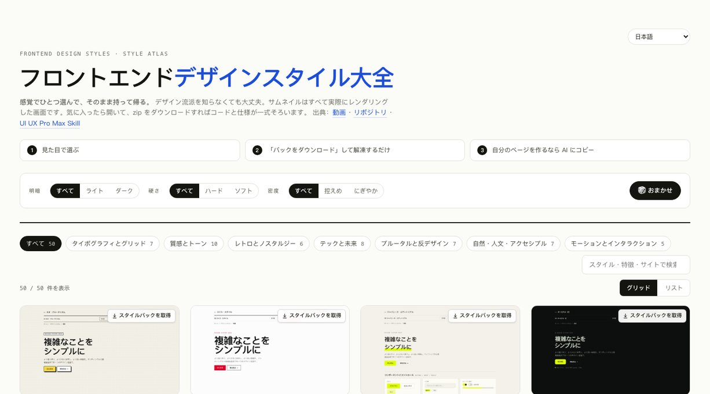
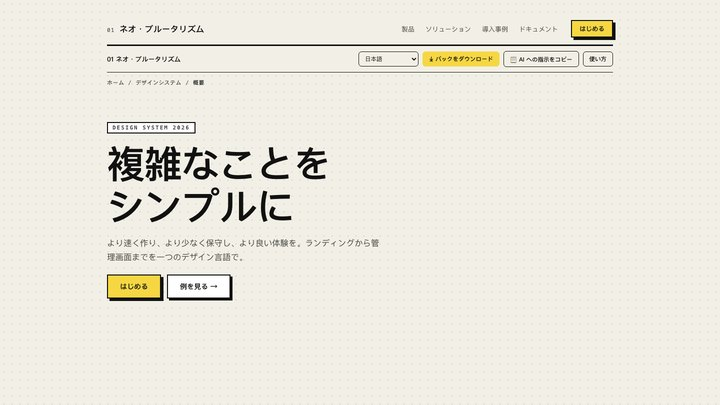
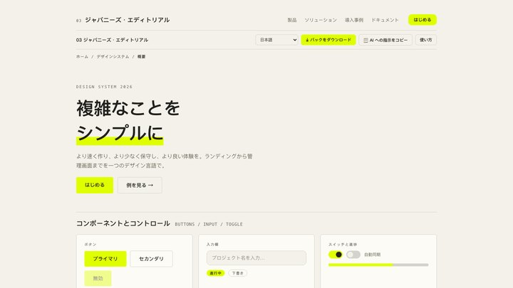
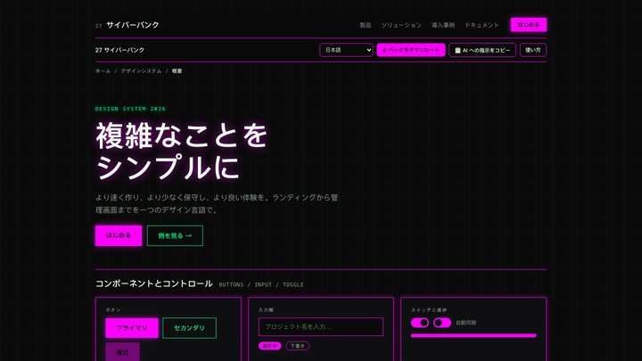
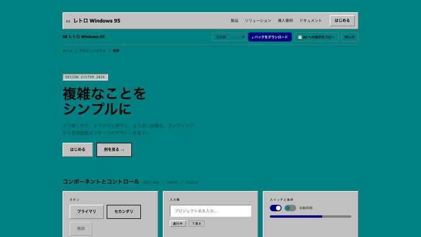
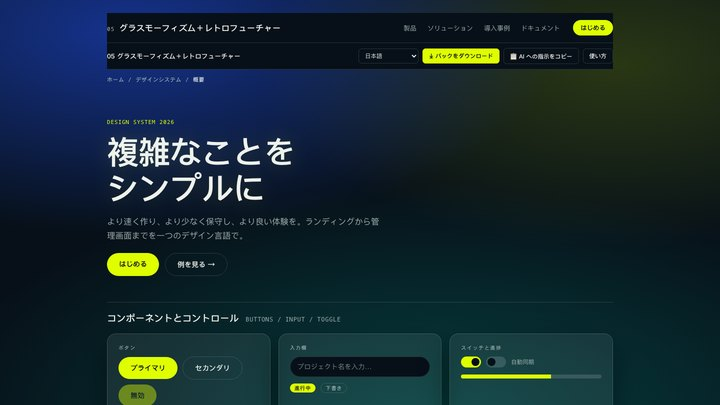
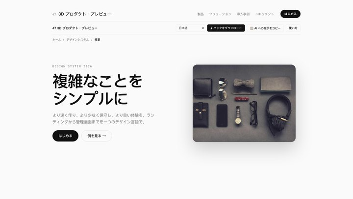

<p align="center">

**言語**：[简体中文](https://github.com/1981yangcq/frontend-style-pack/blob/main/README.md) · [繁體中文](https://github.com/1981yangcq/frontend-style-pack/blob/main/docs/i18n/README.zh-TW.md) · [English](https://github.com/1981yangcq/frontend-style-pack/blob/main/docs/i18n/README.en.md) · [Español](https://github.com/1981yangcq/frontend-style-pack/blob/main/docs/i18n/README.es.md) · [Français](https://github.com/1981yangcq/frontend-style-pack/blob/main/docs/i18n/README.fr.md) · [Português (BR)](https://github.com/1981yangcq/frontend-style-pack/blob/main/docs/i18n/README.pt-BR.md) · [Русский](https://github.com/1981yangcq/frontend-style-pack/blob/main/docs/i18n/README.ru.md) · [Deutsch](https://github.com/1981yangcq/frontend-style-pack/blob/main/docs/i18n/README.de.md) · **日本語** · [한국어](https://github.com/1981yangcq/frontend-style-pack/blob/main/docs/i18n/README.ko.md)

</p>

<div align="center">

# フロントエンドデザインスタイル大全 · Style Atlas

**感覚でひとつ選んで、そのまま持って帰る。**

フロントエンドのデザインスタイル 50 種。サムネイルはすべて実際に描画した画面で、開けばそのまま
完全なページ（ランディング + 105 コンポーネント）になります。zip をひとつ落とせば、コードと仕様が一式そろいます。



[**🌐 オンラインプレビュー**](https://1981yangcq.github.io/frontend-style-pack/?lang=ja) · [**🇨🇳 中国ミラー**](https://sunsong.surge.sh?lang=ja) · [**⬇ スタイルパックを取得**](https://github.com/1981yangcq/frontend-style-pack/releases/) · [**📖 AI での使い方**](../../specs/README.md)

</div>

---

## タップして開く

> 6 枚はすべて実際のスクリーンショットです。どれかをタップすると、そのスタイルの完全なページ（ランディング + 105 コンポーネント）が開きます。

| | | |
|---|---|---|
| <a href="https://1981yangcq.github.io/frontend-style-pack/demos/01-neo-brutalism.html?lang=ja"></a> | <a href="https://1981yangcq.github.io/frontend-style-pack/demos/03-japanese-editorial.html?lang=ja"></a> | <a href="https://1981yangcq.github.io/frontend-style-pack/demos/27-cyberpunk.html?lang=ja"></a> |
| <a href="https://1981yangcq.github.io/frontend-style-pack/demos/08-retro-win95.html?lang=ja"></a> | <a href="https://1981yangcq.github.io/frontend-style-pack/demos/05-glassmorphism-retro.html?lang=ja"></a> | <a href="https://1981yangcq.github.io/frontend-style-pack/demos/47-3d-product.html?lang=ja"></a> |

---

## これは何か

フロントエンドで一番時間を食うのは、コードを書くことではなく **見た目を決めること** です。Dribbble を眺め、Awwwards を漁り、コンポーネントを継ぎ合わせ、色を合わせる……。
ここではスタイルを一式で用意しました。配色一式、角丸と影の一式、コンポーネント一式。**選んだらそのまま使えます。**

| あなた | やること |
|---|---|
| **とにかく早く 1 ページ欲しい** | プレビューで選ぶ → zip を落とす → 解凍して `demo.html` を開く |
| **AI に作らせたい** | 「AI への指示をコピー」を押し、任意の AI に貼り付けて最後の行を自分の要望に変える |
| **コードを自分で直す** | zip に `spec.md`（仕様カード）と `theme.css`（変数とコンポーネント）が入っています |

> 「ネオ・ブルータリズム」を知らなくても大丈夫。見た目で選べます。

---

## 3 ステップ

1. **見た目で選ぶ** —— トップで明暗／硬さ／密度で絞り込むか、🎲 おまかせを押す
2. **パックを落とす** —— zip が届きます。解凍して `怎么用.html`（使い方）か `demo.html` を開く
3. **自分のページを作る** —— AI への指示をコピーして貼り、最後の行だけ変える

---

## 50 種のスタイル

> 「プレビュー」で完全なページ、「ダウンロード」で zip が手に入ります。

| # | スタイル | ひとこと | リンク |
|---|---|---|---|
| 01 | **ネオ・ブルータリズム**<br><sub>Neo-Brutalism</sub> | 未加工の素材としてページを扱う。太い黒枠と硬いオフセット影で、誠実さと反発を表す。 | [プ⁠レ⁠ビ⁠ュ⁠ー](https://1981yangcq.github.io/frontend-style-pack/?lang=jademos/01-neo-brutalism.html) · [ダ⁠ウ⁠ン⁠ロ⁠ー⁠ド](https://github.com/1981yangcq/frontend-style-pack/releases/latest/download/style-01-neo-brutalism.zip) |
| 02 | **スイス・スタイル**<br><sub>Swiss Style</sub> | 1950 年代のチューリッヒとバーゼル発。装飾をすべてグリッドと文字階層に置き換える。 | [プ⁠レ⁠ビ⁠ュ⁠ー](https://1981yangcq.github.io/frontend-style-pack/?lang=jademos/02-swiss-style.html) · [ダ⁠ウ⁠ン⁠ロ⁠ー⁠ド](https://github.com/1981yangcq/frontend-style-pack/releases/latest/download/style-02-swiss-style.zip) |
| 03 | **ジャパニーズ・エディトリアル**<br><sub>Japanese Editorial</sub> | 雑誌の組版をそのままウェブへ。温かい紙色、極細の罫線、蛍光色を一点だけ。 | [プ⁠レ⁠ビ⁠ュ⁠ー](https://1981yangcq.github.io/frontend-style-pack/?lang=jademos/03-japanese-editorial.html) · [ダ⁠ウ⁠ン⁠ロ⁠ー⁠ド](https://github.com/1981yangcq/frontend-style-pack/releases/latest/download/style-03-japanese-editorial.zip) |
| 04 | **ターミナル UI**<br><sub>Terminal CLI Aesthetic</sub> | コマンドラインをブラウザへ。等幅書体とステータス LED でエンジニアらしい信頼感をつくる。 | [プ⁠レ⁠ビ⁠ュ⁠ー](https://1981yangcq.github.io/frontend-style-pack/?lang=jademos/04-terminal-cli.html) · [ダ⁠ウ⁠ン⁠ロ⁠ー⁠ド](https://github.com/1981yangcq/frontend-style-pack/releases/latest/download/style-04-terminal-cli.zip) |
| 05 | **グラスモーフィズム＋レトロフューチャー**<br><sub>Glassmorphism + Retrofuturism</sub> | 発光する背景にすりガラスのカードを浮かべ、CRT の走査線を重ねる。上質さと郷愁のあいだ。 | [プ⁠レ⁠ビ⁠ュ⁠ー](https://1981yangcq.github.io/frontend-style-pack/?lang=jademos/05-glassmorphism-retro.html) · [ダ⁠ウ⁠ン⁠ロ⁠ー⁠ド](https://github.com/1981yangcq/frontend-style-pack/releases/latest/download/style-05-glassmorphism-retro.zip) |
| 06 | **ヴォクセル**<br><sub>Voxel Aesthetic</sub> | 16×16 のブロック世界をそのまま UI に。ブラウザの中でサンドボックスゲームを開く感覚。 | [プ⁠レ⁠ビ⁠ュ⁠ー](https://1981yangcq.github.io/frontend-style-pack/?lang=jademos/06-voxel.html) · [ダ⁠ウ⁠ン⁠ロ⁠ー⁠ド](https://github.com/1981yangcq/frontend-style-pack/releases/latest/download/style-06-voxel.zip) |
| 07 | **ニューモーフィズム**<br><sub>Neumorphism</sub> | 要素と背景を同じ色にし、明と暗の二つの光だけで立体を押し出す。 | [プ⁠レ⁠ビ⁠ュ⁠ー](https://1981yangcq.github.io/frontend-style-pack/?lang=jademos/07-neumorphism.html) · [ダ⁠ウ⁠ン⁠ロ⁠ー⁠ド](https://github.com/1981yangcq/frontend-style-pack/releases/latest/download/style-07-neumorphism.zip) |
| 08 | **レトロ Windows 95**<br><sub>Retro Win95</sub> | 1995 年のデスクトップを忠実に再現。ウィンドウ、タスクバー、スタートボタンまですべて。 | [プ⁠レ⁠ビ⁠ュ⁠ー](https://1981yangcq.github.io/frontend-style-pack/?lang=jademos/08-retro-win95.html) · [ダ⁠ウ⁠ン⁠ロ⁠ー⁠ド](https://github.com/1981yangcq/frontend-style-pack/releases/latest/download/style-08-retro-win95.zip) |
| 09 | **バイオフィリック**<br><sub>Biophilic Design</sub> | 陽だまり、植物、手漉き紙の質感を画面へ。UI が呼吸するように見える。 | [プ⁠レ⁠ビ⁠ュ⁠ー](https://1981yangcq.github.io/frontend-style-pack/?lang=jademos/09-biophilic.html) · [ダ⁠ウ⁠ン⁠ロ⁠ー⁠ド](https://github.com/1981yangcq/frontend-style-pack/releases/latest/download/style-09-biophilic.zip) |
| 10 | **3D ハイパーリアル**<br><sub>3D & Hyperrealism</sub> | 遠近法と多層の影、素材のグラデーションで、平面の上に本物の奥行きを偽装する。 | [プ⁠レ⁠ビ⁠ュ⁠ー](https://1981yangcq.github.io/frontend-style-pack/?lang=jademos/10-3d-hyperrealism.html) · [ダ⁠ウ⁠ン⁠ロ⁠ー⁠ド](https://github.com/1981yangcq/frontend-style-pack/releases/latest/download/style-10-3d-hyperrealism.zip) |
| 11 | **ビビッド・ブロック**<br><sub>Vibrant & Block-based</sub> | 大きな色面、ぶつかる色、太い枠。ページを彩度の高い積み木にする。 | [プ⁠レ⁠ビ⁠ュ⁠ー](https://1981yangcq.github.io/frontend-style-pack/?lang=jademos/11-vibrant-block.html) · [ダ⁠ウ⁠ン⁠ロ⁠ー⁠ド](https://github.com/1981yangcq/frontend-style-pack/releases/latest/download/style-11-vibrant-block.zip) |
| 12 | **OLED ダーク**<br><sub>Dark Mode OLED</sub> | 純黒のパネルのために調整した暗色。とことん黒く、輝度は控えめに。 | [プ⁠レ⁠ビ⁠ュ⁠ー](https://1981yangcq.github.io/frontend-style-pack/?lang=jademos/12-dark-oled.html) · [ダ⁠ウ⁠ン⁠ロ⁠ー⁠ド](https://github.com/1981yangcq/frontend-style-pack/releases/latest/download/style-12-dark-oled.zip) |
| 13 | **アクセシブル・エシカル**<br><sub>Accessible & Ethical</sub> | 読みやすさと到達しやすさを第一の美学に。飾るより、使えることを優先する。 | [プ⁠レ⁠ビ⁠ュ⁠ー](https://1981yangcq.github.io/frontend-style-pack/?lang=jademos/13-accessible-ethical.html) · [ダ⁠ウ⁠ン⁠ロ⁠ー⁠ド](https://github.com/1981yangcq/frontend-style-pack/releases/latest/download/style-13-accessible-ethical.zip) |
| 14 | **クレイモーフィズム**<br><sub>Claymorphism</sub> | 指でこねた粘土のような要素。柔らかく、厚みがあり、硬い縁が一本もない。 | [プ⁠レ⁠ビ⁠ュ⁠ー](https://1981yangcq.github.io/frontend-style-pack/?lang=jademos/14-claymorphism.html) · [ダ⁠ウ⁠ン⁠ロ⁠ー⁠ド](https://github.com/1981yangcq/frontend-style-pack/releases/latest/download/style-14-claymorphism.zip) |
| 15 | **オーロラ UI**<br><sub>Aurora UI</sub> | 暗い下地に流れるオーロラを、すりガラス越しに見せる。最近の SaaS の「上質さ」の型。 | [プ⁠レ⁠ビ⁠ュ⁠ー](https://1981yangcq.github.io/frontend-style-pack/?lang=jademos/15-aurora-ui.html) · [ダ⁠ウ⁠ン⁠ロ⁠ー⁠ド](https://github.com/1981yangcq/frontend-style-pack/releases/latest/download/style-15-aurora-ui.zip) |
| 16 | **レトロフューチャー**<br><sub>Retro-Futurism</sub> | 80 年代が思い描いた未来。スペース紫、ネオンピンク、光るボタン。 | [プ⁠レ⁠ビ⁠ュ⁠ー](https://1981yangcq.github.io/frontend-style-pack/?lang=jademos/16-retro-futurism.html) · [ダ⁠ウ⁠ン⁠ロ⁠ー⁠ド](https://github.com/1981yangcq/frontend-style-pack/releases/latest/download/style-16-retro-futurism.zip) |
| 17 | **フラットデザイン**<br><sub>Flat Design</sub> | 影もグラデーションも質感も捨て、色と形と文字だけを残す。 | [プ⁠レ⁠ビ⁠ュ⁠ー](https://1981yangcq.github.io/frontend-style-pack/?lang=jademos/17-flat-design.html) · [ダ⁠ウ⁠ン⁠ロ⁠ー⁠ド](https://github.com/1981yangcq/frontend-style-pack/releases/latest/download/style-17-flat-design.zip) |
| 18 | **リキッドグラス**<br><sub>Liquid Glass</sub> | Apple 2025 年のデザイン言語。背景を屈折させる液体ガラスの層のように振る舞う。 | [プ⁠レ⁠ビ⁠ュ⁠ー](https://1981yangcq.github.io/frontend-style-pack/?lang=jademos/18-liquid-glass.html) · [ダ⁠ウ⁠ン⁠ロ⁠ー⁠ド](https://github.com/1981yangcq/frontend-style-pack/releases/latest/download/style-18-liquid-glass.zip) |
| 19 | **モーション・ドリブン**<br><sub>Motion-Driven</sub> | ページのほぼすべてを動きで語る。スクロール、ホバー、遷移そのものが内容になる。 | [プ⁠レ⁠ビ⁠ュ⁠ー](https://1981yangcq.github.io/frontend-style-pack/?lang=jademos/19-motion-driven.html) · [ダ⁠ウ⁠ン⁠ロ⁠ー⁠ド](https://github.com/1981yangcq/frontend-style-pack/releases/latest/download/style-19-motion-driven.zip) |
| 20 | **マイクロインタラクション**<br><sub>Micro-interactions</sub> | 派手さは狙わず、ボタン一つ、状態一つにちょうどよい反応を入れる。 | [プ⁠レ⁠ビ⁠ュ⁠ー](https://1981yangcq.github.io/frontend-style-pack/?lang=jademos/20-micro-interactions.html) · [ダ⁠ウ⁠ン⁠ロ⁠ー⁠ド](https://github.com/1981yangcq/frontend-style-pack/releases/latest/download/style-20-micro-interactions.zip) |
| 21 | **インクルーシブデザイン**<br><sub>Inclusive Design</sub> | 視覚・運動・認知の違いを前提に、全員が同じ UI を使えるようにする。 | [プ⁠レ⁠ビ⁠ュ⁠ー](https://1981yangcq.github.io/frontend-style-pack/?lang=jademos/21-inclusive-design.html) · [ダ⁠ウ⁠ン⁠ロ⁠ー⁠ド](https://github.com/1981yangcq/frontend-style-pack/releases/latest/download/style-21-inclusive-design.zip) |
| 22 | **ゼロ・インターフェース**<br><sub>Zero Interface</sub> | UI をほとんど消し、文字と余白だけを残す。操作はクリックより対話で。 | [プ⁠レ⁠ビ⁠ュ⁠ー](https://1981yangcq.github.io/frontend-style-pack/?lang=jademos/22-zero-interface.html) · [ダ⁠ウ⁠ン⁠ロ⁠ー⁠ド](https://github.com/1981yangcq/frontend-style-pack/releases/latest/download/style-22-zero-interface.zip) |
| 23 | **ソフト UI エボリューション**<br><sub>Soft UI Evolution</sub> | ニューモーフィズムとフラットの企業向け中間解。少し柔らかく、明快さは犠牲にしない。 | [プ⁠レ⁠ビ⁠ュ⁠ー](https://1981yangcq.github.io/frontend-style-pack/?lang=jademos/23-soft-ui.html) · [ダ⁠ウ⁠ン⁠ロ⁠ー⁠ド](https://github.com/1981yangcq/frontend-style-pack/releases/latest/download/style-23-soft-ui.zip) |
| 24 | **ニューブルータリズム**<br><sub>Neubrutalism</sub> | ブルータリズムの楽観版。クリーム地に赤黄のぶつかり、太い黒枠。若いブランドの定番。 | [プ⁠レ⁠ビ⁠ュ⁠ー](https://1981yangcq.github.io/frontend-style-pack/?lang=jademos/24-neubrutalism.html) · [ダ⁠ウ⁠ン⁠ロ⁠ー⁠ド](https://github.com/1981yangcq/frontend-style-pack/releases/latest/download/style-24-neubrutalism.zip) |
| 25 | **弁当グリッド**<br><sub>Bento Box Grid</sub> | 大きさの違う角丸カードを弁当箱のように組み、一画面で売り切る。 | [プ⁠レ⁠ビ⁠ュ⁠ー](https://1981yangcq.github.io/frontend-style-pack/?lang=jademos/25-bento-grid.html) · [ダ⁠ウ⁠ン⁠ロ⁠ー⁠ド](https://github.com/1981yangcq/frontend-style-pack/releases/latest/download/style-25-bento-grid.zip) |
| 26 | **Y2K 美学**<br><sub>Y2K Aesthetic</sub> | 2000 年代の未来像。アイスブルーからピンクのグラデーション、金属の輝き、光るほど丸い UI。 | [プ⁠レ⁠ビ⁠ュ⁠ー](https://1981yangcq.github.io/frontend-style-pack/?lang=jademos/26-y2k.html) · [ダ⁠ウ⁠ン⁠ロ⁠ー⁠ド](https://github.com/1981yangcq/frontend-style-pack/releases/latest/download/style-26-y2k.zip) |
| 27 | **サイバーパンク**<br><sub>Cyberpunk UI</sub> | 純黒に高コントラストのネオン、そしてグリッチ。ディストピアの技術を視覚言語にする。 | [プ⁠レ⁠ビ⁠ュ⁠ー](https://1981yangcq.github.io/frontend-style-pack/?lang=jademos/27-cyberpunk.html) · [ダ⁠ウ⁠ン⁠ロ⁠ー⁠ド](https://github.com/1981yangcq/frontend-style-pack/releases/latest/download/style-27-cyberpunk.zip) |
| 28 | **AI ネイティブ UI**<br><sub>AI-Native UI</sub> | AI 製品から生まれた見た目。青紫のグラデーション、発光する縁、対話優先のレイアウト。 | [プ⁠レ⁠ビ⁠ュ⁠ー](https://1981yangcq.github.io/frontend-style-pack/?lang=jademos/28-ai-native.html) · [ダ⁠ウ⁠ン⁠ロ⁠ー⁠ド](https://github.com/1981yangcq/frontend-style-pack/releases/latest/download/style-28-ai-native.zip) |
| 29 | **メンフィス**<br><sub>Memphis Design</sub> | 1981 年ミラノの反モダニズム。幾何学、ぶつかる色、ドット。わざと調和させない。 | [プ⁠レ⁠ビ⁠ュ⁠ー](https://1981yangcq.github.io/frontend-style-pack/?lang=jademos/29-memphis.html) · [ダ⁠ウ⁠ン⁠ロ⁠ー⁠ド](https://github.com/1981yangcq/frontend-style-pack/releases/latest/download/style-29-memphis.zip) |
| 30 | **ヴェイパーウェイブ**<br><sub>Vaporwave</sub> | 80 年代のシンセ音楽と消費社会の残像。ピンクのネオンに少しの虚無。 | [プ⁠レ⁠ビ⁠ュ⁠ー](https://1981yangcq.github.io/frontend-style-pack/?lang=jademos/30-vaporwave.html) · [ダ⁠ウ⁠ン⁠ロ⁠ー⁠ド](https://github.com/1981yangcq/frontend-style-pack/releases/latest/download/style-30-vaporwave.zip) |
| 31 | **ディメンショナル・レイヤリング**<br><sub>Dimensional Layering</sub> | 段階的な影で明確な Z 軸をつくり、情報に「どれだけ遠いか」を与える。 | [プ⁠レ⁠ビ⁠ュ⁠ー](https://1981yangcq.github.io/frontend-style-pack/?lang=jademos/31-dimensional-layering.html) · [ダ⁠ウ⁠ン⁠ロ⁠ー⁠ド](https://github.com/1981yangcq/frontend-style-pack/releases/latest/download/style-31-dimensional-layering.zip) |
| 32 | **過剰なミニマリズム**<br><sub>Exaggerated Minimalism</sub> | ミニマルを極端まで押し上げ、文字が画面を埋め尽くし、他には何も残らない。 | [プ⁠レ⁠ビ⁠ュ⁠ー](https://1981yangcq.github.io/frontend-style-pack/?lang=jademos/32-exaggerated-minimalism.html) · [ダ⁠ウ⁠ン⁠ロ⁠ー⁠ド](https://github.com/1981yangcq/frontend-style-pack/releases/latest/download/style-32-exaggerated-minimalism.zip) |
| 33 | **キネティック・タイポグラフィ**<br><sub>Kinetic Typography</sub> | 文字そのものを主役に。大きさ、リズム、動きでポスター級の衝撃をつくる。 | [プ⁠レ⁠ビ⁠ュ⁠ー](https://1981yangcq.github.io/frontend-style-pack/?lang=jademos/33-kinetic-typography.html) · [ダ⁠ウ⁠ン⁠ロ⁠ー⁠ド](https://github.com/1981yangcq/frontend-style-pack/releases/latest/download/style-33-kinetic-typography.zip) |
| 34 | **パララックス・ストーリーテリング**<br><sub>Parallax Storytelling</sub> | スクロール速度の差で物語る。奥行きのある長い巻物をめくるように。 | [プ⁠レ⁠ビ⁠ュ⁠ー](https://1981yangcq.github.io/frontend-style-pack/?lang=jademos/34-parallax-storytelling.html) · [ダ⁠ウ⁠ン⁠ロ⁠ー⁠ド](https://github.com/1981yangcq/frontend-style-pack/releases/latest/download/style-34-parallax-storytelling.zip) |
| 35 | **スイス・モダニズム 2.0**<br><sub>Swiss Modernism 2.0</sub> | スイス様式の極端版。すべてを削り、ウェイトと行間と一本の罫線だけを残す。 | [プ⁠レ⁠ビ⁠ュ⁠ー](https://1981yangcq.github.io/frontend-style-pack/?lang=jademos/35-swiss-modernism-2.html) · [ダ⁠ウ⁠ン⁠ロ⁠ー⁠ド](https://github.com/1981yangcq/frontend-style-pack/releases/latest/download/style-35-swiss-modernism-2.zip) |
| 36 | **HUD / SF FUI**<br><sub>HUD / Sci-Fi FUI</sub> | SF 映画のコンソールの言語。細い発光線、コーナー括弧、流れるデータ。 | [プ⁠レ⁠ビ⁠ュ⁠ー](https://1981yangcq.github.io/frontend-style-pack/?lang=jademos/36-hud-sci-fi.html) · [ダ⁠ウ⁠ン⁠ロ⁠ー⁠ド](https://github.com/1981yangcq/frontend-style-pack/releases/latest/download/style-36-hud-sci-fi.zip) |
| 37 | **弁当グリッド 2.0**<br><sub>Bento Grids 2.0</sub> | 弁当グリッドの若い版。温かい灰色の下地、iPhone レッドの差し色、ゆるい角丸。 | [プ⁠レ⁠ビ⁠ュ⁠ー](https://1981yangcq.github.io/frontend-style-pack/?lang=jademos/37-bento-2.html) · [ダ⁠ウ⁠ン⁠ロ⁠ー⁠ド](https://github.com/1981yangcq/frontend-style-pack/releases/latest/download/style-37-bento-2.zip) |
| 38 | **スペーシャル UI / visionOS**<br><sub>Spatial UI / VisionOS</sub> | ヘッドセット向けの設計。空気中に浮かぶガラスの板。厚みと光がある。 | [プ⁠レ⁠ビ⁠ュ⁠ー](https://1981yangcq.github.io/frontend-style-pack/?lang=jademos/38-spatial-ui.html) · [ダ⁠ウ⁠ン⁠ロ⁠ー⁠ド](https://github.com/1981yangcq/frontend-style-pack/releases/latest/download/style-38-spatial-ui.zip) |
| 39 | **電子ペーパー**<br><sub>E-Ink & Paper</sub> | 画面を紙に。温かい白、セリフ体、影なし。長時間の読書のために。 | [プ⁠レ⁠ビ⁠ュ⁠ー](https://1981yangcq.github.io/frontend-style-pack/?lang=jademos/39-e-ink-paper.html) · [ダ⁠ウ⁠ン⁠ロ⁠ー⁠ド](https://github.com/1981yangcq/frontend-style-pack/releases/latest/download/style-39-e-ink-paper.zip) |
| 40 | **Z 世代の混沌**<br><sub>Gen Z Chaos / Maximalism</sub> | 丁寧に設計された「散らかり」。高彩度、ずれ、ステッカー感。上質さへの反発。 | [プ⁠レ⁠ビ⁠ュ⁠ー](https://1981yangcq.github.io/frontend-style-pack/?lang=jademos/40-genz-chaos.html) · [ダ⁠ウ⁠ン⁠ロ⁠ー⁠ド](https://github.com/1981yangcq/frontend-style-pack/releases/latest/download/style-40-genz-chaos.zip) |
| 41 | **バイオミメティック 2.0**<br><sub>Biomimetic / Organic 2.0</sub> | 自然の色だけでなく、自然の成長の論理と構造を借りる。 | [プ⁠レ⁠ビ⁠ュ⁠ー](https://1981yangcq.github.io/frontend-style-pack/?lang=jademos/41-biomimetic.html) · [ダ⁠ウ⁠ン⁠ロ⁠ー⁠ド](https://github.com/1981yangcq/frontend-style-pack/releases/latest/download/style-41-biomimetic.zip) |
| 42 | **アンチ・ポリッシュ**<br><sub>Anti-Polish / Raw Aesthetic</sub> | あえて設計しない。点線の枠、システムフォント、角丸ゼロ。ワイヤーフレームをそのまま公開する。 | [プ⁠レ⁠ビ⁠ュ⁠ー](https://1981yangcq.github.io/frontend-style-pack/?lang=jademos/42-anti-polish-raw.html) · [ダ⁠ウ⁠ン⁠ロ⁠ー⁠ド](https://github.com/1981yangcq/frontend-style-pack/releases/latest/download/style-42-anti-polish-raw.zip) |
| 43 | **タクタイル・デジタル**<br><sub>Tactile Digital / Deformable UI</sub> | 画面上のものを紙、布、木のように感じさせる。厚みと変形で温度を伝える。 | [プ⁠レ⁠ビ⁠ュ⁠ー](https://1981yangcq.github.io/frontend-style-pack/?lang=jademos/43-tactile-digital.html) · [ダ⁠ウ⁠ン⁠ロ⁠ー⁠ド](https://github.com/1981yangcq/frontend-style-pack/releases/latest/download/style-43-tactile-digital.zip) |
| 44 | **自然の蒸留**<br><sub>Nature Distilled</sub> | 葉も山も描かず、比率と色温度と抑制された緑へ自然を煮詰める。 | [プ⁠レ⁠ビ⁠ュ⁠ー](https://1981yangcq.github.io/frontend-style-pack/?lang=jademos/44-nature-distilled.html) · [ダ⁠ウ⁠ン⁠ロ⁠ー⁠ド](https://github.com/1981yangcq/frontend-style-pack/releases/latest/download/style-44-nature-distilled.zip) |
| 45 | **カーソル・インタラクション**<br><sub>Interactive Cursor Design</sub> | ポインタを主役に。十字照準、残像、磁力。カーソルそのものがナビゲーションになる。 | [プ⁠レ⁠ビ⁠ュ⁠ー](https://1981yangcq.github.io/frontend-style-pack/?lang=jademos/45-interactive-cursor.html) · [ダ⁠ウ⁠ン⁠ロ⁠ー⁠ド](https://github.com/1981yangcq/frontend-style-pack/releases/latest/download/style-45-interactive-cursor.zip) |
| 46 | **ボイスファースト**<br><sub>Voice-First Multimodal</sub> | 「話す」ために設計された UI。入口は一つ、音の輪、ほかはすべて退く。 | [プ⁠レ⁠ビ⁠ュ⁠ー](https://1981yangcq.github.io/frontend-style-pack/?lang=jademos/46-voice-first.html) · [ダ⁠ウ⁠ン⁠ロ⁠ー⁠ド](https://github.com/1981yangcq/frontend-style-pack/releases/latest/download/style-46-voice-first.zip) |
| 47 | **3D プロダクト・プレビュー**<br><sub>3D Product Preview</sub> | スタジオのように無影壁の前に製品を置き、3D モデルだけを内容にする。 | [プ⁠レ⁠ビ⁠ュ⁠ー](https://1981yangcq.github.io/frontend-style-pack/?lang=jademos/47-3d-product.html) · [ダ⁠ウ⁠ン⁠ロ⁠ー⁠ド](https://github.com/1981yangcq/frontend-style-pack/releases/latest/download/style-47-3d-product.zip) |
| 48 | **グラデーション・メッシュ**<br><sub>Gradient Mesh / Aurora Evolved</sub> | オーロラの進化形。多色の光の面が織り合わさり、呼吸するメッシュになる。 | [プ⁠レ⁠ビ⁠ュ⁠ー](https://1981yangcq.github.io/frontend-style-pack/?lang=jademos/48-gradient-mesh.html) · [ダ⁠ウ⁠ン⁠ロ⁠ー⁠ド](https://github.com/1981yangcq/frontend-style-pack/releases/latest/download/style-48-gradient-mesh.zip) |
| 49 | **RGB ずれ**<br><sub>Chromatic Aberration / RGB Split</sub> | レンズの色収差という「欠陥」を言語に。赤緑青をずらしてデジタルの故障感を出す。 | [プ⁠レ⁠ビ⁠ュ⁠ー](https://1981yangcq.github.io/frontend-style-pack/?lang=jademos/49-chromatic-aberration.html) · [ダ⁠ウ⁠ン⁠ロ⁠ー⁠ド](https://github.com/1981yangcq/frontend-style-pack/releases/latest/download/style-49-chromatic-aberration.zip) |
| 50 | **ヴィンテージ・フィルム**<br><sub>Vintage Analog / Retro Film</sub> | 古い写真と古い本の質感。酸化した暖かい黄、フィルムの粒子、茶の色。 | [プ⁠レ⁠ビ⁠ュ⁠ー](https://1981yangcq.github.io/frontend-style-pack/?lang=jademos/50-vintage-film.html) · [ダ⁠ウ⁠ン⁠ロ⁠ー⁠ド](https://github.com/1981yangcq/frontend-style-pack/releases/latest/download/style-50-vintage-film.zip) |

---

## スタイルパックの中身

| ファイル | 説明 |
|---|---|
| `怎么用.html` | **まずこれ**：3 ステップの説明（ブラウザで開くだけ） |
| `demo.html` | 完全なサンプルページ：ランディング + 105 コンポーネント、単一ファイル |
| `给AI的话.txt` | このスタイルの配色と禁止事項を入れた AI 用の指示 |
| `spec.md` | 仕様カード：tokens、必須の手法、禁止リスト、アクセシビリティ下限 |
| `spec.json` | 同じ内容の機械可読版 |
| `theme.css` | tokens から生成したスタイルシート。`@import` で使えます |
| `preview.jpg` | ファーストビューのスクリーンショット |
| `assets/` | demo が使う写真（同梱・オフラインでも表示） |

---

## AI で使う（ダウンロード不要）

zip を落とさずに使うこともできます：

- [`styles-bundle.md`](styles-bundle.md) —— 全スタイルの仕様。まとめて AI に貼れます
- [`styles-bundle.json`](styles-bundle.json) —— 機械可読版
- [`specs/README.md`](specs/README.md) —— 投げ方、3 段階、受け入れチェック

```
以下はフロントエンドデザインスタイル大全の仕様ライブラリです。指定した 1 つだけを使ってください。
【指定スタイル】27 / サイバーパンク
【私の要望】コーヒーのランディングページ。ファーストビュー、3 つの訴求、料金表つき
```

---

## ローカルで動かす

完全な静的サイトで依存なし。`index.html` を開くだけで動きます。スタイルを変えたら再生成：

```bash
pip install pillow
python build_demos.py      # 50 页
python build_thumbs.py
python build_zips.py
python build.py            # 首页
```

---

## スタイルを追加する

[CONTRIBUTING.md](CONTRIBUTING.md) を参照。3 ステップです：

1. `styles.json` に 1 行追加（名前 / ひとこと / グループ / 参考サイト）
2. `themes.py` に tokens を追加（色 / 角丸 / 影 / 書体）
3. `build_demos.py` を実行し、ページが生成できれば合格

マージされるとサイトと AI バンドルに自動で反映されます。

---

## ライセンスと謝辞

- **コード**（生成スクリプト、CSS、HTML）：[MIT](LICENSE)
- **文章 / 仕様カード / コンポーネント表**：CC BY 4.0
- **スタイル一覧**は Bilibili の動画とそのリポジトリ（MIT）、[UI UX Pro Max Skill](https://github.com/nextlevelbuilder/ui-ux-pro-max-skill)（MIT）を参考にしています
- **demo 実装 / 仕様カード / コンポーネント一覧 / パック**：本リポジトリのオリジナル
- **写真**は [picsum.photos](https://picsum.photos)（Unsplash）。プレースホルダーなので商用時は差し替えてください
