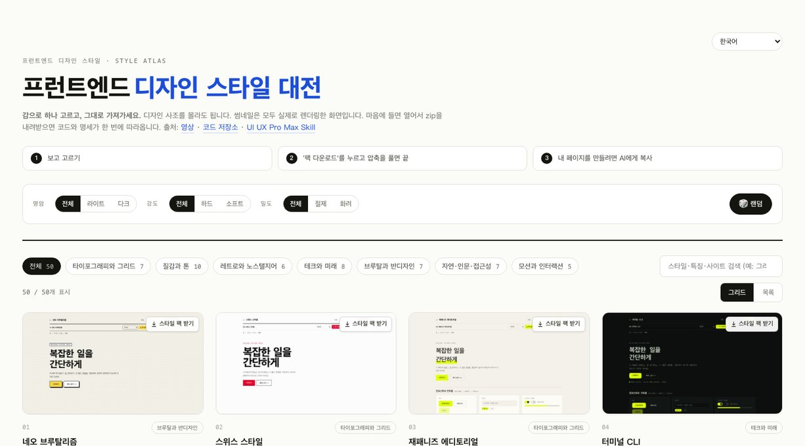
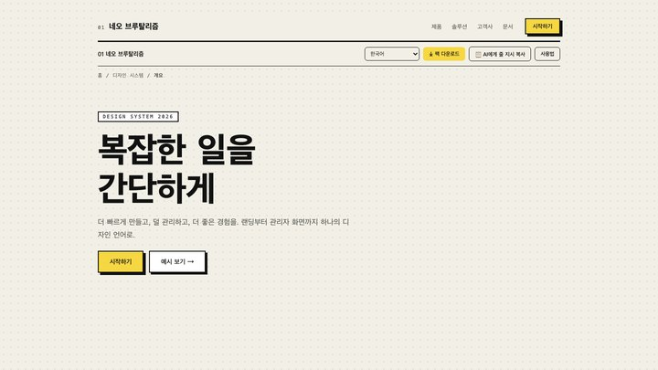
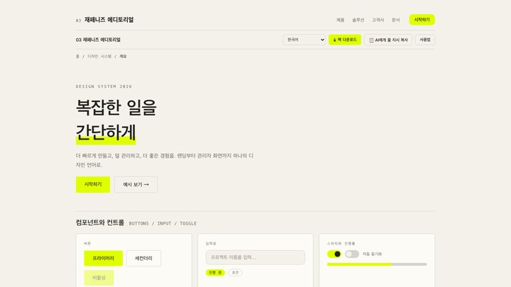
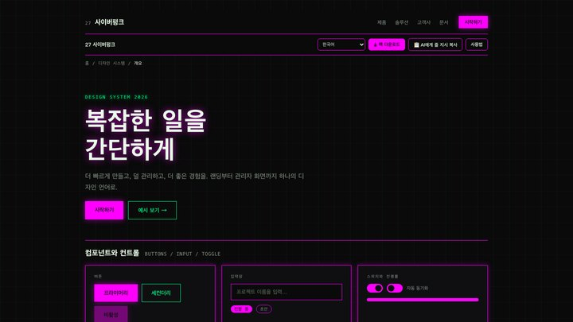
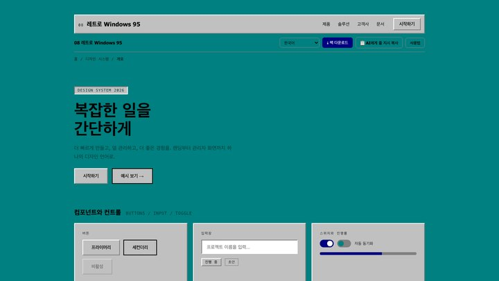
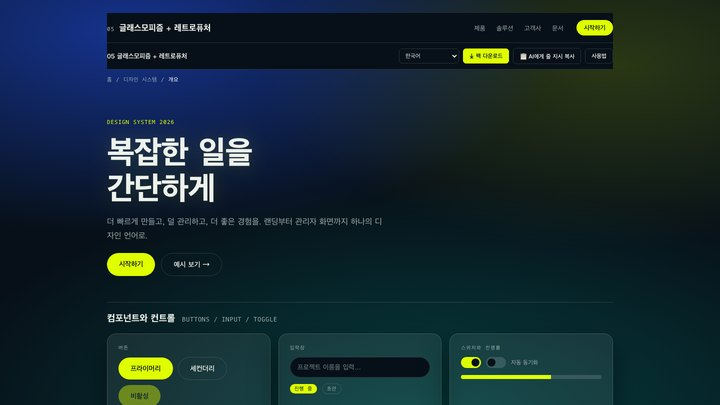
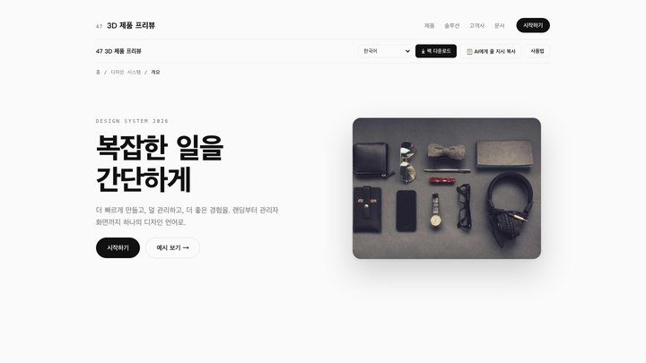

<div align="center">

# 프런트엔드 디자인 스타일 대전 · Style Atlas

**감으로 하나 고르고, 그대로 가져가세요.**

프런트엔드 디자인 스타일 50종. 썸네일은 모두 실제로 렌더링한 화면이고, 열면 바로
완성된 페이지(랜딩 + 105개 컴포넌트)가 됩니다. zip 하나를 받으면 코드와 명세가 한 번에 따라옵니다.



[**🌐 온라인 미리보기**](https://1981yangcq.github.io/frontend-style-pack/?lang=ko) · [**🇨🇳 중국 미러**](https://sunsong.surge.sh?lang=ko) · [**⬇ 스타일 팩 받기**](https://github.com/1981yangcq/frontend-style-pack/releases/) · [**📖 AI와 함께 쓰기**](../../specs/README.md)

</div>

**언어**: [简体中文](https://github.com/1981yangcq/frontend-style-pack/blob/main/README.md) · [繁體中文](https://github.com/1981yangcq/frontend-style-pack/blob/main/docs/i18n/README.zh-TW.md) · [English](https://github.com/1981yangcq/frontend-style-pack/blob/main/docs/i18n/README.en.md) · [Español](https://github.com/1981yangcq/frontend-style-pack/blob/main/docs/i18n/README.es.md) · [Français](https://github.com/1981yangcq/frontend-style-pack/blob/main/docs/i18n/README.fr.md) · [Português (BR)](https://github.com/1981yangcq/frontend-style-pack/blob/main/docs/i18n/README.pt-BR.md) · [Русский](https://github.com/1981yangcq/frontend-style-pack/blob/main/docs/i18n/README.ru.md) · [Deutsch](https://github.com/1981yangcq/frontend-style-pack/blob/main/docs/i18n/README.de.md) · [日本語](https://github.com/1981yangcq/frontend-style-pack/blob/main/docs/i18n/README.ja.md) · **한국어**

---

## 눌러서 열기

> 여섯 장 모두 실제 스크린샷입니다. 아무거나 누르면 그 스타일의 완성된 페이지(랜딩 + 105개 컴포넌트)가 열립니다.

| | | |
|---|---|---|
| <a href="https://1981yangcq.github.io/frontend-style-pack/demos/01-neo-brutalism.html?lang=ko"></a> | <a href="https://1981yangcq.github.io/frontend-style-pack/demos/03-japanese-editorial.html?lang=ko"></a> | <a href="https://1981yangcq.github.io/frontend-style-pack/demos/27-cyberpunk.html?lang=ko"></a> |
| <a href="https://1981yangcq.github.io/frontend-style-pack/demos/08-retro-win95.html?lang=ko"></a> | <a href="https://1981yangcq.github.io/frontend-style-pack/demos/05-glassmorphism-retro.html?lang=ko"></a> | <a href="https://1981yangcq.github.io/frontend-style-pack/demos/47-3d-product.html?lang=ko"></a> |

---

## 무엇인가

프런트엔드에서 가장 시간을 잡아먹는 일은 코드가 아니라 **어떤 모습일지 정하는 일**입니다. Dribbble을 넘기고, Awwwards를 뒤지고, 컴포넌트를 짜깁기하고, 색을 맞추는 일.
여기서는 스타일을 통째로 준비했습니다. 색 한 세트, 모서리와 그림자 한 세트, 컴포넌트 한 세트. **고르면 바로 씁니다.**

| 당신은 | 이렇게 |
|---|---|
| **빠르게 한 페이지가 필요하다** | 미리보기에서 고르기 → zip 받기 → 압축 풀고 `demo.html` 열기 |
| **AI에게 만들게 하고 싶다** | ‘AI에게 줄 지시 복사’를 누르고 아무 AI에 붙여넣은 뒤 마지막 줄만 바꾸기 |
| **코드를 직접 고치겠다** | zip 안에 `spec.md`(명세 카드)와 `theme.css`(변수와 컴포넌트)가 있습니다 |

> ‘네오 브루탈리즘’이 뭔지 몰라도 됩니다. 보면 압니다.

---

## 3단계

1. **보고 고르기** —— 첫 화면에서 명암 / 강도 / 밀도로 걸러내거나 🎲 랜덤을 누릅니다
2. **팩 받기** —— zip이 받아집니다. 압축을 풀고 `怎么用.html`(사용법)이나 `demo.html`을 엽니다
3. **내 페이지 만들기** —— AI 지시를 복사해 붙이고 마지막 줄만 바꿉니다

---

## 50가지 스타일

> ‘미리보기’는 완성된 페이지, ‘다운로드’는 zip입니다.

| # | 스타일 | 한 줄 설명 | 링크 |
|---|---|---|---|
| 01 | **네오 브루탈리즘**<br><sub>Neo-Brutalism</sub> | 웹페이지를 다듬지 않은 원재료로 다룹니다. 두꺼운 검정 테두리와 단단한 오프셋 그림자로 정직함과 반항을 표현합니다. | [미리보기](https://1981yangcq.github.io/frontend-style-pack/?lang=kodemos/01-neo-brutalism.html) · [다운로드](https://github.com/1981yangcq/frontend-style-pack/releases/latest/download/style-01-neo-brutalism.zip) |
| 02 | **스위스 스타일**<br><sub>Swiss Style</sub> | 1950년대 취리히와 바젤에서 시작. 장식을 모두 그리드와 활자 위계로 대체합니다. | [미리보기](https://1981yangcq.github.io/frontend-style-pack/?lang=kodemos/02-swiss-style.html) · [다운로드](https://github.com/1981yangcq/frontend-style-pack/releases/latest/download/style-02-swiss-style.zip) |
| 03 | **재패니즈 에디토리얼**<br><sub>Japanese Editorial</sub> | 잡지 조판을 웹으로. 따뜻한 종이색, 아주 얇은 괘선, 형광색 한 점. | [미리보기](https://1981yangcq.github.io/frontend-style-pack/?lang=kodemos/03-japanese-editorial.html) · [다운로드](https://github.com/1981yangcq/frontend-style-pack/releases/latest/download/style-03-japanese-editorial.zip) |
| 04 | **터미널 CLI**<br><sub>Terminal CLI Aesthetic</sub> | 명령줄을 브라우저로. 고정폭 서체와 상태 LED로 엔지니어다운 신뢰감을 만듭니다. | [미리보기](https://1981yangcq.github.io/frontend-style-pack/?lang=kodemos/04-terminal-cli.html) · [다운로드](https://github.com/1981yangcq/frontend-style-pack/releases/latest/download/style-04-terminal-cli.zip) |
| 05 | **글래스모피즘 + 레트로퓨처**<br><sub>Glassmorphism + Retrofuturism</sub> | 발광하는 배경 위에 반투명 유리 카드를 띄우고 CRT 주사선을 겹칩니다. 고급스러움과 향수의 사이. | [미리보기](https://1981yangcq.github.io/frontend-style-pack/?lang=kodemos/05-glassmorphism-retro.html) · [다운로드](https://github.com/1981yangcq/frontend-style-pack/releases/latest/download/style-05-glassmorphism-retro.zip) |
| 06 | **복셀**<br><sub>Voxel Aesthetic</sub> | 16×16 블록 세계를 그대로 인터페이스로. 브라우저 안에서 샌드박스 게임을 여는 느낌. | [미리보기](https://1981yangcq.github.io/frontend-style-pack/?lang=kodemos/06-voxel.html) · [다운로드](https://github.com/1981yangcq/frontend-style-pack/releases/latest/download/style-06-voxel.zip) |
| 07 | **뉴모피즘**<br><sub>Neumorphism</sub> | 요소와 배경을 같은 색으로 두고 밝고 어두운 두 빛만으로 입체를 밀어냅니다. | [미리보기](https://1981yangcq.github.io/frontend-style-pack/?lang=kodemos/07-neumorphism.html) · [다운로드](https://github.com/1981yangcq/frontend-style-pack/releases/latest/download/style-07-neumorphism.zip) |
| 08 | **레트로 Windows 95**<br><sub>Retro Win95</sub> | 1995년 데스크톱을 그대로 재현. 창, 작업 표시줄, 시작 버튼까지. | [미리보기](https://1981yangcq.github.io/frontend-style-pack/?lang=kodemos/08-retro-win95.html) · [다운로드](https://github.com/1981yangcq/frontend-style-pack/releases/latest/download/style-08-retro-win95.zip) |
| 09 | **바이오필릭**<br><sub>Biophilic Design</sub> | 햇살, 식물, 수제 종이의 질감을 화면으로. 인터페이스가 숨 쉬는 느낌. | [미리보기](https://1981yangcq.github.io/frontend-style-pack/?lang=kodemos/09-biophilic.html) · [다운로드](https://github.com/1981yangcq/frontend-style-pack/releases/latest/download/style-09-biophilic.zip) |
| 10 | **3D 하이퍼리얼**<br><sub>3D & Hyperrealism</sub> | 원근과 다층 그림자, 재질 그라디언트로 평면 위에 실제 같은 깊이를 만듭니다. | [미리보기](https://1981yangcq.github.io/frontend-style-pack/?lang=kodemos/10-3d-hyperrealism.html) · [다운로드](https://github.com/1981yangcq/frontend-style-pack/releases/latest/download/style-10-3d-hyperrealism.zip) |
| 11 | **비비드 블록**<br><sub>Vibrant & Block-based</sub> | 큰 색면, 부딪히는 색, 두꺼운 테두리. 페이지를 고채도 블록 쌓기로 만듭니다. | [미리보기](https://1981yangcq.github.io/frontend-style-pack/?lang=kodemos/11-vibrant-block.html) · [다운로드](https://github.com/1981yangcq/frontend-style-pack/releases/latest/download/style-11-vibrant-block.zip) |
| 12 | **OLED 다크**<br><sub>Dark Mode OLED</sub> | 순수 검정 패널에 맞춘 다크 테마. 완전히 검고, 밝기는 절제. | [미리보기](https://1981yangcq.github.io/frontend-style-pack/?lang=kodemos/12-dark-oled.html) · [다운로드](https://github.com/1981yangcq/frontend-style-pack/releases/latest/download/style-12-dark-oled.zip) |
| 13 | **접근성·윤리**<br><sub>Accessible & Ethical</sub> | 가독성과 도달 가능성을 첫 번째 미학으로. 화려함보다 쓸 수 있음을. | [미리보기](https://1981yangcq.github.io/frontend-style-pack/?lang=kodemos/13-accessible-ethical.html) · [다운로드](https://github.com/1981yangcq/frontend-style-pack/releases/latest/download/style-13-accessible-ethical.zip) |
| 14 | **클레이모피즘**<br><sub>Claymorphism</sub> | 손가락으로 주무른 점토 같은 요소. 부드럽고 두께감 있고 단단한 모서리가 없습니다. | [미리보기](https://1981yangcq.github.io/frontend-style-pack/?lang=kodemos/14-claymorphism.html) · [다운로드](https://github.com/1981yangcq/frontend-style-pack/releases/latest/download/style-14-claymorphism.zip) |
| 15 | **오로라 UI**<br><sub>Aurora UI</sub> | 어두운 배경 위로 흐르는 오로라와 반투명 유리. 최근 SaaS의 '고급스러움' 공식. | [미리보기](https://1981yangcq.github.io/frontend-style-pack/?lang=kodemos/15-aurora-ui.html) · [다운로드](https://github.com/1981yangcq/frontend-style-pack/releases/latest/download/style-15-aurora-ui.zip) |
| 16 | **레트로퓨처리즘**<br><sub>Retro-Futurism</sub> | 1980년대가 상상한 미래. 스페이스 퍼플, 네온 핑크, 빛나는 버튼. | [미리보기](https://1981yangcq.github.io/frontend-style-pack/?lang=kodemos/16-retro-futurism.html) · [다운로드](https://github.com/1981yangcq/frontend-style-pack/releases/latest/download/style-16-retro-futurism.zip) |
| 17 | **플랫 디자인**<br><sub>Flat Design</sub> | 그림자, 그라디언트, 질감을 모두 걷어내고 색과 형태와 글자만 남깁니다. | [미리보기](https://1981yangcq.github.io/frontend-style-pack/?lang=kodemos/17-flat-design.html) · [다운로드](https://github.com/1981yangcq/frontend-style-pack/releases/latest/download/style-17-flat-design.zip) |
| 18 | **리퀴드 글래스**<br><sub>Liquid Glass</sub> | Apple 2025의 디자인 언어. 배경을 굴절시키는 액체 유리 한 겹처럼 동작합니다. | [미리보기](https://1981yangcq.github.io/frontend-style-pack/?lang=kodemos/18-liquid-glass.html) · [다운로드](https://github.com/1981yangcq/frontend-style-pack/releases/latest/download/style-18-liquid-glass.zip) |
| 19 | **모션 드리븐**<br><sub>Motion-Driven</sub> | 페이지의 거의 모든 것을 움직임으로 말합니다. 스크롤, 호버, 전환이 곧 내용. | [미리보기](https://1981yangcq.github.io/frontend-style-pack/?lang=kodemos/19-motion-driven.html) · [다운로드](https://github.com/1981yangcq/frontend-style-pack/releases/latest/download/style-19-motion-driven.zip) |
| 20 | **마이크로 인터랙션**<br><sub>Micro-interactions</sub> | 화려함 대신 버튼 하나, 상태 하나에 정확한 반응을 넣습니다. | [미리보기](https://1981yangcq.github.io/frontend-style-pack/?lang=kodemos/20-micro-interactions.html) · [다운로드](https://github.com/1981yangcq/frontend-style-pack/releases/latest/download/style-20-micro-interactions.zip) |
| 21 | **포용적 디자인**<br><sub>Inclusive Design</sub> | 시각·운동·인지의 차이를 전제로 모두가 같은 인터페이스를 쓰게 합니다. | [미리보기](https://1981yangcq.github.io/frontend-style-pack/?lang=kodemos/21-inclusive-design.html) · [다운로드](https://github.com/1981yangcq/frontend-style-pack/releases/latest/download/style-21-inclusive-design.zip) |
| 22 | **제로 인터페이스**<br><sub>Zero Interface</sub> | UI를 거의 지우고 글자와 여백만 남깁니다. 조작은 클릭보다 대화로. | [미리보기](https://1981yangcq.github.io/frontend-style-pack/?lang=kodemos/22-zero-interface.html) · [다운로드](https://github.com/1981yangcq/frontend-style-pack/releases/latest/download/style-22-zero-interface.zip) |
| 23 | **소프트 UI 에볼루션**<br><sub>Soft UI Evolution</sub> | 뉴모피즘과 플랫 사이의 기업용 절충. 조금 부드럽지만 명료함은 양보하지 않습니다. | [미리보기](https://1981yangcq.github.io/frontend-style-pack/?lang=kodemos/23-soft-ui.html) · [다운로드](https://github.com/1981yangcq/frontend-style-pack/releases/latest/download/style-23-soft-ui.zip) |
| 24 | **뉴브루탈리즘**<br><sub>Neubrutalism</sub> | 브루탈리즘의 낙관적 버전. 크림 배경에 빨강·노랑 충돌, 두꺼운 검정 테두리. 젊은 브랜드의 기본값. | [미리보기](https://1981yangcq.github.io/frontend-style-pack/?lang=kodemos/24-neubrutalism.html) · [다운로드](https://github.com/1981yangcq/frontend-style-pack/releases/latest/download/style-24-neubrutalism.zip) |
| 25 | **벤토 그리드**<br><sub>Bento Box Grid</sub> | 크기가 다른 둥근 카드를 도시락처럼 조합해 한 화면에서 모든 장점을 설명합니다. | [미리보기](https://1981yangcq.github.io/frontend-style-pack/?lang=kodemos/25-bento-grid.html) · [다운로드](https://github.com/1981yangcq/frontend-style-pack/releases/latest/download/style-25-bento-grid.zip) |
| 26 | **Y2K 미학**<br><sub>Y2K Aesthetic</sub> | 밀레니엄의 미래상. 아이스 블루에서 핑크로 가는 그라디언트, 금속 광택, 빛날 만큼 둥근 컨트롤. | [미리보기](https://1981yangcq.github.io/frontend-style-pack/?lang=kodemos/26-y2k.html) · [다운로드](https://github.com/1981yangcq/frontend-style-pack/releases/latest/download/style-26-y2k.zip) |
| 27 | **사이버펑크**<br><sub>Cyberpunk UI</sub> | 순수 검정 위 고대비 네온과 글리치. 디스토피아 기술을 시각 언어로. | [미리보기](https://1981yangcq.github.io/frontend-style-pack/?lang=kodemos/27-cyberpunk.html) · [다운로드](https://github.com/1981yangcq/frontend-style-pack/releases/latest/download/style-27-cyberpunk.zip) |
| 28 | **AI 네이티브 UI**<br><sub>AI-Native UI</sub> | AI 제품에서 자란 모습. 청보라 그라디언트, 발광 테두리, 대화 우선 레이아웃. | [미리보기](https://1981yangcq.github.io/frontend-style-pack/?lang=kodemos/28-ai-native.html) · [다운로드](https://github.com/1981yangcq/frontend-style-pack/releases/latest/download/style-28-ai-native.zip) |
| 29 | **멤피스**<br><sub>Memphis Design</sub> | 1981년 밀라노의 반모더니즘. 기하학, 충돌하는 색, 도트. 일부러 조화를 깨뜨립니다. | [미리보기](https://1981yangcq.github.io/frontend-style-pack/?lang=kodemos/29-memphis.html) · [다운로드](https://github.com/1981yangcq/frontend-style-pack/releases/latest/download/style-29-memphis.zip) |
| 30 | **베이퍼웨이브**<br><sub>Vaporwave</sub> | 80년대 신스 음악과 소비주의의 잔상. 핑크 네온 속에 약간의 허무. | [미리보기](https://1981yangcq.github.io/frontend-style-pack/?lang=kodemos/30-vaporwave.html) · [다운로드](https://github.com/1981yangcq/frontend-style-pack/releases/latest/download/style-30-vaporwave.zip) |
| 31 | **디멘셔널 레이어링**<br><sub>Dimensional Layering</sub> | 단계적 그림자로 분명한 Z축을 만들어 정보마다 '얼마나 먼지'를 부여합니다. | [미리보기](https://1981yangcq.github.io/frontend-style-pack/?lang=kodemos/31-dimensional-layering.html) · [다운로드](https://github.com/1981yangcq/frontend-style-pack/releases/latest/download/style-31-dimensional-layering.zip) |
| 32 | **과장된 미니멀리즘**<br><sub>Exaggerated Minimalism</sub> | 미니멀을 극단까지 밀어 글자가 화면을 채우고 나머지는 아무것도 없습니다. | [미리보기](https://1981yangcq.github.io/frontend-style-pack/?lang=kodemos/32-exaggerated-minimalism.html) · [다운로드](https://github.com/1981yangcq/frontend-style-pack/releases/latest/download/style-32-exaggerated-minimalism.zip) |
| 33 | **키네틱 타이포그래피**<br><sub>Kinetic Typography</sub> | 글자 자체를 주인공으로. 크기와 리듬과 움직임으로 포스터급 충격을 만듭니다. | [미리보기](https://1981yangcq.github.io/frontend-style-pack/?lang=kodemos/33-kinetic-typography.html) · [다운로드](https://github.com/1981yangcq/frontend-style-pack/releases/latest/download/style-33-kinetic-typography.zip) |
| 34 | **패럴랙스 스토리텔링**<br><sub>Parallax Storytelling</sub> | 스크롤 속도의 차이로 이야기합니다. 깊이가 있는 긴 두루마리를 넘기듯. | [미리보기](https://1981yangcq.github.io/frontend-style-pack/?lang=kodemos/34-parallax-storytelling.html) · [다운로드](https://github.com/1981yangcq/frontend-style-pack/releases/latest/download/style-34-parallax-storytelling.zip) |
| 35 | **스위스 모더니즘 2.0**<br><sub>Swiss Modernism 2.0</sub> | 스위스 스타일의 극단판. 모두 걷어내고 웨이트와 행간, 한 줄의 괘선만. | [미리보기](https://1981yangcq.github.io/frontend-style-pack/?lang=kodemos/35-swiss-modernism-2.html) · [다운로드](https://github.com/1981yangcq/frontend-style-pack/releases/latest/download/style-35-swiss-modernism-2.zip) |
| 36 | **HUD / SF FUI**<br><sub>HUD / Sci-Fi FUI</sub> | SF 영화의 콘솔 언어. 얇은 발광선, 코너 브래킷, 흐르는 데이터. | [미리보기](https://1981yangcq.github.io/frontend-style-pack/?lang=kodemos/36-hud-sci-fi.html) · [다운로드](https://github.com/1981yangcq/frontend-style-pack/releases/latest/download/style-36-hud-sci-fi.zip) |
| 37 | **벤토 그리드 2.0**<br><sub>Bento Grids 2.0</sub> | 벤토 그리드의 젊은 버전. 따뜻한 회색 배경, iPhone 레드 포인트, 느슨한 모서리. | [미리보기](https://1981yangcq.github.io/frontend-style-pack/?lang=kodemos/37-bento-2.html) · [다운로드](https://github.com/1981yangcq/frontend-style-pack/releases/latest/download/style-37-bento-2.zip) |
| 38 | **스페이셜 UI / visionOS**<br><sub>Spatial UI / VisionOS</sub> | 헤드셋을 위한 설계. 공중에 떠 있는 유리판. 두께와 빛이 있습니다. | [미리보기](https://1981yangcq.github.io/frontend-style-pack/?lang=kodemos/38-spatial-ui.html) · [다운로드](https://github.com/1981yangcq/frontend-style-pack/releases/latest/download/style-38-spatial-ui.zip) |
| 39 | **전자 잉크**<br><sub>E-Ink & Paper</sub> | 화면을 종이로. 따뜻한 흰색, 세리프, 그림자 없음. 오래 읽기 위해. | [미리보기](https://1981yangcq.github.io/frontend-style-pack/?lang=kodemos/39-e-ink-paper.html) · [다운로드](https://github.com/1981yangcq/frontend-style-pack/releases/latest/download/style-39-e-ink-paper.zip) |
| 40 | **Z세대 카오스**<br><sub>Gen Z Chaos / Maximalism</sub> | 정교하게 설계한 '어수선함'. 고채도, 어긋남, 스티커 감성. 세련됨에 대한 반발. | [미리보기](https://1981yangcq.github.io/frontend-style-pack/?lang=kodemos/40-genz-chaos.html) · [다운로드](https://github.com/1981yangcq/frontend-style-pack/releases/latest/download/style-40-genz-chaos.zip) |
| 41 | **바이오미메틱 2.0**<br><sub>Biomimetic / Organic 2.0</sub> | 자연의 색이 아니라 자연의 성장 논리와 구조를 빌립니다. | [미리보기](https://1981yangcq.github.io/frontend-style-pack/?lang=kodemos/41-biomimetic.html) · [다운로드](https://github.com/1981yangcq/frontend-style-pack/releases/latest/download/style-41-biomimetic.zip) |
| 42 | **안티 폴리시**<br><sub>Anti-Polish / Raw Aesthetic</sub> | 일부러 디자인하지 않습니다. 점선 테두리, 시스템 폰트, 모서리 0. 와이어프레임을 그대로 출시. | [미리보기](https://1981yangcq.github.io/frontend-style-pack/?lang=kodemos/42-anti-polish-raw.html) · [다운로드](https://github.com/1981yangcq/frontend-style-pack/releases/latest/download/style-42-anti-polish-raw.zip) |
| 43 | **택타일 디지털**<br><sub>Tactile Digital / Deformable UI</sub> | 화면 속 사물을 종이, 천, 나무처럼 느끼게 합니다. 두께와 변형으로 온도를 전합니다. | [미리보기](https://1981yangcq.github.io/frontend-style-pack/?lang=kodemos/43-tactile-digital.html) · [다운로드](https://github.com/1981yangcq/frontend-style-pack/releases/latest/download/style-43-tactile-digital.zip) |
| 44 | **자연의 증류**<br><sub>Nature Distilled</sub> | 잎도 산도 그리지 않고 비율과 색온도, 절제된 초록으로 자연을 농축합니다. | [미리보기](https://1981yangcq.github.io/frontend-style-pack/?lang=kodemos/44-nature-distilled.html) · [다운로드](https://github.com/1981yangcq/frontend-style-pack/releases/latest/download/style-44-nature-distilled.zip) |
| 45 | **커서 인터랙션**<br><sub>Interactive Cursor Design</sub> | 포인터를 주인공으로. 조준선, 잔상, 자석. 커서 자체가 내비게이션입니다. | [미리보기](https://1981yangcq.github.io/frontend-style-pack/?lang=kodemos/45-interactive-cursor.html) · [다운로드](https://github.com/1981yangcq/frontend-style-pack/releases/latest/download/style-45-interactive-cursor.zip) |
| 46 | **보이스 퍼스트**<br><sub>Voice-First Multimodal</sub> | '말하기'를 위해 설계한 UI. 입구 하나, 소리 고리, 나머지는 모두 물러납니다. | [미리보기](https://1981yangcq.github.io/frontend-style-pack/?lang=kodemos/46-voice-first.html) · [다운로드](https://github.com/1981yangcq/frontend-style-pack/releases/latest/download/style-46-voice-first.zip) |
| 47 | **3D 제품 프리뷰**<br><sub>3D Product Preview</sub> | 스튜디오처럼 무영벽 앞에 제품을 두고 3D 모델만을 내용으로 삼습니다. | [미리보기](https://1981yangcq.github.io/frontend-style-pack/?lang=kodemos/47-3d-product.html) · [다운로드](https://github.com/1981yangcq/frontend-style-pack/releases/latest/download/style-47-3d-product.zip) |
| 48 | **그라디언트 메시**<br><sub>Gradient Mesh / Aurora Evolved</sub> | 오로라의 진화형. 여러 색의 빛면이 엮여 숨 쉬는 메시가 됩니다. | [미리보기](https://1981yangcq.github.io/frontend-style-pack/?lang=kodemos/48-gradient-mesh.html) · [다운로드](https://github.com/1981yangcq/frontend-style-pack/releases/latest/download/style-48-gradient-mesh.zip) |
| 49 | **RGB 분리**<br><sub>Chromatic Aberration / RGB Split</sub> | 렌즈의 색수차라는 '결함'을 언어로. 빨강·초록·파랑을 어긋나게 해 디지털 고장 감성을 냅니다. | [미리보기](https://1981yangcq.github.io/frontend-style-pack/?lang=kodemos/49-chromatic-aberration.html) · [다운로드](https://github.com/1981yangcq/frontend-style-pack/releases/latest/download/style-49-chromatic-aberration.zip) |
| 50 | **빈티지 필름**<br><sub>Vintage Analog / Retro Film</sub> | 오래된 사진과 책의 분위기. 산화된 따뜻한 노랑, 필름 입자, 갈색 톤. | [미리보기](https://1981yangcq.github.io/frontend-style-pack/?lang=kodemos/50-vintage-film.html) · [다운로드](https://github.com/1981yangcq/frontend-style-pack/releases/latest/download/style-50-vintage-film.zip) |

---

## 스타일 팩 구성

| 파일 | 설명 |
|---|---|
| `怎么用.html` | **먼저 이것** — 3단계 설명(브라우저에서 바로 열림) |
| `demo.html` | 완성된 예시 페이지: 랜딩 + 105개 컴포넌트, 단일 파일 |
| `给AI的话.txt` | 이 스타일의 색과 금지 사항을 채운 AI용 지시문 |
| `spec.md` | 명세 카드: tokens, 필수 기법, 금지 목록, 접근성 하한 |
| `spec.json` | 같은 내용의 기계 판독용 |
| `theme.css` | tokens로 생성한 스타일시트. `@import`로 바로 사용 |
| `preview.jpg` | 첫 화면 스크린샷 |
| `assets/` | 데모가 쓰는 사진(내장, 오프라인에서도 표시) |

---

## AI와 함께 쓰기(다운로드 없이)

zip 없이도 됩니다:

- [`styles-bundle.md`](styles-bundle.md) —— 모든 스타일 명세, 한 번에 AI에 붙여넣기
- [`styles-bundle.json`](styles-bundle.json) —— 기계 판독용
- [`specs/README.md`](specs/README.md) —— 넣는 방법, 3단계, 검수 체크리스트

```
아래는 프런트엔드 디자인 스타일 대전의 명세 라이브러리입니다. 제가 지정한 하나만 사용하세요.
【지정 스타일】27 / 사이버펑크
【내 요구】커피 랜딩 페이지. 첫 화면, 세 가지 장점, 가격표 포함
```

---

## 로컬에서 실행

완전한 정적 사이트라 의존성이 없습니다. `index.html`을 열면 됩니다. 스타일을 바꾼 뒤 재생성:

```bash
pip install pillow
python build_demos.py      # 50 页
python build_thumbs.py
python build_zips.py
python build.py            # 首页
```

---

## 스타일 추가하기

[CONTRIBUTING.md](CONTRIBUTING.md) 참고. 3단계입니다:

1. `styles.json`에 한 줄 추가(이름 / 한 줄 설명 / 그룹 / 참고 사이트)
2. `themes.py`에 tokens 추가(색 / 모서리 / 그림자 / 서체)
3. `build_demos.py` 실행 — 페이지가 나오면 통과

머지되면 사이트와 AI 번들에 자동으로 반영됩니다.

---

## 라이선스와 감사의 말

- **코드**(생성 스크립트, CSS, HTML): [MIT](LICENSE)
- **문안 / 명세 카드 / 컴포넌트 표**: CC BY 4.0
- **스타일 목록**은 Bilibili 영상과 그 저장소(MIT), [UI UX Pro Max Skill](https://github.com/nextlevelbuilder/ui-ux-pro-max-skill)(MIT)을 참고했습니다
- **데모 구현 / 명세 카드 / 컴포넌트 목록 / 팩**: 이 저장소의 창작물
- **사진**은 [picsum.photos](https://picsum.photos)(Unsplash)의 임시 이미지입니다. 상업적 사용 시 교체하세요
