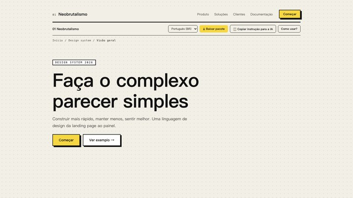
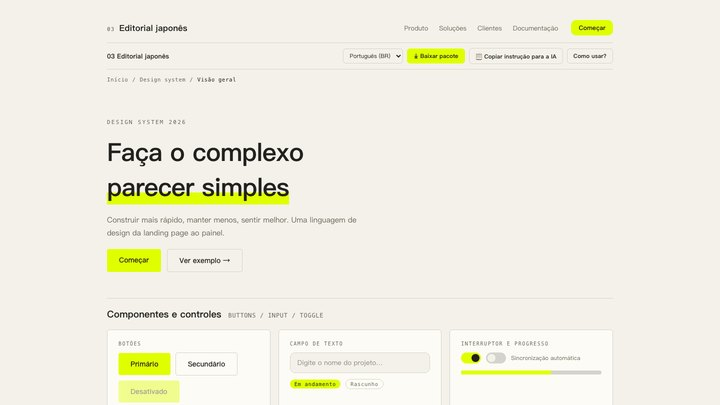
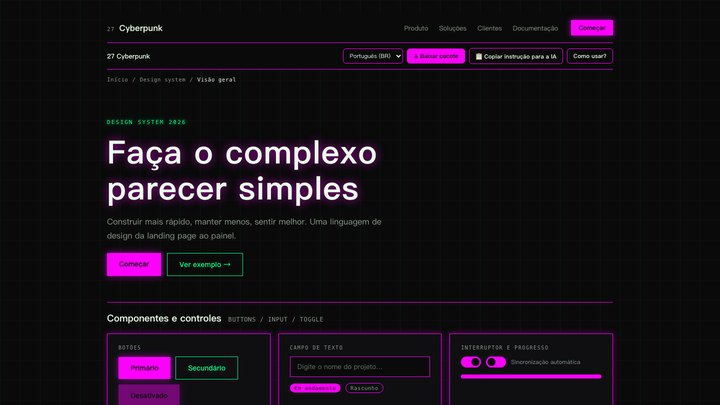
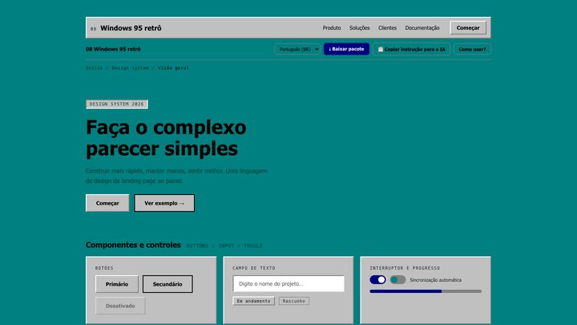
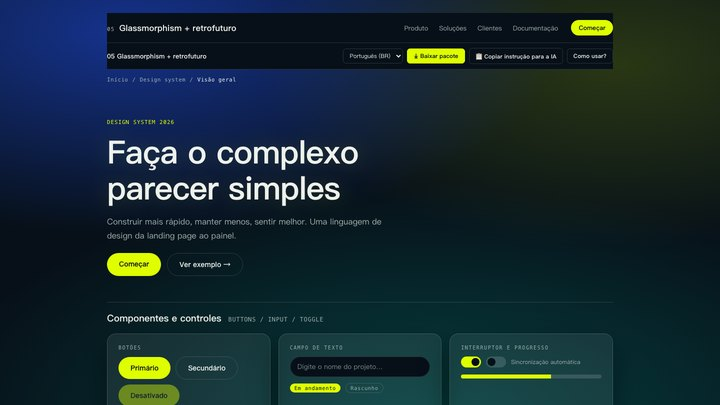
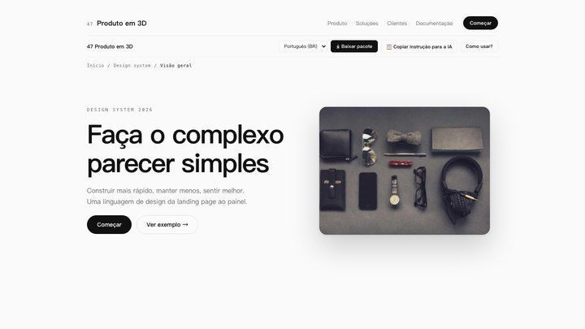

<div align="center">

# Catálogo de estilos de design frontend · Style Atlas

**Escolha pelo feeling e leve.**

50 estilos de design frontend: cada miniatura é um render real e, ao abrir, você cai numa página
completa (landing page + 105 componentes). Baixe um zip e leve todo o código e as especificações.

[**🌐 Prévia online**](https://1981yangcq.github.io/frontend-style-pack/?lang=pt-BR) · [**🇨🇳 Espelho na China**](https://sunsong.surge.sh?lang=pt-BR) · [**⬇ Baixar pacotes**](https://github.com/1981yangcq/frontend-style-pack/releases/) · [**📖 Usar com IA**](../../specs/README.md)

</div>

**Idioma**: [简体中文](https://github.com/1981yangcq/frontend-style-pack/blob/main/README.md) · [繁體中文](https://github.com/1981yangcq/frontend-style-pack/blob/main/docs/i18n/README.zh-TW.md) · [English](https://github.com/1981yangcq/frontend-style-pack/blob/main/docs/i18n/README.en.md) · [Español](https://github.com/1981yangcq/frontend-style-pack/blob/main/docs/i18n/README.es.md) · [Français](https://github.com/1981yangcq/frontend-style-pack/blob/main/docs/i18n/README.fr.md) · **Português (BR)** · [Русский](https://github.com/1981yangcq/frontend-style-pack/blob/main/docs/i18n/README.ru.md) · [Deutsch](https://github.com/1981yangcq/frontend-style-pack/blob/main/docs/i18n/README.de.md) · [日本語](https://github.com/1981yangcq/frontend-style-pack/blob/main/docs/i18n/README.ja.md) · [한국어](https://github.com/1981yangcq/frontend-style-pack/blob/main/docs/i18n/README.ko.md)

---

## Toque para abrir

> As seis são capturas reais. Toque em qualquer uma para abrir a página completa daquele estilo (landing + 105 componentes).

| | | |
|---|---|---|
| <a href="https://1981yangcq.github.io/frontend-style-pack/demos/01-neo-brutalism.html?lang=pt-BR"></a> | <a href="https://1981yangcq.github.io/frontend-style-pack/demos/03-japanese-editorial.html?lang=pt-BR"></a> | <a href="https://1981yangcq.github.io/frontend-style-pack/demos/27-cyberpunk.html?lang=pt-BR"></a> |
| <a href="https://1981yangcq.github.io/frontend-style-pack/demos/08-retro-win95.html?lang=pt-BR"></a> | <a href="https://1981yangcq.github.io/frontend-style-pack/demos/05-glassmorphism-retro.html?lang=pt-BR"></a> | <a href="https://1981yangcq.github.io/frontend-style-pack/demos/47-3d-product.html?lang=pt-BR"></a> |

---

## O que é isto

O que mais consome tempo no frontend não é escrever código, é **decidir a cara da coisa**: rolar o Dribbble, garimpar o Awwwards, remendar bibliotecas de componentes, acertar cores.
Aqui o estilo vem inteiro: uma paleta, um sistema de raios e sombras, um conjunto de componentes. **Escolheu, usou.**

| Quem é você | O que fazer |
|---|---|
| **Só quero uma página, rápido** | Escolha na prévia → baixe o zip → descompacte e abra `demo.html` |
| **Quero que a IA faça** | Clique em «Copiar instrução para a IA», cole em qualquer IA e troque a última linha |
| **Vou mexer no código** | O zip traz `spec.md` (ficha técnica) + `theme.css` (tokens e componentes prontos) |

> Não precisa saber o que é «neobrutalismo». Olhe e escolha.

---

## Três passos

1. **Escolha olhando** — filtre por tom / dureza / densidade, ou clique em 🎲 Aleatório
2. **Baixe o pacote** — chega um zip; descompacte e abra `怎么用.html` ou `demo.html`
3. **Crie sua página** — copie a instrução para a IA, cole e troque a última linha

---

## 50 estilos

> «Prévia» abre a página completa; «Baixar» entrega o zip.

| # | Estilo | Em uma frase | Links |
|---|---|---|---|
| 01 | **Neobrutalismo**<br><sub>Neo-Brutalism</sub> | Trata a página como material bruto: bordas pretas grossas e sombras duras que comunicam honestidade e rebeldia. | [Prévia](https://1981yangcq.github.io/frontend-style-pack/?lang=pt-BRdemos/01-neo-brutalism.html) · [Baixar](https://github.com/1981yangcq/frontend-style-pack/releases/latest/download/style-01-neo-brutalism.zip) |
| 02 | **Estilo suíço**<br><sub>Swiss Style</sub> | Nasceu em Zurique e Basileia nos anos 1950: troque todo ornamento por grade e hierarquia tipográfica. | [Prévia](https://1981yangcq.github.io/frontend-style-pack/?lang=pt-BRdemos/02-swiss-style.html) · [Baixar](https://github.com/1981yangcq/frontend-style-pack/releases/latest/download/style-02-swiss-style.zip) |
| 03 | **Editorial japonês**<br><sub>Japanese Editorial</sub> | Leva a diagramação de revista para a web: papel quente, filetes finíssimos e um único acento fluorescente. | [Prévia](https://1981yangcq.github.io/frontend-style-pack/?lang=pt-BRdemos/03-japanese-editorial.html) · [Baixar](https://github.com/1981yangcq/frontend-style-pack/releases/latest/download/style-03-japanese-editorial.zip) |
| 04 | **Estética terminal**<br><sub>Terminal CLI Aesthetic</sub> | Coloca a linha de comando no navegador: monoespaçada e luzes de status para transmitir credibilidade de engenharia. | [Prévia](https://1981yangcq.github.io/frontend-style-pack/?lang=pt-BRdemos/04-terminal-cli.html) · [Baixar](https://github.com/1981yangcq/frontend-style-pack/releases/latest/download/style-04-terminal-cli.zip) |
| 05 | **Glassmorphism + retrofuturo**<br><sub>Glassmorphism + Retrofuturism</sub> | Cards de vidro fosco sobre um fundo luminoso, com linhas de varredura CRT por cima: metade premium, metade nostalgia. | [Prévia](https://1981yangcq.github.io/frontend-style-pack/?lang=pt-BRdemos/05-glassmorphism-retro.html) · [Baixar](https://github.com/1981yangcq/frontend-style-pack/releases/latest/download/style-05-glassmorphism-retro.zip) |
| 06 | **Voxel**<br><sub>Voxel Aesthetic</sub> | Um mundo de blocos 16×16 virou interface, como abrir um jogo sandbox dentro da página. | [Prévia](https://1981yangcq.github.io/frontend-style-pack/?lang=pt-BRdemos/06-voxel.html) · [Baixar](https://github.com/1981yangcq/frontend-style-pack/releases/latest/download/style-06-voxel.zip) |
| 07 | **Neumorfismo**<br><sub>Neumorphism</sub> | Os elementos têm a cor do fundo; duas luzes, uma clara e uma escura, empurram a forma para fora da superfície. | [Prévia](https://1981yangcq.github.io/frontend-style-pack/?lang=pt-BRdemos/07-neumorphism.html) · [Baixar](https://github.com/1981yangcq/frontend-style-pack/releases/latest/download/style-07-neumorphism.zip) |
| 08 | **Windows 95 retrô**<br><sub>Retro Win95</sub> | Réplica fiel da área de trabalho de 1995: janelas, barra de tarefas e botão iniciar. | [Prévia](https://1981yangcq.github.io/frontend-style-pack/?lang=pt-BRdemos/08-retro-win95.html) · [Baixar](https://github.com/1981yangcq/frontend-style-pack/releases/latest/download/style-08-retro-win95.zip) |
| 09 | **Biofílico**<br><sub>Biophilic Design</sub> | Traz luz do sol, plantas e papel artesanal para a tela para a interface respirar. | [Prévia](https://1981yangcq.github.io/frontend-style-pack/?lang=pt-BRdemos/09-biophilic.html) · [Baixar](https://github.com/1981yangcq/frontend-style-pack/releases/latest/download/style-09-biophilic.zip) |
| 10 | **3D hiper-realista**<br><sub>3D & Hyperrealism</sub> | Finge profundidade real no plano com perspectiva, sombras em camadas e gradientes de material. | [Prévia](https://1981yangcq.github.io/frontend-style-pack/?lang=pt-BRdemos/10-3d-hyperrealism.html) · [Baixar](https://github.com/1981yangcq/frontend-style-pack/releases/latest/download/style-10-3d-hyperrealism.zip) |
| 11 | **Blocos vibrantes**<br><sub>Vibrant & Block-based</sub> | Grandes blocos de cor, choque cromático e bordas grossas transformam a página em tijolos saturados. | [Prévia](https://1981yangcq.github.io/frontend-style-pack/?lang=pt-BRdemos/11-vibrant-block.html) · [Baixar](https://github.com/1981yangcq/frontend-style-pack/releases/latest/download/style-11-vibrant-block.zip) |
| 12 | **Escuro OLED**<br><sub>Dark Mode OLED</sub> | Esquema escuro ajustado para painéis de preto puro: preto de verdade, brilho contido. | [Prévia](https://1981yangcq.github.io/frontend-style-pack/?lang=pt-BRdemos/12-dark-oled.html) · [Baixar](https://github.com/1981yangcq/frontend-style-pack/releases/latest/download/style-12-dark-oled.zip) |
| 13 | **Acessível e ético**<br><sub>Accessible & Ethical</sub> | Legibilidade e alcance como primeira estética: simples antes de bonito. | [Prévia](https://1981yangcq.github.io/frontend-style-pack/?lang=pt-BRdemos/13-accessible-ethical.html) · [Baixar](https://github.com/1981yangcq/frontend-style-pack/releases/latest/download/style-13-accessible-ethical.zip) |
| 14 | **Argila**<br><sub>Claymorphism</sub> | Os elementos parecem moldados com o dedo em argila: macios, com volume e sem nenhuma aresta dura. | [Prévia](https://1981yangcq.github.io/frontend-style-pack/?lang=pt-BRdemos/14-claymorphism.html) · [Baixar](https://github.com/1981yangcq/frontend-style-pack/releases/latest/download/style-14-claymorphism.zip) |
| 15 | **Aurora UI**<br><sub>Aurora UI</sub> | Manchas de aurora fluindo sobre fundo escuro atrás de vidro fosco: a receita recente de premium em SaaS. | [Prévia](https://1981yangcq.github.io/frontend-style-pack/?lang=pt-BRdemos/15-aurora-ui.html) · [Baixar](https://github.com/1981yangcq/frontend-style-pack/releases/latest/download/style-15-aurora-ui.zip) |
| 16 | **Retrofuturismo**<br><sub>Retro-Futurism</sub> | O futuro como os anos 1980 imaginavam: roxo espacial, rosa neon e botões que brilham. | [Prévia](https://1981yangcq.github.io/frontend-style-pack/?lang=pt-BRdemos/16-retro-futurism.html) · [Baixar](https://github.com/1981yangcq/frontend-style-pack/releases/latest/download/style-16-retro-futurism.zip) |
| 17 | **Design plano**<br><sub>Flat Design</sub> | Sem sombras, sem gradientes, sem texturas: só cor, forma e tipografia. | [Prévia](https://1981yangcq.github.io/frontend-style-pack/?lang=pt-BRdemos/17-flat-design.html) · [Baixar](https://github.com/1981yangcq/frontend-style-pack/releases/latest/download/style-17-flat-design.zip) |
| 18 | **Vidro líquido**<br><sub>Liquid Glass</sub> | A linguagem da Apple em 2025: a interface se comporta como uma camada de vidro líquido que refrata o que está atrás. | [Prévia](https://1981yangcq.github.io/frontend-style-pack/?lang=pt-BRdemos/18-liquid-glass.html) · [Baixar](https://github.com/1981yangcq/frontend-style-pack/releases/latest/download/style-18-liquid-glass.zip) |
| 19 | **Dirigido por movimento**<br><sub>Motion-Driven</sub> | A página conta a história quase só pelo movimento: rolamento, hover e transição são o conteúdo. | [Prévia](https://1981yangcq.github.io/frontend-style-pack/?lang=pt-BRdemos/19-motion-driven.html) · [Baixar](https://github.com/1981yangcq/frontend-style-pack/releases/latest/download/style-19-motion-driven.zip) |
| 20 | **Microinterações**<br><sub>Micro-interactions</sub> | Sem espetáculo visual: a quantidade certa de resposta em cada botão e cada estado. | [Prévia](https://1981yangcq.github.io/frontend-style-pack/?lang=pt-BRdemos/20-micro-interactions.html) · [Baixar](https://github.com/1981yangcq/frontend-style-pack/releases/latest/download/style-20-micro-interactions.zip) |
| 21 | **Design inclusivo**<br><sub>Inclusive Design</sub> | Assume diferenças visuais, motoras e cognitivas e constrói uma interface que serve a todos. | [Prévia](https://1981yangcq.github.io/frontend-style-pack/?lang=pt-BRdemos/21-inclusive-design.html) · [Baixar](https://github.com/1981yangcq/frontend-style-pack/releases/latest/download/style-21-inclusive-design.zip) |
| 22 | **Interface zero**<br><sub>Zero Interface</sub> | A interface quase desaparece, sobram texto e espaço. Interage-se conversando, não clicando. | [Prévia](https://1981yangcq.github.io/frontend-style-pack/?lang=pt-BRdemos/22-zero-interface.html) · [Baixar](https://github.com/1981yangcq/frontend-style-pack/releases/latest/download/style-22-zero-interface.zip) |
| 23 | **Evolução da UI suave**<br><sub>Soft UI Evolution</sub> | O meio-termo corporativo entre neumorfismo e plano: um pouco macio, nunca à custa da clareza. | [Prévia](https://1981yangcq.github.io/frontend-style-pack/?lang=pt-BRdemos/23-soft-ui.html) · [Baixar](https://github.com/1981yangcq/frontend-style-pack/releases/latest/download/style-23-soft-ui.zip) |
| 24 | **Neubrutalismo**<br><sub>Neubrutalism</sub> | O brutalismo otimista: fundo creme, choque vermelho-amarelo e bordas pretas grossas, o padrão das marcas jovens. | [Prévia](https://1981yangcq.github.io/frontend-style-pack/?lang=pt-BRdemos/24-neubrutalism.html) · [Baixar](https://github.com/1981yangcq/frontend-style-pack/releases/latest/download/style-24-neubrutalism.zip) |
| 25 | **Grade bento**<br><sub>Bento Box Grid</sub> | Cards arredondados de tamanhos diferentes montados como um bento japonês, contando tudo em uma tela. | [Prévia](https://1981yangcq.github.io/frontend-style-pack/?lang=pt-BRdemos/25-bento-grid.html) · [Baixar](https://github.com/1981yangcq/frontend-style-pack/releases/latest/download/style-25-bento-grid.zip) |
| 26 | **Estética Y2K**<br><sub>Y2K Aesthetic</sub> | A ideia de futuro do milênio: gradientes de azul-gelo a rosa, brilho metálico e controles tão redondos que brilham. | [Prévia](https://1981yangcq.github.io/frontend-style-pack/?lang=pt-BRdemos/26-y2k.html) · [Baixar](https://github.com/1981yangcq/frontend-style-pack/releases/latest/download/style-26-y2k.zip) |
| 27 | **Cyberpunk**<br><sub>Cyberpunk UI</sub> | Neon de alto contraste sobre preto puro com glitch: a tecnologia distópica como linguagem visual. | [Prévia](https://1981yangcq.github.io/frontend-style-pack/?lang=pt-BRdemos/27-cyberpunk.html) · [Baixar](https://github.com/1981yangcq/frontend-style-pack/releases/latest/download/style-27-cyberpunk.zip) |
| 28 | **UI nativa de IA**<br><sub>AI-Native UI</sub> | O visual que os produtos de IA adotaram: gradientes azul-violeta, bordas luminosas e composição conversacional. | [Prévia](https://1981yangcq.github.io/frontend-style-pack/?lang=pt-BRdemos/28-ai-native.html) · [Baixar](https://github.com/1981yangcq/frontend-style-pack/releases/latest/download/style-28-ai-native.zip) |
| 29 | **Memphis**<br><sub>Memphis Design</sub> | Milão, 1981, contra o modernismo: geometria, cores que brigam e bolinhas, de propósito desafinado. | [Prévia](https://1981yangcq.github.io/frontend-style-pack/?lang=pt-BRdemos/29-memphis.html) · [Baixar](https://github.com/1981yangcq/frontend-style-pack/releases/latest/download/style-29-memphis.zip) |
| 30 | **Vaporwave**<br><sub>Vaporwave</sub> | Música synth dos anos 80 e resíduo do consumismo: neon rosa com um pouco de vazio dentro. | [Prévia](https://1981yangcq.github.io/frontend-style-pack/?lang=pt-BRdemos/30-vaporwave.html) · [Baixar](https://github.com/1981yangcq/frontend-style-pack/releases/latest/download/style-30-vaporwave.zip) |
| 31 | **Camadas dimensionais**<br><sub>Dimensional Layering</sub> | Sombras progressivas constroem um eixo Z claro: cada informação tem uma distância. | [Prévia](https://1981yangcq.github.io/frontend-style-pack/?lang=pt-BRdemos/31-dimensional-layering.html) · [Baixar](https://github.com/1981yangcq/frontend-style-pack/releases/latest/download/style-31-dimensional-layering.zip) |
| 32 | **Minimalismo exagerado**<br><sub>Exaggerated Minimalism</sub> | Minimalismo levado ao extremo: a tipografia ocupa a tela e não sobra mais nada. | [Prévia](https://1981yangcq.github.io/frontend-style-pack/?lang=pt-BRdemos/32-exaggerated-minimalism.html) · [Baixar](https://github.com/1981yangcq/frontend-style-pack/releases/latest/download/style-32-exaggerated-minimalism.zip) |
| 33 | **Tipografia cinética**<br><sub>Kinetic Typography</sub> | A tipografia é a protagonista: escala, ritmo e animação para impacto de cartaz. | [Prévia](https://1981yangcq.github.io/frontend-style-pack/?lang=pt-BRdemos/33-kinetic-typography.html) · [Baixar](https://github.com/1981yangcq/frontend-style-pack/releases/latest/download/style-33-kinetic-typography.zip) |
| 34 | **Narrativa parallax**<br><sub>Parallax Storytelling</sub> | Conta a história pelas diferenças de velocidade de scroll, como um rolo longo com profundidade. | [Prévia](https://1981yangcq.github.io/frontend-style-pack/?lang=pt-BRdemos/34-parallax-storytelling.html) · [Baixar](https://github.com/1981yangcq/frontend-style-pack/releases/latest/download/style-34-parallax-storytelling.zip) |
| 35 | **Modernismo suíço 2.0**<br><sub>Swiss Modernism 2.0</sub> | O estilo suíço no limite: tire tudo, deixe peso, entrelinha e um único filete. | [Prévia](https://1981yangcq.github.io/frontend-style-pack/?lang=pt-BRdemos/35-swiss-modernism-2.html) · [Baixar](https://github.com/1981yangcq/frontend-style-pack/releases/latest/download/style-35-swiss-modernism-2.zip) |
| 36 | **HUD / FUI de ficção científica**<br><sub>HUD / Sci-Fi FUI</sub> | A linguagem dos consoles das naves: linhas finas luminosas, cantos marcados e dados fluindo. | [Prévia](https://1981yangcq.github.io/frontend-style-pack/?lang=pt-BRdemos/36-hud-sci-fi.html) · [Baixar](https://github.com/1981yangcq/frontend-style-pack/releases/latest/download/style-36-hud-sci-fi.zip) |
| 37 | **Grade bento 2.0**<br><sub>Bento Grids 2.0</sub> | A versão jovem do bento: cinza quente, toques de vermelho iPhone e raios mais soltos. | [Prévia](https://1981yangcq.github.io/frontend-style-pack/?lang=pt-BRdemos/37-bento-2.html) · [Baixar](https://github.com/1981yangcq/frontend-style-pack/releases/latest/download/style-37-bento-2.zip) |
| 38 | **UI espacial / visionOS**<br><sub>Spatial UI / VisionOS</sub> | Desenhado para visores: painéis de vidro suspensos no ar, com espessura e iluminação. | [Prévia](https://1981yangcq.github.io/frontend-style-pack/?lang=pt-BRdemos/38-spatial-ui.html) · [Baixar](https://github.com/1981yangcq/frontend-style-pack/releases/latest/download/style-38-spatial-ui.zip) |
| 39 | **Tinta eletrônica**<br><sub>E-Ink & Paper</sub> | Transforma a tela em papel: branco quente, serifada e sem sombras, para leitura longa. | [Prévia](https://1981yangcq.github.io/frontend-style-pack/?lang=pt-BRdemos/39-e-ink-paper.html) · [Baixar](https://github.com/1981yangcq/frontend-style-pack/releases/latest/download/style-39-e-ink-paper.zip) |
| 40 | **Caos geração Z**<br><sub>Gen Z Chaos / Maximalism</sub> | Desordem desenhada com cuidado: saturação, deslocamento e adesivos contra o refinamento. | [Prévia](https://1981yangcq.github.io/frontend-style-pack/?lang=pt-BRdemos/40-genz-chaos.html) · [Baixar](https://github.com/1981yangcq/frontend-style-pack/releases/latest/download/style-40-genz-chaos.zip) |
| 41 | **Biomimético 2.0**<br><sub>Biomimetic / Organic 2.0</sub> | Não pega as cores da natureza, mas sua lógica de crescimento e estrutura. | [Prévia](https://1981yangcq.github.io/frontend-style-pack/?lang=pt-BRdemos/41-biomimetic.html) · [Baixar](https://github.com/1981yangcq/frontend-style-pack/releases/latest/download/style-41-biomimetic.zip) |
| 42 | **Antipolimento**<br><sub>Anti-Polish / Raw Aesthetic</sub> | Deliberadamente sem design: molduras tracejadas, fonte do sistema e raio zero, como um wireframe publicado. | [Prévia](https://1981yangcq.github.io/frontend-style-pack/?lang=pt-BRdemos/42-anti-polish-raw.html) · [Baixar](https://github.com/1981yangcq/frontend-style-pack/releases/latest/download/style-42-anti-polish-raw.zip) |
| 43 | **Tátil digital**<br><sub>Tactile Digital / Deformable UI</sub> | Faz o que está na tela parecer papel, tecido ou madeira por meio de espessura e deformação. | [Prévia](https://1981yangcq.github.io/frontend-style-pack/?lang=pt-BRdemos/43-tactile-digital.html) · [Baixar](https://github.com/1981yangcq/frontend-style-pack/releases/latest/download/style-43-tactile-digital.zip) |
| 44 | **Natureza destilada**<br><sub>Nature Distilled</sub> | Sem folhas nem montanhas: a natureza reduzida a proporção, temperatura de cor e um verde contido. | [Prévia](https://1981yangcq.github.io/frontend-style-pack/?lang=pt-BRdemos/44-nature-distilled.html) · [Baixar](https://github.com/1981yangcq/frontend-style-pack/releases/latest/download/style-44-nature-distilled.zip) |
| 45 | **Interação com cursor**<br><sub>Interactive Cursor Design</sub> | O ponteiro é o protagonista: mira, rastro e magnetismo; o cursor é a navegação. | [Prévia](https://1981yangcq.github.io/frontend-style-pack/?lang=pt-BRdemos/45-interactive-cursor.html) · [Baixar](https://github.com/1981yangcq/frontend-style-pack/releases/latest/download/style-45-interactive-cursor.zip) |
| 46 | **Voz primeiro**<br><sub>Voice-First Multimodal</sub> | Desenhado para falar: uma entrada, um anel de som e todo o resto recua. | [Prévia](https://1981yangcq.github.io/frontend-style-pack/?lang=pt-BRdemos/46-voice-first.html) · [Baixar](https://github.com/1981yangcq/frontend-style-pack/releases/latest/download/style-46-voice-first.zip) |
| 47 | **Produto em 3D**<br><sub>3D Product Preview</sub> | Coloca o produto diante de uma parede sem sombras, como num estúdio, e o modelo 3D é todo o conteúdo. | [Prévia](https://1981yangcq.github.io/frontend-style-pack/?lang=pt-BRdemos/47-3d-product.html) · [Baixar](https://github.com/1981yangcq/frontend-style-pack/releases/latest/download/style-47-3d-product.zip) |
| 48 | **Malha de gradientes**<br><sub>Gradient Mesh / Aurora Evolved</sub> | A aurora evoluída: vários campos de cor tecidos numa malha que respira. | [Prévia](https://1981yangcq.github.io/frontend-style-pack/?lang=pt-BRdemos/48-gradient-mesh.html) · [Baixar](https://github.com/1981yangcq/frontend-style-pack/releases/latest/download/style-48-gradient-mesh.zip) |
| 49 | **Separação RGB**<br><sub>Chromatic Aberration / RGB Split</sub> | Transforma a aberração cromática, um defeito, em linguagem: vermelho, verde e azul fora de registro. | [Prévia](https://1981yangcq.github.io/frontend-style-pack/?lang=pt-BRdemos/49-chromatic-aberration.html) · [Baixar](https://github.com/1981yangcq/frontend-style-pack/releases/latest/download/style-49-chromatic-aberration.zip) |
| 50 | **Filme vintage**<br><sub>Vintage Analog / Retro Film</sub> | O clima de fotos e livros antigos: amarelos oxidados, granulação de filme e tons de marrom. | [Prévia](https://1981yangcq.github.io/frontend-style-pack/?lang=pt-BRdemos/50-vintage-film.html) · [Baixar](https://github.com/1981yangcq/frontend-style-pack/releases/latest/download/style-50-vintage-film.zip) |

---

## O que vem num pacote

| Arquivo | O que é |
|---|---|
| `怎么用.html` | **Leia isto primeiro** — três passos, abre no navegador |
| `demo.html` | A página de exemplo completa: landing + 105 componentes, arquivo único |
| `给AI的话.txt` | A instrução para a IA com as cores e proibições já preenchidas |
| `spec.md` | Ficha técnica: tokens, recursos obrigatórios, lista de proibições, piso de acessibilidade |
| `spec.json` | O mesmo, legível por máquina |
| `theme.css` | Folha de estilos gerada dos tokens, pronta para `@import` |
| `preview.jpg` | Captura da primeira tela |
| `assets/` | Fotos do demo (incluídas, funcionam offline) |

---

## Usar com IA (sem baixar)

Sem zip? Use o pacote completo:

- [`styles-bundle.md`](styles-bundle.md) — as especificações de todos os estilos, num único colar
- [`styles-bundle.json`](styles-bundle.json) — versão legível por máquina
- [`specs/README.md`](specs/README.md) — como alimentar, três níveis, checklist de aceite

```
Abaixo está a biblioteca de especificações do Catálogo de estilos de design frontend. Use apenas o que eu indicar.
[Estilo] 27 / Cyberpunk
[O que preciso] Uma landing de café com capa, três benefícios e tabela de preços
```

---

## Rodar localmente

Totalmente estático, sem dependências: abra `index.html`. Para regerar depois de mudar um estilo:

```bash
pip install pillow
python build_demos.py      # 50 页
python build_thumbs.py
python build_zips.py
python build.py            # 首页
```

---

## Adicionar um estilo

Veja [CONTRIBUTING.md](CONTRIBUTING.md). Três passos:

1. Adicione uma linha em `styles.json` (nome / uma frase / grupo / sites de referência)
2. Adicione um conjunto de tokens em `themes.py` (cor / raio / sombra / tipografia)
3. Rode `build_demos.py`: se a página gerar, passou

Ao mesclar, ele aparece sozinho no site e no pacote de IA.

---

## Licença e créditos

- **Código** (geradores, CSS, HTML): [MIT](LICENSE)
- **Textos / fichas / matriz de componentes**: CC BY 4.0
- **Lista de estilos** baseada no vídeo do Bilibili e seu repositório (MIT), [UI UX Pro Max Skill](https://github.com/nextlevelbuilder/ui-ux-pro-max-skill) (MIT)
- **Implementação dos demos / fichas / visão de componentes / pacotes**: originais deste repositório
- **Fotos** de [picsum.photos](https://picsum.photos) (Unsplash), apenas como espaço reservado — troque para uso comercial
