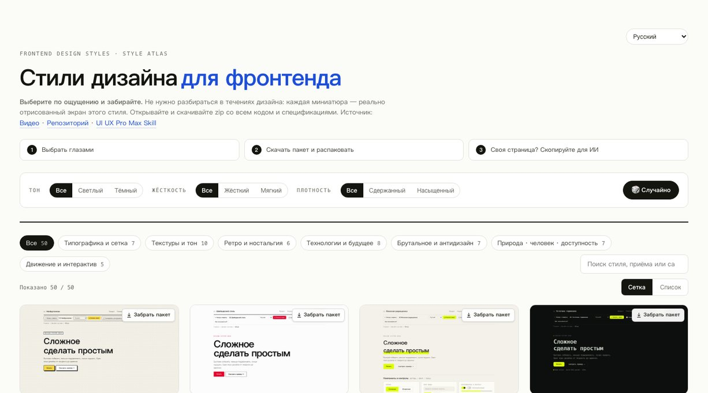
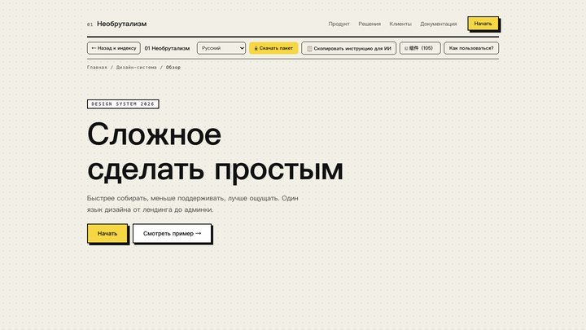
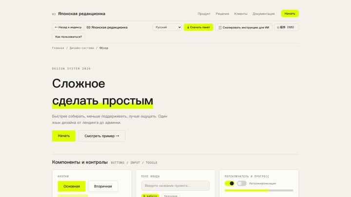
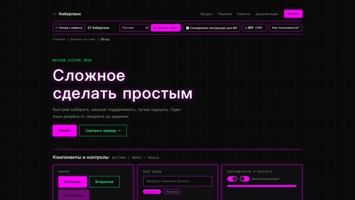
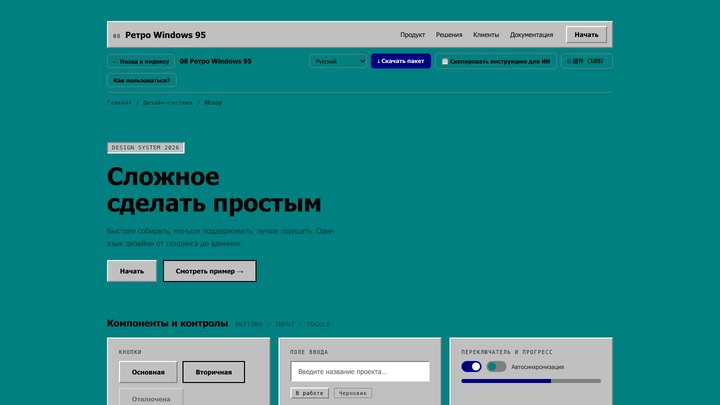
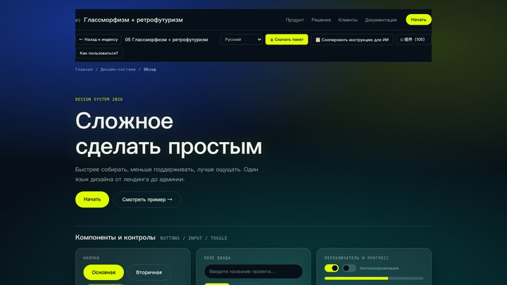
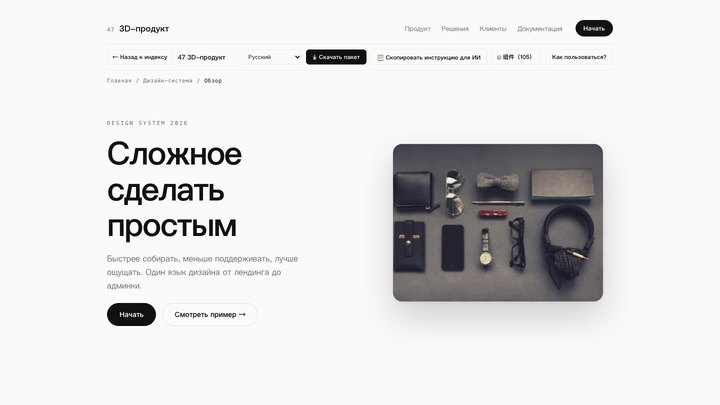

<p align="center">

**Язык**: [简体中文](https://github.com/1981yangcq/frontend-style-pack/blob/main/README.md) · [繁體中文](https://github.com/1981yangcq/frontend-style-pack/blob/main/docs/i18n/README.zh-TW.md) · [English](https://github.com/1981yangcq/frontend-style-pack/blob/main/docs/i18n/README.en.md) · [Español](https://github.com/1981yangcq/frontend-style-pack/blob/main/docs/i18n/README.es.md) · [Français](https://github.com/1981yangcq/frontend-style-pack/blob/main/docs/i18n/README.fr.md) · [Português (BR)](https://github.com/1981yangcq/frontend-style-pack/blob/main/docs/i18n/README.pt-BR.md) · **Русский** · [Deutsch](https://github.com/1981yangcq/frontend-style-pack/blob/main/docs/i18n/README.de.md) · [日本語](https://github.com/1981yangcq/frontend-style-pack/blob/main/docs/i18n/README.ja.md) · [한국어](https://github.com/1981yangcq/frontend-style-pack/blob/main/docs/i18n/README.ko.md)

</p>

<div align="center">

# Каталог стилей фронтенд-дизайна · Style Atlas

**Выберите по ощущению и забирайте.**

50 стилей фронтенд-дизайна: каждая миниатюра — настоящий рендер, а по клику открывается
полная страница (лендинг + 105 компонентов). Скачайте zip и забирайте весь код со спецификациями.



[**🌐 Онлайн-просмотр**](https://1981yangcq.github.io/frontend-style-pack/?lang=ru) · [**🇨🇳 Зеркало в Китае**](https://sunsong.surge.sh?lang=ru) · [**⬇ Скачать пакеты**](https://github.com/1981yangcq/frontend-style-pack/releases/) · [**📖 Как использовать с ИИ**](../../specs/README.md)

</div>

---

## Нажмите, чтобы открыть

> Все шесть — настоящие скриншоты. Нажмите на любой, чтобы открыть полную страницу этого стиля (лендинг + 105 компонентов).

| | | |
|---|---|---|
| <a href="https://1981yangcq.github.io/frontend-style-pack/demos/01-neo-brutalism.html?lang=ru"></a> | <a href="https://1981yangcq.github.io/frontend-style-pack/demos/03-japanese-editorial.html?lang=ru"></a> | <a href="https://1981yangcq.github.io/frontend-style-pack/demos/27-cyberpunk.html?lang=ru"></a> |
| <a href="https://1981yangcq.github.io/frontend-style-pack/demos/08-retro-win95.html?lang=ru"></a> | <a href="https://1981yangcq.github.io/frontend-style-pack/demos/05-glassmorphism-retro.html?lang=ru"></a> | <a href="https://1981yangcq.github.io/frontend-style-pack/demos/47-3d-product.html?lang=ru"></a> |

---

## Что это

Больше всего времени во фронтенде съедает не код, а **решение, как это должно выглядеть**: листать Dribbble, копаться в Awwwards, сшивать библиотеки компонентов, подбирать цвета.
Здесь стиль идёт целым пакетом: набор цветов, система радиусов и теней, набор компонентов. **Выбрали — используете.**

| Кто вы | Что делать |
|---|---|
| **Нужна страница, и быстро** | Выберите в просмотре → скачайте zip → распакуйте и откройте `demo.html` |
| **Хочу, чтобы сделал ИИ** | Нажмите «Скопировать инструкцию для ИИ», вставьте в любой ИИ и замените последнюю строку |
| **Буду править код сам** | В zip есть `spec.md` (карточка спецификации) и `theme.css` (готовые токены и компоненты) |

> Не нужно знать, что такое «необрутализм». Просто смотрите.

---

## Три шага

1. **Выберите глазами** — фильтр по тону / жёсткости / плотности или кнопка 🎲 Случайно
2. **Скачайте пакет** — придёт zip; распакуйте и откройте `怎么用.html` или `demo.html`
3. **Сделайте свою страницу** — скопируйте инструкцию для ИИ, вставьте и поменяйте последнюю строку

---

## 50 стилей

> «Просмотр» открывает целую страницу, «Скачать» отдаёт zip.

| # | Стиль | В одну строку | Ссылки |
|---|---|---|---|
| 01 | **Необрутализм**<br><sub>Neo-Brutalism</sub> | Относится к странице как к необработанному материалу: тяжёлые чёрные рамки и жёсткие тени говорят о честности и бунте. | [Просмотр](https://1981yangcq.github.io/frontend-style-pack/?lang=rudemos/01-neo-brutalism.html) · [Скачать](https://github.com/1981yangcq/frontend-style-pack/releases/latest/download/style-01-neo-brutalism.zip) |
| 02 | **Швейцарский стиль**<br><sub>Swiss Style</sub> | Родился в Цюрихе и Базеле в 1950-х: заменить любой орнамент сеткой и типографической иерархией. | [Просмотр](https://1981yangcq.github.io/frontend-style-pack/?lang=rudemos/02-swiss-style.html) · [Скачать](https://github.com/1981yangcq/frontend-style-pack/releases/latest/download/style-02-swiss-style.zip) |
| 03 | **Японская редакционка**<br><sub>Japanese Editorial</sub> | Переносит журнальную вёрстку в веб: тёплая бумага, тончайшие линии, один флуоресцентный акцент. | [Просмотр](https://1981yangcq.github.io/frontend-style-pack/?lang=rudemos/03-japanese-editorial.html) · [Скачать](https://github.com/1981yangcq/frontend-style-pack/releases/latest/download/style-03-japanese-editorial.zip) |
| 04 | **Эстетика терминала**<br><sub>Terminal CLI Aesthetic</sub> | Переносит командную строку в браузер: моноширинный шрифт и индикаторы состояния дают инженерное доверие. | [Просмотр](https://1981yangcq.github.io/frontend-style-pack/?lang=rudemos/04-terminal-cli.html) · [Скачать](https://github.com/1981yangcq/frontend-style-pack/releases/latest/download/style-04-terminal-cli.zip) |
| 05 | **Глассморфизм + ретрофутуризм**<br><sub>Glassmorphism + Retrofuturism</sub> | Матовые карточки на светящемся фоне, сверху строки развёртки CRT: половина премиума, половина ностальгии. | [Просмотр](https://1981yangcq.github.io/frontend-style-pack/?lang=rudemos/05-glassmorphism-retro.html) · [Скачать](https://github.com/1981yangcq/frontend-style-pack/releases/latest/download/style-05-glassmorphism-retro.zip) |
| 06 | **Воксель**<br><sub>Voxel Aesthetic</sub> | Мир блоков 16×16 стал интерфейсом, будто в браузере открыли песочницу. | [Просмотр](https://1981yangcq.github.io/frontend-style-pack/?lang=rudemos/06-voxel.html) · [Скачать](https://github.com/1981yangcq/frontend-style-pack/releases/latest/download/style-06-voxel.zip) |
| 07 | **Неоморфизм**<br><sub>Neumorphism</sub> | Элементы имеют цвет фона; два света, светлый и тёмный, выталкивают форму из поверхности. | [Просмотр](https://1981yangcq.github.io/frontend-style-pack/?lang=rudemos/07-neumorphism.html) · [Скачать](https://github.com/1981yangcq/frontend-style-pack/releases/latest/download/style-07-neumorphism.zip) |
| 08 | **Ретро Windows 95**<br><sub>Retro Win95</sub> | Точная копия рабочего стола 1995 года: окна, панель задач, кнопка пуск. | [Просмотр](https://1981yangcq.github.io/frontend-style-pack/?lang=rudemos/08-retro-win95.html) · [Скачать](https://github.com/1981yangcq/frontend-style-pack/releases/latest/download/style-08-retro-win95.zip) |
| 09 | **Биофилия**<br><sub>Biophilic Design</sub> | Приносит на экран солнечный свет, растения и бумагу ручной работы, чтобы интерфейс дышал. | [Просмотр](https://1981yangcq.github.io/frontend-style-pack/?lang=rudemos/09-biophilic.html) · [Скачать](https://github.com/1981yangcq/frontend-style-pack/releases/latest/download/style-09-biophilic.zip) |
| 10 | **3D-гиперреализм**<br><sub>3D & Hyperrealism</sub> | Имитирует настоящую глубину на плоскости: перспектива, слои теней и градиенты материалов. | [Просмотр](https://1981yangcq.github.io/frontend-style-pack/?lang=rudemos/10-3d-hyperrealism.html) · [Скачать](https://github.com/1981yangcq/frontend-style-pack/releases/latest/download/style-10-3d-hyperrealism.zip) |
| 11 | **Яркие блоки**<br><sub>Vibrant & Block-based</sub> | Крупные цветовые блоки, столкновение цветов и толстые рамки превращают страницу в кладку насыщенных кирпичей. | [Просмотр](https://1981yangcq.github.io/frontend-style-pack/?lang=rudemos/11-vibrant-block.html) · [Скачать](https://github.com/1981yangcq/frontend-style-pack/releases/latest/download/style-11-vibrant-block.zip) |
| 12 | **Тёмная тема OLED**<br><sub>Dark Mode OLED</sub> | Тёмная схема под панели с настоящим чёрным: чёрный по-настоящему, яркость сдержанная. | [Просмотр](https://1981yangcq.github.io/frontend-style-pack/?lang=rudemos/12-dark-oled.html) · [Скачать](https://github.com/1981yangcq/frontend-style-pack/releases/latest/download/style-12-dark-oled.zip) |
| 13 | **Доступность и этика**<br><sub>Accessible & Ethical</sub> | Читаемость и достижимость как первая эстетика: простое раньше красивого. | [Просмотр](https://1981yangcq.github.io/frontend-style-pack/?lang=rudemos/13-accessible-ethical.html) · [Скачать](https://github.com/1981yangcq/frontend-style-pack/releases/latest/download/style-13-accessible-ethical.zip) |
| 14 | **Глина**<br><sub>Claymorphism</sub> | Элементы будто слеплены пальцем из глины: мягкие, объёмные, без единой жёсткой грани. | [Просмотр](https://1981yangcq.github.io/frontend-style-pack/?lang=rudemos/14-claymorphism.html) · [Скачать](https://github.com/1981yangcq/frontend-style-pack/releases/latest/download/style-14-claymorphism.zip) |
| 15 | **Aurora UI**<br><sub>Aurora UI</sub> | Потоки северного сияния на тёмном фоне за матовым стеклом: недавняя формула премиума в SaaS. | [Просмотр](https://1981yangcq.github.io/frontend-style-pack/?lang=rudemos/15-aurora-ui.html) · [Скачать](https://github.com/1981yangcq/frontend-style-pack/releases/latest/download/style-15-aurora-ui.zip) |
| 16 | **Ретрофутуризм**<br><sub>Retro-Futurism</sub> | Будущее, каким его видели в 1980-х: космический фиолетовый, неоновый розовый, светящиеся кнопки. | [Просмотр](https://1981yangcq.github.io/frontend-style-pack/?lang=rudemos/16-retro-futurism.html) · [Скачать](https://github.com/1981yangcq/frontend-style-pack/releases/latest/download/style-16-retro-futurism.zip) |
| 17 | **Плоский дизайн**<br><sub>Flat Design</sub> | Ни теней, ни градиентов, ни текстур: только цвет, форма и шрифт. | [Просмотр](https://1981yangcq.github.io/frontend-style-pack/?lang=rudemos/17-flat-design.html) · [Скачать](https://github.com/1981yangcq/frontend-style-pack/releases/latest/download/style-17-flat-design.zip) |
| 18 | **Жидкое стекло**<br><sub>Liquid Glass</sub> | Язык Apple 2025: интерфейс ведёт себя как слой жидкого стекла, преломляющий фон. | [Просмотр](https://1981yangcq.github.io/frontend-style-pack/?lang=rudemos/18-liquid-glass.html) · [Скачать](https://github.com/1981yangcq/frontend-style-pack/releases/latest/download/style-18-liquid-glass.zip) |
| 19 | **Управление движением**<br><sub>Motion-Driven</sub> | Страница рассказывает почти всё движением: скролл, наведение и переход и есть контент. | [Просмотр](https://1981yangcq.github.io/frontend-style-pack/?lang=rudemos/19-motion-driven.html) · [Скачать](https://github.com/1981yangcq/frontend-style-pack/releases/latest/download/style-19-motion-driven.zip) |
| 20 | **Микроинтеракции**<br><sub>Micro-interactions</sub> | Без зрелища: ровно столько отклика, сколько нужно в каждой кнопке и состоянии. | [Просмотр](https://1981yangcq.github.io/frontend-style-pack/?lang=rudemos/20-micro-interactions.html) · [Скачать](https://github.com/1981yangcq/frontend-style-pack/releases/latest/download/style-20-micro-interactions.zip) |
| 21 | **Инклюзивный дизайн**<br><sub>Inclusive Design</sub> | Исходит из различий зрения, моторики и восприятия и делает интерфейс для всех. | [Просмотр](https://1981yangcq.github.io/frontend-style-pack/?lang=rudemos/21-inclusive-design.html) · [Скачать](https://github.com/1981yangcq/frontend-style-pack/releases/latest/download/style-21-inclusive-design.zip) |
| 22 | **Нулевой интерфейс**<br><sub>Zero Interface</sub> | Интерфейс почти исчезает, остаются текст и воздух. Взаимодействие — разговор, не клик. | [Просмотр](https://1981yangcq.github.io/frontend-style-pack/?lang=rudemos/22-zero-interface.html) · [Скачать](https://github.com/1981yangcq/frontend-style-pack/releases/latest/download/style-22-zero-interface.zip) |
| 23 | **Эволюция мягкого UI**<br><sub>Soft UI Evolution</sub> | Корпоративная середина между неоморфизмом и плоским: чуть мягче, но не в ущерб ясности. | [Просмотр](https://1981yangcq.github.io/frontend-style-pack/?lang=rudemos/23-soft-ui.html) · [Скачать](https://github.com/1981yangcq/frontend-style-pack/releases/latest/download/style-23-soft-ui.zip) |
| 24 | **Необрутализм 2.0**<br><sub>Neubrutalism</sub> | Оптимистичный брутализм: кремовый фон, столкновение красного и жёлтого, толстые чёрные рамки. | [Просмотр](https://1981yangcq.github.io/frontend-style-pack/?lang=rudemos/24-neubrutalism.html) · [Скачать](https://github.com/1981yangcq/frontend-style-pack/releases/latest/download/style-24-neubrutalism.zip) |
| 25 | **Бенто-сетка**<br><sub>Bento Box Grid</sub> | Разные по размеру скруглённые карточки собраны как японский бенто, всё объясняется на одном экране. | [Просмотр](https://1981yangcq.github.io/frontend-style-pack/?lang=rudemos/25-bento-grid.html) · [Скачать](https://github.com/1981yangcq/frontend-style-pack/releases/latest/download/style-25-bento-grid.zip) |
| 26 | **Эстетика Y2K**<br><sub>Y2K Aesthetic</sub> | Представление о будущем на рубеже тысячелетий: градиенты от ледяного синего к розовому, металлический блеск, очень круглые контролы. | [Просмотр](https://1981yangcq.github.io/frontend-style-pack/?lang=rudemos/26-y2k.html) · [Скачать](https://github.com/1981yangcq/frontend-style-pack/releases/latest/download/style-26-y2k.zip) |
| 27 | **Киберпанк**<br><sub>Cyberpunk UI</sub> | Высококонтрастный неон на чистом чёрном с глитчем: антиутопичная техника как визуальный язык. | [Просмотр](https://1981yangcq.github.io/frontend-style-pack/?lang=rudemos/27-cyberpunk.html) · [Скачать](https://github.com/1981yangcq/frontend-style-pack/releases/latest/download/style-27-cyberpunk.zip) |
| 28 | **Нативный UI для ИИ**<br><sub>AI-Native UI</sub> | Тот вид, который выработали продукты с ИИ: сине-фиолетовые градиенты, светящиеся кромки, разговор в первую очередь. | [Просмотр](https://1981yangcq.github.io/frontend-style-pack/?lang=rudemos/28-ai-native.html) · [Скачать](https://github.com/1981yangcq/frontend-style-pack/releases/latest/download/style-28-ai-native.zip) |
| 29 | **Мемфис**<br><sub>Memphis Design</sub> | Милан 1981 против модернизма: геометрия, сталкивающиеся цвета и точки, нарочито нестройно. | [Просмотр](https://1981yangcq.github.io/frontend-style-pack/?lang=rudemos/29-memphis.html) · [Скачать](https://github.com/1981yangcq/frontend-style-pack/releases/latest/download/style-29-memphis.zip) |
| 30 | **Vaporwave**<br><sub>Vaporwave</sub> | Синт-музыка 80-х и остатки консюмеризма: розовый неон с пустотой внутри. | [Просмотр](https://1981yangcq.github.io/frontend-style-pack/?lang=rudemos/30-vaporwave.html) · [Скачать](https://github.com/1981yangcq/frontend-style-pack/releases/latest/download/style-30-vaporwave.zip) |
| 31 | **Пространственные слои**<br><sub>Dimensional Layering</sub> | Ступенчатые тени строят ясную ось Z: у каждой информации есть расстояние. | [Просмотр](https://1981yangcq.github.io/frontend-style-pack/?lang=rudemos/31-dimensional-layering.html) · [Скачать](https://github.com/1981yangcq/frontend-style-pack/releases/latest/download/style-31-dimensional-layering.zip) |
| 32 | **Утрированный минимализм**<br><sub>Exaggerated Minimalism</sub> | Минимализм до предела: шрифт занимает экран, больше ничего не остаётся. | [Просмотр](https://1981yangcq.github.io/frontend-style-pack/?lang=rudemos/32-exaggerated-minimalism.html) · [Скачать](https://github.com/1981yangcq/frontend-style-pack/releases/latest/download/style-32-exaggerated-minimalism.zip) |
| 33 | **Кинетическая типографика**<br><sub>Kinetic Typography</sub> | Шрифт — главный герой: масштаб, ритм и анимация дают эффект плаката. | [Просмотр](https://1981yangcq.github.io/frontend-style-pack/?lang=rudemos/33-kinetic-typography.html) · [Скачать](https://github.com/1981yangcq/frontend-style-pack/releases/latest/download/style-33-kinetic-typography.zip) |
| 34 | **Параллакс-история**<br><sub>Parallax Storytelling</sub> | Рассказывает через разницу скорости скролла, как длинный свиток с глубиной. | [Просмотр](https://1981yangcq.github.io/frontend-style-pack/?lang=rudemos/34-parallax-storytelling.html) · [Скачать](https://github.com/1981yangcq/frontend-style-pack/releases/latest/download/style-34-parallax-storytelling.zip) |
| 35 | **Швейцарский модернизм 2.0**<br><sub>Swiss Modernism 2.0</sub> | Швейцарский стиль до предела: убрать всё, оставить вес, интерлиньяж и одну линию. | [Просмотр](https://1981yangcq.github.io/frontend-style-pack/?lang=rudemos/35-swiss-modernism-2.html) · [Скачать](https://github.com/1981yangcq/frontend-style-pack/releases/latest/download/style-35-swiss-modernism-2.zip) |
| 36 | **HUD / Sci-Fi FUI**<br><sub>HUD / Sci-Fi FUI</sub> | Язык консолей из фантастики: тонкие светящиеся линии, угловые скобки, бегущие данные. | [Просмотр](https://1981yangcq.github.io/frontend-style-pack/?lang=rudemos/36-hud-sci-fi.html) · [Скачать](https://github.com/1981yangcq/frontend-style-pack/releases/latest/download/style-36-hud-sci-fi.zip) |
| 37 | **Бенто-сетка 2.0**<br><sub>Bento Grids 2.0</sub> | Молодая версия бенто: тёплый серый, акценты iPhone-красного, более свободные радиусы. | [Просмотр](https://1981yangcq.github.io/frontend-style-pack/?lang=rudemos/37-bento-2.html) · [Скачать](https://github.com/1981yangcq/frontend-style-pack/releases/latest/download/style-37-bento-2.zip) |
| 38 | **Пространственный UI / visionOS**<br><sub>Spatial UI / VisionOS</sub> | Спроектирован для шлемов: стеклянные панели в воздухе, с толщиной и светом. | [Просмотр](https://1981yangcq.github.io/frontend-style-pack/?lang=rudemos/38-spatial-ui.html) · [Скачать](https://github.com/1981yangcq/frontend-style-pack/releases/latest/download/style-38-spatial-ui.zip) |
| 39 | **Электронные чернила**<br><sub>E-Ink & Paper</sub> | Превращает экран в бумагу: тёплый белый, шрифт с засечками, без теней, для долгого чтения. | [Просмотр](https://1981yangcq.github.io/frontend-style-pack/?lang=rudemos/39-e-ink-paper.html) · [Скачать](https://github.com/1981yangcq/frontend-style-pack/releases/latest/download/style-39-e-ink-paper.zip) |
| 40 | **Хаос поколения Z**<br><sub>Gen Z Chaos / Maximalism</sub> | Тщательно спроектированный беспорядок: насыщенность, смещение, стикеры против лоска. | [Просмотр](https://1981yangcq.github.io/frontend-style-pack/?lang=rudemos/40-genz-chaos.html) · [Скачать](https://github.com/1981yangcq/frontend-style-pack/releases/latest/download/style-40-genz-chaos.zip) |
| 41 | **Биомиметика 2.0**<br><sub>Biomimetic / Organic 2.0</sub> | Берёт не цвета природы, а её логику роста и структуру. | [Просмотр](https://1981yangcq.github.io/frontend-style-pack/?lang=rudemos/41-biomimetic.html) · [Скачать](https://github.com/1981yangcq/frontend-style-pack/releases/latest/download/style-41-biomimetic.zip) |
| 42 | **Антилоск**<br><sub>Anti-Polish / Raw Aesthetic</sub> | Нарочито без дизайна: пунктирные рамки, системный шрифт, радиус ноль, как опубликованный вайрфрейм. | [Просмотр](https://1981yangcq.github.io/frontend-style-pack/?lang=rudemos/42-anti-polish-raw.html) · [Скачать](https://github.com/1981yangcq/frontend-style-pack/releases/latest/download/style-42-anti-polish-raw.zip) |
| 43 | **Тактильный цифровой**<br><sub>Tactile Digital / Deformable UI</sub> | Заставляет вещи на экране ощущаться как бумага, ткань или дерево через толщину и деформацию. | [Просмотр](https://1981yangcq.github.io/frontend-style-pack/?lang=rudemos/43-tactile-digital.html) · [Скачать](https://github.com/1981yangcq/frontend-style-pack/releases/latest/download/style-43-tactile-digital.zip) |
| 44 | **Дистиллированная природа**<br><sub>Nature Distilled</sub> | Ни листьев, ни гор: природа, сведённая к пропорции, температуре цвета и сдержанному зелёному. | [Просмотр](https://1981yangcq.github.io/frontend-style-pack/?lang=rudemos/44-nature-distilled.html) · [Скачать](https://github.com/1981yangcq/frontend-style-pack/releases/latest/download/style-44-nature-distilled.zip) |
| 45 | **Взаимодействие курсором**<br><sub>Interactive Cursor Design</sub> | Указатель — главный герой: прицел, шлейф, магнетизм; курсор и есть навигация. | [Просмотр](https://1981yangcq.github.io/frontend-style-pack/?lang=rudemos/45-interactive-cursor.html) · [Скачать](https://github.com/1981yangcq/frontend-style-pack/releases/latest/download/style-45-interactive-cursor.zip) |
| 46 | **Голос в первую очередь**<br><sub>Voice-First Multimodal</sub> | Спроектирован для речи: один вход, кольцо звука, всё остальное отступает. | [Просмотр](https://1981yangcq.github.io/frontend-style-pack/?lang=rudemos/46-voice-first.html) · [Скачать](https://github.com/1981yangcq/frontend-style-pack/releases/latest/download/style-46-voice-first.zip) |
| 47 | **3D-продукт**<br><sub>3D Product Preview</sub> | Ставит продукт перед безтеневой стеной, как в студии, и 3D-модель становится единственным контентом. | [Просмотр](https://1981yangcq.github.io/frontend-style-pack/?lang=rudemos/47-3d-product.html) · [Скачать](https://github.com/1981yangcq/frontend-style-pack/releases/latest/download/style-47-3d-product.zip) |
| 48 | **Градиентная сетка**<br><sub>Gradient Mesh / Aurora Evolved</sub> | Аврора нового поколения: несколько цветовых полей сплетены в дышащую сетку. | [Просмотр](https://1981yangcq.github.io/frontend-style-pack/?lang=rudemos/48-gradient-mesh.html) · [Скачать](https://github.com/1981yangcq/frontend-style-pack/releases/latest/download/style-48-gradient-mesh.zip) |
| 49 | **Разделение RGB**<br><sub>Chromatic Aberration / RGB Split</sub> | Превращает хроматическую аберрацию, дефект, в язык: красный, зелёный и синий смещены. | [Просмотр](https://1981yangcq.github.io/frontend-style-pack/?lang=rudemos/49-chromatic-aberration.html) · [Скачать](https://github.com/1981yangcq/frontend-style-pack/releases/latest/download/style-49-chromatic-aberration.zip) |
| 50 | **Винтажная плёнка**<br><sub>Vintage Analog / Retro Film</sub> | Атмосфера старых фотографий и книг: окисленные тёплые жёлтые, зерно плёнки, коричневые тона. | [Просмотр](https://1981yangcq.github.io/frontend-style-pack/?lang=rudemos/50-vintage-film.html) · [Скачать](https://github.com/1981yangcq/frontend-style-pack/releases/latest/download/style-50-vintage-film.zip) |

---

## Что внутри пакета

| Файл | Что это |
|---|---|
| `怎么用.html` | **Сначала это** — три шага, открывается в браузере |
| `demo.html` | Полная примерная страница: лендинг + 105 компонентов, один файл |
| `给AI的话.txt` | Инструкция для ИИ с уже вписанными цветами и запретами |
| `spec.md` | Карточка спецификации: tokens, обязательные приёмы, список запретов, порог доступности |
| `spec.json` | То же, машиночитаемо |
| `theme.css` | Таблица стилей из tokens, готова к `@import` |
| `preview.jpg` | Скриншот первого экрана |
| `assets/` | Фотографии из демо (в комплекте, работают офлайн) |

---

## Использовать с ИИ (без скачивания)

Без zip можно взять общий пакет:

- [`styles-bundle.md`](styles-bundle.md) — спецификации всех стилей, одним вставлением
- [`styles-bundle.json`](styles-bundle.json) — машиночитаемая версия
- [`specs/README.md`](specs/README.md) — как подавать, три уровня, чек-лист приёмки

```
Ниже библиотека спецификаций «Каталог стилей фронтенд-дизайна». Используй только тот, что я назову.
[Стиль] 27 / Киберпанк
[Что нужно] Лендинг кофейни: первый экран, три преимущества и таблица тарифов
```

---

## Запустить локально

Чистая статика без зависимостей: откройте `index.html`. Пересобрать после изменения стиля:

```bash
pip install pillow
python build_demos.py      # 50 页
python build_thumbs.py
python build_zips.py
python build.py            # 首页
```

---

## Добавить стиль

Смотрите [CONTRIBUTING.md](CONTRIBUTING.md). Три шага:

1. Добавить строку в `styles.json` (название / одна строка / группа / референсы)
2. Добавить набор tokens в `themes.py` (цвет / радиус / тень / шрифт)
3. Запустить `build_demos.py` — если страница собралась, всё в порядке

После мержа он сам появится на сайте и в пакете для ИИ.

---

## Лицензия и благодарности

- **Код** (генераторы, CSS, HTML): [MIT](LICENSE)
- **Тексты / карточки спецификаций / матрица компонентов**: CC BY 4.0
- **Список стилей** по видео на Bilibili и его репозиторию (MIT), [UI UX Pro Max Skill](https://github.com/nextlevelbuilder/ui-ux-pro-max-skill) (MIT)
- **Реализация демо / карточки / обзор компонентов / пакеты**: оригинальные для этого репозитория
- **Фотографии** с [picsum.photos](https://picsum.photos) (Unsplash), только как заглушки — замените для коммерческого использования
