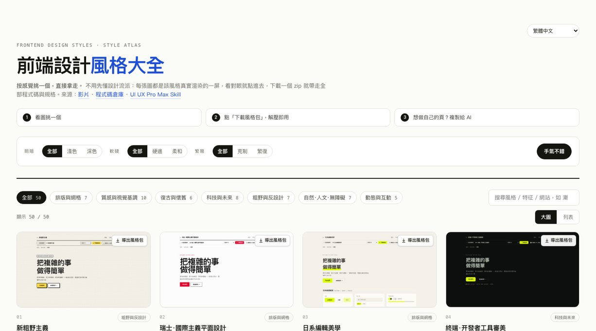
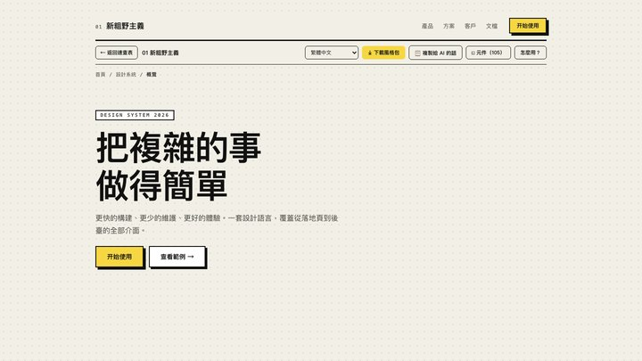
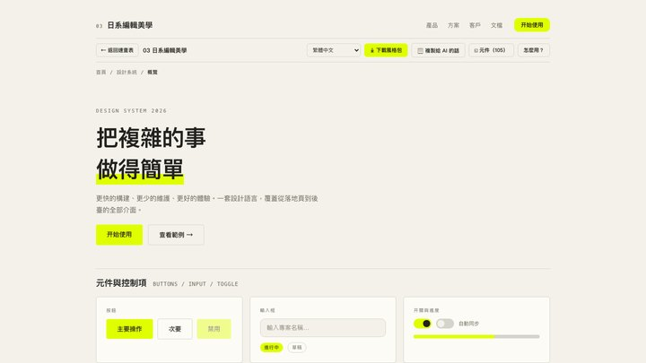
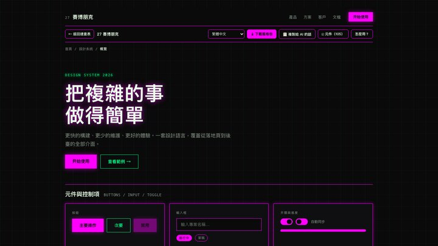
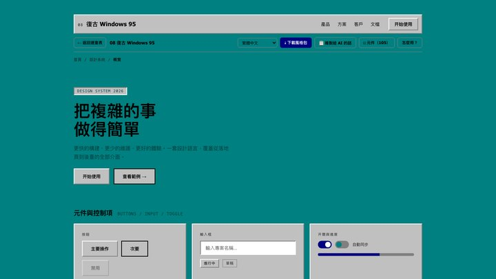
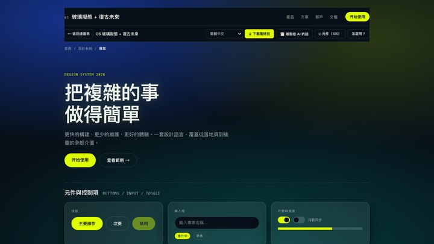
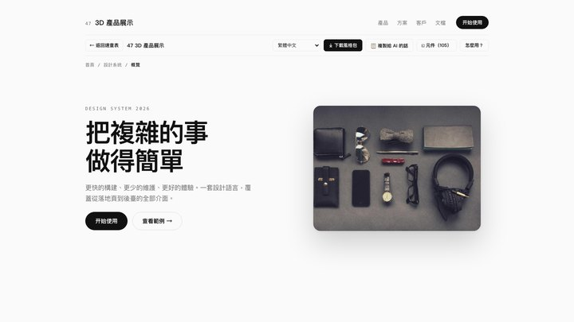

<p align="center">

**語言**：[简体中文](https://github.com/1981yangcq/frontend-style-pack/blob/main/README.md) · **繁體中文** · [English](https://github.com/1981yangcq/frontend-style-pack/blob/main/docs/i18n/README.en.md) · [Español](https://github.com/1981yangcq/frontend-style-pack/blob/main/docs/i18n/README.es.md) · [Français](https://github.com/1981yangcq/frontend-style-pack/blob/main/docs/i18n/README.fr.md) · [Português (BR)](https://github.com/1981yangcq/frontend-style-pack/blob/main/docs/i18n/README.pt-BR.md) · [Русский](https://github.com/1981yangcq/frontend-style-pack/blob/main/docs/i18n/README.ru.md) · [Deutsch](https://github.com/1981yangcq/frontend-style-pack/blob/main/docs/i18n/README.de.md) · [日本語](https://github.com/1981yangcq/frontend-style-pack/blob/main/docs/i18n/README.ja.md) · [한국어](https://github.com/1981yangcq/frontend-style-pack/blob/main/docs/i18n/README.ko.md)

</p>

<div align="center">

# 前端設計風格大全 · Style Atlas

**按感覺挑一個，直接拿走。**

50 種前端設計風格：每張縮圖都是真實呈現的一屏，點進去就是完整頁面（著陸頁 + 105 個元件），
下載一個 zip 就帶走全部程式碼與規格。



[**🌐 線上預覽**](https://1981yangcq.github.io/frontend-style-pack/?lang=zh-TW) · [**🇨🇳 中國鏡像**](https://sunsong.surge.sh?lang=zh-TW) · [**⬇ 下載風格包**](https://github.com/1981yangcq/frontend-style-pack/releases/) · [**📖 怎麼給 AI 用**](../../specs/README.md)

</div>

---

## 點圖直達

> 六張都是真實截圖。點任意一張，直接進入該風格的完整頁面（著陸頁 + 105 個元件）。

| | | |
|---|---|---|
| <a href="https://1981yangcq.github.io/frontend-style-pack/demos/01-neo-brutalism.html?lang=zh-TW"></a> | <a href="https://1981yangcq.github.io/frontend-style-pack/demos/03-japanese-editorial.html?lang=zh-TW"></a> | <a href="https://1981yangcq.github.io/frontend-style-pack/demos/27-cyberpunk.html?lang=zh-TW"></a> |
| <a href="https://1981yangcq.github.io/frontend-style-pack/demos/08-retro-win95.html?lang=zh-TW"></a> | <a href="https://1981yangcq.github.io/frontend-style-pack/demos/05-glassmorphism-retro.html?lang=zh-TW"></a> | <a href="https://1981yangcq.github.io/frontend-style-pack/demos/47-3d-product.html?lang=zh-TW"></a> |

---

## 這是什麼

做前端最常浪費的時間，不是寫程式，是**決定長什麼樣子**：翻 Dribbble、扒 Awwwards、拼元件庫、對齊顏色……
這裡把「風格」整包做好：一套配色、一套圓角陰影、一套元件，**挑中就能用**。

| 你是誰 | 怎麼用 |
|---|---|
| **只想快速要一個頁面** | 線上預覽挑一個 → 下載 zip → 解壓縮點兩下 `demo.html` 看效果 |
| **想讓 AI 幫你做** | 點「複製給 AI 的話」，貼給任意 AI，最後一行換成你的需求 |
| **要自己改程式碼** | zip 裡有 `spec.md`（規格卡）+ `theme.css`（現成變數與元件） |

> 不用先懂「新粗野主義」是什麼。看圖就行。

---

## 三步拿走

1. **看圖挑一個** —— 首頁支援按「明暗 / 軟硬 / 繁簡」篩選，或點 🎲 手氣不錯
2. **點「下載風格包」** —— 得到一個 zip，解壓縮後點兩下 `怎么用.html` 或 `demo.html`
3. **想做自己的頁面** —— 複製「給 AI 的話」，貼給 AI，改最後一行

---

## 50 種風格

> 點「預覽」看完整頁面，點「下載」直接拿 zip。

| # | 風格 | 一句話 | 連結 |
|---|---|---|---|
| 01 | **新粗野主義**<br><sub>Neo-Brutalism</sub> | 把網頁當作未經打磨的原件，用粗黑邊框和生硬投影表達誠實與反叛。 | [預覽](https://1981yangcq.github.io/frontend-style-pack/?lang=zh-TWdemos/01-neo-brutalism.html) · [下載](https://github.com/1981yangcq/frontend-style-pack/releases/latest/download/style-01-neo-brutalism.zip) |
| 02 | **瑞士·國際主義平面設計**<br><sub>Swiss Style</sub> | 源自 1950s 蘇黎世與巴塞爾，用網格和字級層級取代一切裝飾。 | [預覽](https://1981yangcq.github.io/frontend-style-pack/?lang=zh-TWdemos/02-swiss-style.html) · [下載](https://github.com/1981yangcq/frontend-style-pack/releases/latest/download/style-02-swiss-style.zip) |
| 03 | **日系編輯美學**<br><sub>Japanese Editorial</sub> | 把雜誌版式搬上網頁：暖紙底、極細分割線、一處螢光色點睛。 | [預覽](https://1981yangcq.github.io/frontend-style-pack/?lang=zh-TWdemos/03-japanese-editorial.html) · [下載](https://github.com/1981yangcq/frontend-style-pack/releases/latest/download/style-03-japanese-editorial.zip) |
| 04 | **終端·开發者工具審美**<br><sub>Terminal CLI Aesthetic</sub> | 把命令行搬進瀏覽器，用等寬字型和狀態燈建立工程可信感。 | [預覽](https://1981yangcq.github.io/frontend-style-pack/?lang=zh-TWdemos/04-terminal-cli.html) · [下載](https://github.com/1981yangcq/frontend-style-pack/releases/latest/download/style-04-terminal-cli.zip) |
| 05 | **玻璃擬態 + 復古未來**<br><sub>Glassmorphism + Retrofuturism</sub> | 毛玻璃卡片浮在發光背景上，再疊一層 CRT 掃描線，介於高級與懷舊之間。 | [預覽](https://1981yangcq.github.io/frontend-style-pack/?lang=zh-TWdemos/05-glassmorphism-retro.html) · [下載](https://github.com/1981yangcq/frontend-style-pack/releases/latest/download/style-05-glassmorphism-retro.zip) |
| 06 | **體素美學**<br><sub>Voxel Aesthetic</sub> | 用 16×16 的方塊世界語言做介面，像在網頁裡开了一局沙盒遊戲。 | [預覽](https://1981yangcq.github.io/frontend-style-pack/?lang=zh-TWdemos/06-voxel.html) · [下載](https://github.com/1981yangcq/frontend-style-pack/releases/latest/download/style-06-voxel.zip) |
| 07 | **新擬物化**<br><sub>Neumorphism</sub> | 元素與背景同色，只靠一明一暗兩道光「擠」出立體感。 | [預覽](https://1981yangcq.github.io/frontend-style-pack/?lang=zh-TWdemos/07-neumorphism.html) · [下載](https://github.com/1981yangcq/frontend-style-pack/releases/latest/download/style-07-neumorphism.zip) |
| 08 | **復古 Windows 95**<br><sub>Retro Win95</sub> | 完整復刻 1995 年的桌面系統：窗口、任務欄、开始按鈕一個不少。 | [預覽](https://1981yangcq.github.io/frontend-style-pack/?lang=zh-TWdemos/08-retro-win95.html) · [下載](https://github.com/1981yangcq/frontend-style-pack/releases/latest/download/style-08-retro-win95.zip) |
| 09 | **有機自然**<br><sub>Biophilic Design</sub> | 把陽光、植物和手工紙的質感搬進螢幕，讓介面會呼吸。 | [預覽](https://1981yangcq.github.io/frontend-style-pack/?lang=zh-TWdemos/09-biophilic.html) · [下載](https://github.com/1981yangcq/frontend-style-pack/releases/latest/download/style-09-biophilic.zip) |
| 10 | **3D 超寫實**<br><sub>3D & Hyperrealism</sub> | 用透視、多層陰影和材質漸層，在平面上偽造真實的三維空間。 | [預覽](https://1981yangcq.github.io/frontend-style-pack/?lang=zh-TWdemos/10-3d-hyperrealism.html) · [下載](https://github.com/1981yangcq/frontend-style-pack/releases/latest/download/style-10-3d-hyperrealism.zip) |
| 11 | **鮮豔塊狀**<br><sub>Vibrant & Block-based</sub> | 大色塊 + 撞色 + 粗邊框，把頁面做成一塊塊高飽和積木。 | [預覽](https://1981yangcq.github.io/frontend-style-pack/?lang=zh-TWdemos/11-vibrant-block.html) · [下載](https://github.com/1981yangcq/frontend-style-pack/releases/latest/download/style-11-vibrant-block.zip) |
| 12 | **OLED 暗黑**<br><sub>Dark Mode OLED</sub> | 為純黑螢幕最佳化的暗色方案：黑得徹底、亮得克制。 | [預覽](https://1981yangcq.github.io/frontend-style-pack/?lang=zh-TWdemos/12-dark-oled.html) · [下載](https://github.com/1981yangcq/frontend-style-pack/releases/latest/download/style-12-dark-oled.zip) |
| 13 | **無障礙倫理**<br><sub>Accessible & Ethical</sub> | 把可讀性和可達性當第一美學，寧可樸素也不犧牲可用。 | [預覽](https://1981yangcq.github.io/frontend-style-pack/?lang=zh-TWdemos/13-accessible-ethical.html) · [下載](https://github.com/1981yangcq/frontend-style-pack/releases/latest/download/style-13-accessible-ethical.zip) |
| 14 | **粘土風**<br><sub>Claymorphism</sub> | 元素像被手指揉圓的粘土，柔軟、有體積、沒有一條硬邊。 | [預覽](https://1981yangcq.github.io/frontend-style-pack/?lang=zh-TWdemos/14-claymorphism.html) · [下載](https://github.com/1981yangcq/frontend-style-pack/releases/latest/download/style-14-claymorphism.zip) |
| 15 | **極光介面**<br><sub>Aurora UI</sub> | 深色底上流動的極光色斑配毛玻璃，近年 SaaS 的「高級感範本」。 | [預覽](https://1981yangcq.github.io/frontend-style-pack/?lang=zh-TWdemos/15-aurora-ui.html) · [下載](https://github.com/1981yangcq/frontend-style-pack/releases/latest/download/style-15-aurora-ui.zip) |
| 16 | **復古未來**<br><sub>Retro-Futurism</sub> | 80 年代人們想象的未來：太空紫、霓虹粉、會發光的按鈕。 | [預覽](https://1981yangcq.github.io/frontend-style-pack/?lang=zh-TWdemos/16-retro-futurism.html) · [下載](https://github.com/1981yangcq/frontend-style-pack/releases/latest/download/style-16-retro-futurism.zip) |
| 17 | **扁平設計**<br><sub>Flat Design</sub> | 去掉一切陰影、漸層和紋理，只留顏色、形狀和字。 | [預覽](https://1981yangcq.github.io/frontend-style-pack/?lang=zh-TWdemos/17-flat-design.html) · [下載](https://github.com/1981yangcq/frontend-style-pack/releases/latest/download/style-17-flat-design.zip) |
| 18 | **液態玻璃**<br><sub>Liquid Glass</sub> | Apple 2025 年的設計語言：介面像一層會折射背景的液態玻璃。 | [預覽](https://1981yangcq.github.io/frontend-style-pack/?lang=zh-TWdemos/18-liquid-glass.html) · [下載](https://github.com/1981yangcq/frontend-style-pack/releases/latest/download/style-18-liquid-glass.zip) |
| 19 | **動效驅動**<br><sub>Motion-Driven</sub> | 頁面幾乎靠動效講故事，捲動、懸停、轉場本身就是內容。 | [預覽](https://1981yangcq.github.io/frontend-style-pack/?lang=zh-TWdemos/19-motion-driven.html) · [下載](https://github.com/1981yangcq/frontend-style-pack/releases/latest/download/style-19-motion-driven.zip) |
| 20 | **微互動**<br><sub>Micro-interactions</sub> | 不追求視覺衝擊，而是在每個按鈕、每個狀態裡塞進恰到好處的回饋。 | [預覽](https://1981yangcq.github.io/frontend-style-pack/?lang=zh-TWdemos/20-micro-interactions.html) · [下載](https://github.com/1981yangcq/frontend-style-pack/releases/latest/download/style-20-micro-interactions.zip) |
| 21 | **包容性設計**<br><sub>Inclusive Design</sub> | 假設使用者有視力、運動、認知等各種差異，讓所有人用同一個介面。 | [預覽](https://1981yangcq.github.io/frontend-style-pack/?lang=zh-TWdemos/21-inclusive-design.html) · [下載](https://github.com/1981yangcq/frontend-style-pack/releases/latest/download/style-21-inclusive-design.zip) |
| 22 | **零介面**<br><sub>Zero Interface</sub> | 介面退到近乎不存在，只留文字和留白，互動靠對話而非點按。 | [預覽](https://1981yangcq.github.io/frontend-style-pack/?lang=zh-TWdemos/22-zero-interface.html) · [下載](https://github.com/1981yangcq/frontend-style-pack/releases/latest/download/style-22-zero-interface.zip) |
| 23 | **柔和 UI 進化**<br><sub>Soft UI Evolution</sub> | 新擬物與扁平之間的企業級折中：有一點軟，但絕不犧牲清晰。 | [預覽](https://1981yangcq.github.io/frontend-style-pack/?lang=zh-TWdemos/23-soft-ui.html) · [下載](https://github.com/1981yangcq/frontend-style-pack/releases/latest/download/style-23-soft-ui.zip) |
| 24 | **新粗野 2.0**<br><sub>Neubrutalism</sub> | 粗野主義的樂觀版：奶油底、紅黃撞色、粗黑邊，年輕品牌的標準動作。 | [預覽](https://1981yangcq.github.io/frontend-style-pack/?lang=zh-TWdemos/24-neubrutalism.html) · [下載](https://github.com/1981yangcq/frontend-style-pack/releases/latest/download/style-24-neubrutalism.zip) |
| 25 | **便當盒網格**<br><sub>Bento Box Grid</sub> | 像日式便當一樣把不等大的圓角卡片拼在一起，一屏講清所有賣點。 | [預覽](https://1981yangcq.github.io/frontend-style-pack/?lang=zh-TWdemos/25-bento-grid.html) · [下載](https://github.com/1981yangcq/frontend-style-pack/releases/latest/download/style-25-bento-grid.zip) |
| 26 | **Y2K 美學**<br><sub>Y2K Aesthetic</sub> | 千禧年對未來的想象：冰藍粉漸層、金屬高光、圓潤到發亮的控制項。 | [預覽](https://1981yangcq.github.io/frontend-style-pack/?lang=zh-TWdemos/26-y2k.html) · [下載](https://github.com/1981yangcq/frontend-style-pack/releases/latest/download/style-26-y2k.zip) |
| 27 | **賽博朋克**<br><sub>Cyberpunk UI</sub> | 高對比霓虹 + 純黑 + 故障感，把反烏托邦科技做成視覺語言。 | [預覽](https://1981yangcq.github.io/frontend-style-pack/?lang=zh-TWdemos/27-cyberpunk.html) · [下載](https://github.com/1981yangcq/frontend-style-pack/releases/latest/download/style-27-cyberpunk.zip) |
| 28 | **AI 原生介面**<br><sub>AI-Native UI</sub> | 為 AI 產品長出來的視覺：藍紫漸層、微光邊框、對話優先的版面。 | [預覽](https://1981yangcq.github.io/frontend-style-pack/?lang=zh-TWdemos/28-ai-native.html) · [下載](https://github.com/1981yangcq/frontend-style-pack/releases/latest/download/style-28-ai-native.zip) |
| 29 | **孟菲斯設計**<br><sub>Memphis Design</sub> | 1981 年米蘭的反現代主義：幾何、撞色、波點，故意「不協調」。 | [預覽](https://1981yangcq.github.io/frontend-style-pack/?lang=zh-TWdemos/29-memphis.html) · [下載](https://github.com/1981yangcq/frontend-style-pack/releases/latest/download/style-29-memphis.zip) |
| 30 | **蒸汽波**<br><sub>Vaporwave</sub> | 80 年代合成器音樂 + 消費主義殘影，粉紫霓虹裡帶一點虛無。 | [預覽](https://1981yangcq.github.io/frontend-style-pack/?lang=zh-TWdemos/30-vaporwave.html) · [下載](https://github.com/1981yangcq/frontend-style-pack/releases/latest/download/style-30-vaporwave.zip) |
| 31 | **維度層疊**<br><sub>Dimensional Layering</sub> | 用遞進陰影搭出清晰的 Z 軸，讓資訊有「離你多遠」的層次。 | [預覽](https://1981yangcq.github.io/frontend-style-pack/?lang=zh-TWdemos/31-dimensional-layering.html) · [下載](https://github.com/1981yangcq/frontend-style-pack/releases/latest/download/style-31-dimensional-layering.zip) |
| 32 | **極度極簡**<br><sub>Exaggerated Minimalism</sub> | 把極簡推到極端：字大到占滿屏，其餘什麼都沒有。 | [預覽](https://1981yangcq.github.io/frontend-style-pack/?lang=zh-TWdemos/32-exaggerated-minimalism.html) · [下載](https://github.com/1981yangcq/frontend-style-pack/releases/latest/download/style-32-exaggerated-minimalism.zip) |
| 33 | **動態排版**<br><sub>Kinetic Typography</sub> | 讓文字本身成為主角，靠大小、節奏和動畫制造海報級衝擊。 | [預覽](https://1981yangcq.github.io/frontend-style-pack/?lang=zh-TWdemos/33-kinetic-typography.html) · [下載](https://github.com/1981yangcq/frontend-style-pack/releases/latest/download/style-33-kinetic-typography.zip) |
| 34 | **視差敘事**<br><sub>Parallax Storytelling</sub> | 用捲動速度差講故事，像翻一本有縱深的長卷。 | [預覽](https://1981yangcq.github.io/frontend-style-pack/?lang=zh-TWdemos/34-parallax-storytelling.html) · [下載](https://github.com/1981yangcq/frontend-style-pack/releases/latest/download/style-34-parallax-storytelling.zip) |
| 35 | **瑞士現代 2.0**<br><sub>Swiss Modernism 2.0</sub> | 瑞士風格的極端化版本：去掉一切，只剩字重、行高和一條細線。 | [預覽](https://1981yangcq.github.io/frontend-style-pack/?lang=zh-TWdemos/35-swiss-modernism-2.html) · [下載](https://github.com/1981yangcq/frontend-style-pack/releases/latest/download/style-35-swiss-modernism-2.zip) |
| 36 | **科幻 HUD**<br><sub>HUD / Sci-Fi FUI</sub> | 電影裡飛船控制臺的介面語言：發光細線、角標框、捲動資料。 | [預覽](https://1981yangcq.github.io/frontend-style-pack/?lang=zh-TWdemos/36-hud-sci-fi.html) · [下載](https://github.com/1981yangcq/frontend-style-pack/releases/latest/download/style-36-hud-sci-fi.zip) |
| 37 | **便當網格 2.0**<br><sub>Bento Grids 2.0</sub> | 便當網格的年輕化版本：暖灰底、iPhone 紅點綴、更鬆快的圓角。 | [預覽](https://1981yangcq.github.io/frontend-style-pack/?lang=zh-TWdemos/37-bento-2.html) · [下載](https://github.com/1981yangcq/frontend-style-pack/releases/latest/download/style-37-bento-2.zip) |
| 38 | **空間計算**<br><sub>Spatial UI / VisionOS</sub> | 為頭顯和空間屏設計：介面像懸在空氣裡的玻璃板，有厚度、有光照。 | [預覽](https://1981yangcq.github.io/frontend-style-pack/?lang=zh-TWdemos/38-spatial-ui.html) · [下載](https://github.com/1981yangcq/frontend-style-pack/releases/latest/download/style-38-spatial-ui.zip) |
| 39 | **電子墨水**<br><sub>E-Ink & Paper</sub> | 把螢幕做成紙：暖白底、襯線字、零陰影，為長時間閱讀而生。 | [預覽](https://1981yangcq.github.io/frontend-style-pack/?lang=zh-TWdemos/39-e-ink-paper.html) · [下載](https://github.com/1981yangcq/frontend-style-pack/releases/latest/download/style-39-e-ink-paper.zip) |
| 40 | **Z 世代混沌**<br><sub>Gen Z Chaos / Maximalism</sub> | 精心設計的「亂七八糟」：高飽和、錯位、貼紙感，反叛一切高級感。 | [預覽](https://1981yangcq.github.io/frontend-style-pack/?lang=zh-TWdemos/40-genz-chaos.html) · [下載](https://github.com/1981yangcq/frontend-style-pack/releases/latest/download/style-40-genz-chaos.zip) |
| 41 | **仿生有機 2.0**<br><sub>Biomimetic / Organic 2.0</sub> | 不只借用自然的顏色，而是借用自然的生長邏輯與結構。 | [預覽](https://1981yangcq.github.io/frontend-style-pack/?lang=zh-TWdemos/41-biomimetic.html) · [下載](https://github.com/1981yangcq/frontend-style-pack/releases/latest/download/style-41-biomimetic.zip) |
| 42 | **反精致粗糙**<br><sub>Anti-Polish / Raw Aesthetic</sub> | 刻意不做設計：虛線框、系統字型、零圓角，像線框圖直接上線。 | [預覽](https://1981yangcq.github.io/frontend-style-pack/?lang=zh-TWdemos/42-anti-polish-raw.html) · [下載](https://github.com/1981yangcq/frontend-style-pack/releases/latest/download/style-42-anti-polish-raw.zip) |
| 43 | **觸覺數字**<br><sub>Tactile Digital / Deformable UI</sub> | 讓螢幕上的東西摸起來像紙、像布、像木頭，靠厚度和形變傳遞温度。 | [預覽](https://1981yangcq.github.io/frontend-style-pack/?lang=zh-TWdemos/43-tactile-digital.html) · [下載](https://github.com/1981yangcq/frontend-style-pack/releases/latest/download/style-43-tactile-digital.zip) |
| 44 | **自然精粹**<br><sub>Nature Distilled</sub> | 不畫葉子不畫山，只把自然提煉成比例、色温和克制的綠。 | [預覽](https://1981yangcq.github.io/frontend-style-pack/?lang=zh-TWdemos/44-nature-distilled.html) · [下載](https://github.com/1981yangcq/frontend-style-pack/releases/latest/download/style-44-nature-distilled.zip) |
| 45 | **光標互動**<br><sub>Interactive Cursor Design</sub> | 把鼠標指針變成主角：準星、拖尾、磁吸，光標本身就是導覽。 | [預覽](https://1981yangcq.github.io/frontend-style-pack/?lang=zh-TWdemos/45-interactive-cursor.html) · [下載](https://github.com/1981yangcq/frontend-style-pack/releases/latest/download/style-45-interactive-cursor.zip) |
| 46 | **語音優先**<br><sub>Voice-First Multimodal</sub> | 為「說話」而設計的介面：一個入口、一圈聲波，其餘全部退場。 | [預覽](https://1981yangcq.github.io/frontend-style-pack/?lang=zh-TWdemos/46-voice-first.html) · [下載](https://github.com/1981yangcq/frontend-style-pack/releases/latest/download/style-46-voice-first.zip) |
| 47 | **3D 產品展示**<br><sub>3D Product Preview</sub> | 像攝影棚一樣把產品放在無影牆前，讓 3D 模型成為唯一內容。 | [預覽](https://1981yangcq.github.io/frontend-style-pack/?lang=zh-TWdemos/47-3d-product.html) · [下載](https://github.com/1981yangcq/frontend-style-pack/releases/latest/download/style-47-3d-product.zip) |
| 48 | **漸層網格**<br><sub>Gradient Mesh / Aurora Evolved</sub> | 極光 UI 的進化版：多層多色光斑交織，像一張會呼吸的漸層網格。 | [預覽](https://1981yangcq.github.io/frontend-style-pack/?lang=zh-TWdemos/48-gradient-mesh.html) · [下載](https://github.com/1981yangcq/frontend-style-pack/releases/latest/download/style-48-gradient-mesh.zip) |
| 49 | **色差 RGB 分裂**<br><sub>Chromatic Aberration / RGB Split</sub> | 把鏡頭色差這個「缺陷」變成設計語言，紅綠藍錯位制造數字故障感。 | [預覽](https://1981yangcq.github.io/frontend-style-pack/?lang=zh-TWdemos/49-chromatic-aberration.html) · [下載](https://github.com/1981yangcq/frontend-style-pack/releases/latest/download/style-49-chromatic-aberration.zip) |
| 50 | **復古膠片**<br><sub>Vintage Analog / Retro Film</sub> | 舊照片和舊書的氣質：暖黃氧化色、膠片顆粒、棕色調。 | [預覽](https://1981yangcq.github.io/frontend-style-pack/?lang=zh-TWdemos/50-vintage-film.html) · [下載](https://github.com/1981yangcq/frontend-style-pack/releases/latest/download/style-50-vintage-film.zip) |

---

## 一個風格包裡有什麼

| 檔案 | 說明 |
|---|---|
| `怎么用.html` | **先看這個**，三步說明（瀏覽器直接打開） |
| `demo.html` | 完整範例頁：著陸頁 + 105 個元件，單一檔案自帶全部資源 |
| `给AI的话.txt` | 複製給 AI 的提示詞，已填好該風格的配色與禁忌 |
| `spec.md` | 規格卡：tokens、必用手法、禁止清單、無障礙下限 |
| `spec.json` | 同上的機器讀版本 |
| `theme.css` | 由 tokens 產生的現成樣式表，可直接 `@import` |
| `preview.jpg` | 首屏截圖 |
| `assets/` | demo 用到的照片（已本地化，離線可看） |

---

## 給 AI 用（免下載）

不想下載 zip，也可以直接用全量包：

- [`styles-bundle.md`](styles-bundle.md) —— 全部風格的規格，一次貼給 AI
- [`styles-bundle.json`](styles-bundle.json) —— 機器讀版本
- [`specs/README.md`](specs/README.md) —— 怎麼餵、三種檔位、驗收清單

```
下面是前端設計風格大全的規格庫，請只使用我指定的那一種。
【指定風格】27 / 賽博龐克
【我的需求】做一個賣咖啡的著陸頁，要有首屏、三個賣點、價目表
```

---

## 本機跑起來

純靜態，無相依套件，直接點兩下 `index.html` 就能看。改了風格之後重新產生：

```bash
pip install pillow
python build_demos.py      # 50 页
python build_thumbs.py
python build_zips.py
python build.py            # 首页
```

---

## 貢獻一個新風格

見 [CONTRIBUTING.md](CONTRIBUTING.md)。核心是 3 步：

1. 在 `styles.json` 加一行（名稱 / 一句話 / 分組 / 參考網站）
2. 在 `themes.py` 加一套 tokens（顏色 / 圓角 / 陰影 / 字體）
3. 跑 `build_demos.py`，能產生頁面就代表合格

提交後會自動出現在網站和 AI 投餵包裡。

---

## 授權與致謝

- **程式碼**（產生器、CSS、HTML）：[MIT](LICENSE)
- **文案 / 規格卡 / 元件矩陣**：CC BY 4.0
- **風格清單**參考 B 站影片及其配套倉庫（MIT）、[UI UX Pro Max Skill](https://github.com/nextlevelbuilder/ui-ux-pro-max-skill)（MIT）
- **demo 實作 / 規格卡 / 元件總覽 / 匯出包**：本倉庫原創
- **示範照片**來自 [picsum.photos](https://picsum.photos)（Unsplash），僅作佔位，商用請自行替換
